# 🛡️ Plano Maestro de Arquitectura de Seguridad y Segmentación por Zonas de Confianza (Trust Boundaries)

> **Rol:** Principal Security Architect & Lead de Ciberseguridad (AppSec)  
> **Proyecto:** Portal Empleo IT  
> **Topología:** Híbrida Distribuida (Vercel Edge/Serverless ↔ Puente HTTP ↔ Raiola Networks cPanel/MySQL ↔ GitHub Actions CI/CD)  
> **Objetivo:** Documento maestro de arquitectura y segmentación de seguridad para guiar auditorías de seguridad modulares con aislamiento de contexto y optimización de tokens.

---

## 1. Diagrama Conceptual de Zonas y Límites de Confianza (Trust Boundaries)

```mermaid
flowchart TD
    subgraph Internet ["🌐 ZONA 0: Internet Público & Orígenes Externos (Untrusted)"]
        Users["Usuarios / Candidatos / Empresas"]
        StripeCloud["Stripe Webhook Cloud"]
        JobPortals["Portales Externos (Remotive, WWR, InfoEmpleo, RSS, etc.)"]
        SocialAPIs["APIs Externas (Telegram, LinkedIn, Mastodon, Bluesky, Gemini, SMTP)"]
        SearchEngines["Crawlers / Agregadores (Google, Jooble, Talent, IndexNow)"]
    end

    subgraph Vercel ["☁️ TRUST BOUNDARY A: Vercel Cloud (Next.js 15 App Router)"]
        subgraph Z3 ["🔐 ZONA 3: Autenticación, Middleware & Panel Admin"]
            MW["middleware.ts / adminAuth.ts"]
            AdminUI["/admin & /api/admin/auth"]
            IndexAPI["/api/index-job"]
        end

        subgraph Z2 ["💳 ZONA 2: Pagos, Webhooks & Lógica Financiera (Stripe)"]
            CheckoutAPI["/api/checkout/* (Ofertas, Newsletter, Candidatos, Reportes)"]
            StripeWH["/api/webhooks/stripe"]
            ReportVerify["reportToken.ts / verify & download"]
        end

        subgraph Z4 ["🌍 ZONA 4: APIs Públicas, Server Actions & Mutación de Estado"]
            ServerActions["app/actions.ts (Suscripciones, Alertas, Reseñas, Reacciones)"]
            PublicAPIs["/api/jobs, /api/salarios, /api/fresh-alerts, /api/widget/*"]
            Tracking["/api/track-open, /api/track-click, /api/unsubscribe, /ref/[code], /redirect/[id]"]
        end

        subgraph Z5 ["🖥️ ZONA 5: Superficie UI/SEO, Feeds XML & Renderizado Contenido"]
            PagesSSR["Páginas SSR/ISR (Ofertas, Blog, Noticias, Glosario, Salarios)"]
            Feeds["/feed.xml, /sitemap*.xml, /api/feeds/jooble, /api/feeds/talent"]
            MarkdownEngine["lib/markdown.tsx & Helpers de Contenido"]
        end

        DBClient["lib/db.ts (Cliente HTTP SQL)"]
    end

    subgraph Raiola ["🖥️ TRUST BOUNDARY B: Servidor Raiola Networks (cPanel / Linux)"]
        subgraph Z1 ["🌉 ZONA 1: Puente de Datos & Persistencia (Data Bridge)"]
            HTAccess[".htaccess (Reglas Apache / ModSecurity)"]
            DBProxy["db_proxy.php (Endpoint HTTP PDO)"]
            MySQL[("MySQL Local :3306\necosier2_PortalEmpleo")]
            PyDB["backend/db_helper.py & backend/psycopg2.py"]
        end

        subgraph Z6 ["🤖 ZONA 6: Ingesta No Confiable (Scrapers), IA & Bots de Difusión"]
            Scrapers["Scrapy + BS4 Scrapers + backend/main.py"]
            AIGen["Generadores IA (generate_news_post.py, generate_blog_post.py)"]
            Mailer["mailer.py & Scripts de Alertas/Onboarding SMTP"]
            SocialBots["Bots (Telegram, LinkedIn, Mastodon, Bluesky, Pinterest, Threads, YT)"]
        end
    end

    subgraph GitHub ["⚙️ TRUST BOUNDARY C: CI/CD, Automatización & Herramientas Auxiliares"]
        subgraph Z7 ["🚀 ZONA 7: Pipelines GitHub Actions, Deploy & Artefactos Auxiliares"]
            GHWorkflows[".github/workflows/*.yml (FTP Deploy, Crons, CI)"]
            LegacyInfra["deploy.sh, server.js, nginx.conf.template"]
            NavegadorAux["Navegador/agente-visual.js & Scripts de Migración/Tests"]
        end
    end

    %% Flujos de Entrada y Cruce de Fronteras
    Users ==>|"HTTPS Requests / Forms"| MW
    Users ==>|"HTTPS POST"| CheckoutAPI
    Users ==>|"Server Actions / GET / POST"| ServerActions
    Users ==>|"Navegación SSR"| PagesSSR
    StripeCloud ==>|"POST + Stripe-Signature"| StripeWH
    SearchEngines ==>|"GET XML/JSON"| Feeds

    AdminUI --> DBClient
    CheckoutAPI --> DBClient
    StripeWH --> DBClient
    ServerActions --> DBClient
    PublicAPIs --> DBClient
    Tracking --> DBClient
    PagesSSR --> DBClient
    Feeds --> DBClient

    %% Cruce crítico Vercel -> Raiola
    DBClient ==>|"HTTPS POST JSON (sql, params)\nHeader: X-Proxy-Token"| DBProxy
    DBProxy ==>|"PDO Prepared Statements (localhost)"| MySQL

    %% Flujos en Backend / CPanel / GitHub Actions
    JobPortals ==>|"HTML / RSS / JSON No Confiable"| Scrapers
    Scrapers --> PyDB
    AIGen <-->|"Prompts / Respuestas LLM"| SocialAPIs
    AIGen --> PyDB
    Mailer -->|"SMTP / Píxeles / Enlaces"| SocialAPIs
    Mailer --> PyDB
    SocialBots <-->|"Webhooks / APIs OAuth"| SocialAPIs
    SocialBots --> PyDB
    PyDB ==>|"Conexión MySQL / HTTP Proxy"| MySQL

    GHWorkflows ==>|"FTP Deploy (Credenciales cPanel)"| HTAccess
    GHWorkflows ==>|"Ejecución Remota / DB_URL"| Z6
```

---

## 2. Reconocimiento y Cartografía de Superficie de Ataque (Puntos de Entrada Externos)

1. **Puente de Base de Datos Expuesto a Internet (`db_proxy.php`):**
   - Recibe peticiones `POST` con payload JSON (`{"sql": "...", "params": [...]}`) autenticadas mediante cabecera `X-Proxy-Token`.
   - Activo de máxima criticidad: traduce tráfico HTTP público directamente en sentencias SQL sobre MySQL en `localhost:3306`.
2. **Route Handlers HTTP en Next.js (`frontend/app/api/**` y rutas especiales):**
   - **Pagos y Descargas:** `/api/checkout`, `/api/checkout/newsletter`, `/api/checkout/premium-candidate`, `/api/checkout/report`, `/api/checkout/report/verify`, `/api/checkout/report/download`.
   - **Webhooks:** `/api/webhooks/stripe` (entrada asíncrona desde Stripe para activación de ofertas, patrocinios y leads).
   - **Administración e Indexación:** `/api/admin/auth`, `/api/index-job`.
   - **Consultas Públicas y Feeds:** `/api/jobs`, `/api/salarios`, `/api/fresh-alerts`, `/api/widget/vacantes-count`, `/api/feeds/jooble`, `/api/feeds/talent`, `/feed.xml`, `/sitemap-news.xml`, `/sitemap-images.xml`.
   - **Tracking, Redirecciones y Bajas:** `/api/track-open`, `/api/track-click`, `/api/unsubscribe`, `/ref/[code]`, `/redirect/[id]`.
3. **Next.js Server Actions (`frontend/app/actions.ts`):**
   - Endpoints RPC implícitos invocables vía `POST` desde cliente para: alta de suscriptores, creación de alertas, envío de reseñas de empresas (`company_reviews`), reacciones, actualización de rachas (`streak`), publicación/moderación de ofertas y operaciones de administración.
4. **Ingesta de Datos Externos No Confiables (Scrapers y Bots):**
   - HTML, JSON y feeds RSS consumidos periódicamente desde portales de terceros (Remotive, WeWorkRemotely, RemoteOK, WorkingNomads, JobFluent, Python.org, Himalayas, InfoEmpleo y fuentes de noticias IT) que luego se almacenan en BD y se renderizan en el frontend o se envían por email/Telegram.
5. **Triggers Programados y Pipelines CI/CD (`.github/workflows/*.yml`):**
   - Ejecución automatizada en runners de GitHub con acceso a secretos de producción (`FTP_PASSWORD`, `DATABASE_URL`, `TELEGRAM_TOKEN`, `GEMINI_API_KEY`, `EMAIL_PASSWORD`).

---

## 3. Fichas Detalladas por Zona de Seguridad

---

### 🟥 ZONA 1: Puente de Transporte de Base de Datos y Capa de Persistencia (Data Bridge & Persistence)
* **Nivel de Criticidad:** **CRÍTICA (Máxima Prioridad - P0)**
* **Justificación de Separación:** Al estar MySQL detrás de un puente HTTP propio (`db_proxy.php`) en lugar de un túnel privado o conexión TLS mutua, cualquier debilidad en la validación del token, en el parseo de la consulta SQL o en el emulador de drivers (`frontend/lib/db.ts`, `backend/psycopg2.py`) equivale a compromiso total de la base de datos (RCE/Full DB Takeover).

#### 📂 Componentes y Rutas de Archivos Incluidos:
* **Puente y Configuración de Servidor (Raíz):**
  * `db_proxy.php`
  * `frontend/.htaccess`
* **Adaptadores y Clientes de Base de Datos (Frontend & Backend):**
  * `frontend/lib/db.ts`
  * `backend/db_helper.py`
  * `backend/psycopg2.py`
  * `frontend/lib/urlSafety.ts` *(validador transversal de URLs previo a persistencia/redirección)*
* **Esquema, Optimización y Scripts de Migración DDL/DML:**
  * `backend/database_optimization.sql`
  * `backend/create_table.py`
  * `backend/create_reviews_table.py`
  * `backend/add_b2b_monetization_tables.py`
  * `backend/add_bluesky_column.py`
  * `backend/add_company_email_to_jobs.py`
  * `backend/add_featured_column.py`
  * `backend/add_google_indexed_at.py`
  * `backend/add_last_sent_column.py`
  * `backend/add_metrics_columns.py`
  * `backend/add_onboarding_columns.py`
  * `backend/add_pinterest_threads_columns.py`
  * `backend/add_reactions_table.py`
  * `backend/add_referrals_notified_count.py`
  * `backend/add_referred_by_column.py`
  * `backend/add_social_columns.py`
  * `backend/apply_indexes.py`
  * `backend/migrate_tiered_pricing.py`
  * `backend/migrate_to_mysql.py`
  * `backend/migrate_v2.py`
  * `backend/dump_supabase_to_json.py`
  * `backend/import_json_to_mysql.py`
  * `backend/check_db.py`
  * `backend/check_subscribers.py`
  * `backend/setup_newsletter.py`
  * `backend/run_migration.sh`
  * `frontend/create_table.js`
  * `frontend/test_db.js`

#### 🔄 Puntos de Entrada y Salida (Flujo de Datos):
* **Entrada:** Peticiones HTTPS `POST` desde Vercel (`frontend/lib/db.ts`) o desde scripts Python (`backend/psycopg2.py`) hacia `https://mail.portalempleoit.com/db_proxy.php` portando `X-Proxy-Token` y cuerpo JSON `{ sql, params }`.
* **Salida:** Ejecución PDO sobre `127.0.0.1:3306` en Raiola y retorno de filas serializadas en JSON o metadatos de inserción (`affected_rows`, `insert_id`).

#### 🎯 Vectores de Ataque Específicos a Auditar:
1. **Timing Attacks y Fuerza Bruta sobre `X-Proxy-Token`:** Comparación de strings (`hash_equals` vs `===`), entropía del secreto, ausencia de rate-limiting en PHP/Apache y bloqueo por IP/ASN.
2. **Ejecución Arbitraria de SQL / Stacked Queries en PDO:** Capacidad de ejecutar sentencias múltiples (`PDO::MYSQL_ATTR_MULTI_STATEMENTS`), `LOAD DATA LOCAL INFILE`, `INTO OUTFILE` o lectura de archivos del servidor desde `db_proxy.php`.
3. **Fuga de Credenciales o Stack Traces:** Exposición de errores PDO detallados, credenciales hardcodeadas en scripts de migración (`check_db.py`, `import_json_to_mysql.py`, `db_proxy.php`) o archivos `.json` de `migration_data/`.
4. **Traducción Insegura de Placeholders (`$1` / `%s` → `?`):** Desajustes en la reescritura de parámetros en `frontend/lib/db.ts` y `backend/psycopg2.py` que puedan romper la parametrización cuando un valor contiene signos `?` o `$1`.
5. **Denegación de Servicio en Capa de Datos:** Timeouts de transporte HTTP, tamaño máximo del body JSON aceptado por `php://input` y agotamiento de conexiones MySQL.

---

### 🟥 ZONA 2: Pasarela de Pagos, Webhooks y Lógica Financiera (Stripe & Monetization)
* **Nivel de Criticidad:** **CRÍTICA (Prioridad - P1)**
* **Justificación de Separación:** Gestiona transacciones monetarias reales (publicación de ofertas patrocinadas, suscripciones newsletter B2C, directorio de candidatos premium y compra/descarga de informes salariales PDF/datos). Un fallo aquí permite publicar anuncios gratis, suplantar eventos de Stripe, alterar precios o descargar activos de pago sin abonar.

#### 📂 Componentes y Rutas de Archivos Incluidos:
* **Endpoints de Checkout y Verificación:**
  * `frontend/app/api/checkout/route.ts`
  * `frontend/app/api/checkout/newsletter/route.ts`
  * `frontend/app/api/checkout/premium-candidate/route.ts`
  * `frontend/app/api/checkout/report/route.ts`
  * `frontend/app/api/checkout/report/verify/route.ts`
  * `frontend/app/api/checkout/report/download/route.ts`
* **Receptor de Webhooks:**
  * `frontend/app/api/webhooks/stripe/route.ts`
* **Criptografía de Tokens de Descarga y Formularios de Compra:**
  * `frontend/lib/reportToken.ts`
  * `frontend/app/publicar-oferta/page.tsx`
  * `frontend/app/publicar-oferta/PublishForm.tsx`
  * `frontend/app/talento-premium/page.tsx`
  * `frontend/app/talento-premium/PremiumForm.tsx`
  * `frontend/app/precios/page.tsx`
  * `frontend/app/publicidad/page.tsx`
  * `frontend/app/gracias/page.tsx`

#### 🔄 Puntos de Entrada y Salida (Flujo de Datos):
* **Entrada:** Datos de empresa/oferta/candidato enviados por `POST` a `/api/checkout/*`; eventos firmados `checkout.session.completed` enviados por Stripe a `/api/webhooks/stripe`; tokens de descarga enviados a `/api/checkout/report/download`.
* **Salida:** Creación de sesiones en Stripe API, inserción en tablas `sponsored_jobs`, `jobs`, `subscribers`, `premium_leads` y emisión/validación de tokens firmados para descarga del informe.

#### 🎯 Vectores de Ataque Específicos a Auditar:
1. **Falsificación o Bypass de Firma de Webhook Stripe:** Verificación estricta de `stripe-signature` con el body crudo (`req.text()`), manejo de secretos vacíos y protección contra ataques de repetición (*Replay Attacks* / idempotencia ante reenvíos del mismo `event.id`).
2. **Manipulación de Planes, Precios y Metadatos (Price/Plan Tampering):** Inyección de tipos de plan (`basic`, `featured`, `enterprise`), manipulación de duración de destacados o inyección de metadatos en `session.metadata` que alteren qué registro se activa en la base de datos.
3. **Inyección de URLs Maliciosas en Ofertas Pagadas (`job_url`):** Publicación de ofertas con esquemas `javascript:`, `data:` o sitios de phishing que se auto-aprueban tras el pago en Stripe.
4. **Criptografía y Expiración de `reportToken.ts`:** Reutilización indefinida de enlaces de descarga del informe de mercado, debilidad del secreto HMAC, falta de vinculación con el `session_id` o `payment_status === 'paid'`.
5. **Open Redirect en `origin` / `success_url` / `cancel_url`:** Manipulación de la cabecera `Origin` o `Host` al construir las URLs de retorno de Stripe Checkout.

---

### 🟧 ZONA 3: Autenticación, Control de Acceso, Middleware y Gobernanza Admin
* **Nivel de Criticidad:** **CRÍTICA (Prioridad - P1)**
* **Justificación de Separación:** Controla el perímetro de las rutas privilegiadas (`/admin`, aprobación/borrado de ofertas, moderación de reseñas y disparo manual de indexación en Google). Un bypass de sesión o de middleware otorga control administrativo sobre el portal.

#### 📂 Componentes y Rutas de Archivos Incluidos:
* **Perímetro y Gestión de Sesiones:**
  * `frontend/middleware.ts`
  * `frontend/lib/adminAuth.ts`
  * `frontend/lib/rate-limit.ts`
  * `frontend/app/api/admin/auth/route.ts`
* **Interfaz y Operaciones de Administración:**
  * `frontend/app/admin/page.tsx`
  * `frontend/app/admin/AdminLoginForm.tsx`
  * `frontend/app/admin/AdminLogoutButton.tsx`
  * `frontend/app/empresa-dashboard/page.tsx`
* **Indexación Privilegiada:**
  * `frontend/app/api/index-job/route.ts`
  * `frontend/lib/googleIndexing.ts`

#### 🔄 Puntos de Entrada y Salida (Flujo de Datos):
* **Entrada:** Credenciales de administrador en `/api/admin/auth`, cookies de sesión en peticiones a `/admin` y Server Actions administrativas, y tokens Bearer/Cron en `/api/index-job`.
* **Salida:** Cookies `HttpOnly` firmadas, cabeceras de seguridad CSP/HSTS desde `middleware.ts`, mutaciones administrativas en base de datos y llamadas autenticadas con cuenta de servicio a Google Indexing API.

#### 🎯 Vectores de Ataque Específicos a Auditar:
1. **Forjado de Cookies de Sesión Admin y Criptografía en `adminAuth.ts`:** Derivación de clave de firma, algoritmo HMAC, validación de expiración (`exp`), atributos `HttpOnly`, `Secure`, `SameSite` y posibilidad de *Session Fixation* o ausencia de revocación real en logout.
2. **Autorización Incompleta entre Middleware y Server Actions (Broken Access Control):** Verificar que las funciones administrativas exportadas en `frontend/app/actions.ts` validen la sesión internamente y no confíen únicamente en que `frontend/middleware.ts` proteja la ruta visual `/admin`.
3. **Evasión de Rate Limiting en Entornos Serverless (`rate-limit.ts`):** Falsificación de IP mediante cabeceras `X-Forwarded-For` / `X-Real-IP` y pérdida de estado en memoria entre instancias efímeras de Vercel (permitiendo fuerza bruta distribuida contra el login de admin).
4. **Abuso de `/api/index-job` y SSRF / Agotamiento de Cuota de Google API:** Validación del secreto de autorización y restricción del dominio de las URLs enviadas a indexar.
5. **Control de Acceso en `/empresa-dashboard`:** Posibilidad de enumerar métricas de impresiones/clics de otras empresas (IDOR) mediante manipulación de parámetros de consulta.

---

### 🟧 ZONA 4: APIs Públicas, Server Actions, Tracking y Mutación de Estado de Usuario
* **Nivel de Criticidad:** **ALTA (Prioridad - P2)**
* **Justificación de Separación:** Agrupa todos los puntos donde usuarios anónimos pueden leer datos dinámicos vía API o **escribir en la base de datos** (suscribirse al boletín, crear alertas, publicar reseñas de empresas, votar reacciones, registrar clics/aperturas de correo, darse de baja o usar códigos de referidos).

#### 📂 Componentes y Rutas de Archivos Incluidos:
* **Server Actions (Mutaciones RPC):**
  * `frontend/app/actions.ts`
* **Endpoints de Lectura, Tracking, Redirección y Bajas:**
  * `frontend/app/api/jobs/route.ts`
  * `frontend/app/api/salarios/route.ts`
  * `frontend/app/api/fresh-alerts/route.ts`
  * `frontend/app/api/widget/vacantes-count/route.ts`
  * `frontend/app/api/track-open/route.ts`
  * `frontend/app/api/track-click/route.ts`
  * `frontend/app/api/unsubscribe/route.ts`
  * `frontend/app/ref/[code]/route.ts`
  * `frontend/app/redirect/[id]/page.tsx`
  * `frontend/app/redirect/[id]/RedirectClient.tsx`
* **Helpers de Lógica de Usuario y Consultas:**
  * `frontend/lib/jobs.ts`
  * `frontend/lib/salarios.ts`
  * `frontend/lib/referral.ts`
* **Formularios y Componentes Interactivos con Mutación de Estado:**
  * `frontend/components/SubscribeForm.tsx`
  * `frontend/components/CompanyReviewForm.tsx`
  * `frontend/components/ReactionButton.tsx`
  * `frontend/components/UserStreak.tsx`
  * `frontend/components/PushSubscribe.tsx`
  * `frontend/components/ApplyButton.tsx`
  * `frontend/app/darse-de-baja/page.tsx`
  * `frontend/app/referidos/page.tsx`
  * `frontend/app/mi-perfil/page.tsx`
  * `frontend/app/perfil/page.tsx`

#### 🔄 Puntos de Entrada y Salida (Flujo de Datos):
* **Entrada:** Parámetros query (`GET`) en APIs y tracking, y `FormData` / argumentos JSON en las funciones `use server` de `frontend/app/actions.ts`.
* **Salida:** Inserciones/actualizaciones en `subscribers`, `alerts`, `company_reviews`, `job_reactions`, `email_tracking`, contadores de clics en `jobs` y redirecciones HTTP hacia ofertas externas.

#### 🎯 Vectores de Ataque Específicos a Auditar:
1. **Inyección SQL en Filtros Dinámicos (`lib/jobs.ts`, `/api/jobs`, `/api/salarios`):** Construcción dinámica de cláusulas `WHERE`, `ORDER BY` y `LIMIT` con parámetros de búsqueda, sector, ciudad o tecnología.
2. **Baja No Autorizada de Suscriptores (IDOR / CSRF en `/api/unsubscribe` y `darse-de-baja`):** Posibilidad de dar de baja masivamente cualquier correo electrónico adivinando el email o sin requerir un token HMAC firmado por suscriptor.
3. **Open Redirect y Phishing en `/api/track-click` y `/redirect/[id]`:** Validación de URLs de destino para impedir que el dominio del portal se utilice como trampolín hacia sitios maliciosos.
4. **Fraude en Sistema de Referidos, Rachas y Reacciones (Gaming & Sybil Attacks):** Incremento artificial de `referrals_notified_count` o `streak_days` para desbloquear beneficios premium sin validación real, o spam masivo de reseñas/reacciones en `actions.ts`.
5. **Enumeración de Usuarios / Fuga de PII:** Respuestas diferenciales en suscripción, consulta de perfil o referidos que revelen si un correo está registrado o sus preferencias.

---

### 🟨 ZONA 5: Superficie UI/SEO, Feeds Sindicados (XML/RSS) y Renderizado de Contenido
* **Nivel de Criticidad:** **MEDIA-ALTA (Prioridad - P3)**
* **Justificación de Separación:** Comprende todas las páginas SSR/ISR de Next.js, el motor de renderizado Markdown/HTML, la inyección de esquemas JSON-LD (`application/ld+json`) y los feeds XML para agregadores (Google News, Jooble, Talent.com, RSS). Dado que el contenido proviene de scrapers externos y generadores IA, es la superficie principal para **Stored XSS**, **XML Injection** y **Client-Side DOM Manipulation**.

#### 📂 Componentes y Rutas de Archivos Incluidos:
* **Feeds XML, Sitemaps y Configuración Web/PWA:**
  * `frontend/app/feed.xml/route.ts`
  * `frontend/app/sitemap.ts`
  * `frontend/app/sitemap-news.xml/route.ts`
  * `frontend/app/sitemap-images.xml/route.ts`
  * `frontend/app/api/feeds/jooble/route.ts`
  * `frontend/app/api/feeds/talent/route.ts`
  * `frontend/app/robots.ts`
  * `frontend/next.config.ts`
  * `frontend/public/sw.js`
  * `frontend/public/OneSignalSDKWorker.js`
  * `frontend/public/manifest.json`
  * *(Archivos estáticos de verificación/publicidad en `frontend/public/`: `ads.txt`, `llms.txt`, `google9700929cee55f363.html`, `85ae2b8a7c644d6a9a7a974b789128f6.txt`, `8f4b9c1d2e3f4a5b6c7d8e9f0a1b2c3d.txt`, `logo.png`, `og-image.png`)*
* **Motor de Renderizado y Librerías de Contenido (`frontend/lib/`):**
  * `frontend/lib/markdown.tsx`
  * `frontend/lib/blog.ts`
  * `frontend/lib/blog-clusters.ts`
  * `frontend/lib/certificaciones.ts`
  * `frontend/lib/constants.ts`
  * `frontend/lib/convertirse.ts`
  * `frontend/lib/entrevistas.ts`
  * `frontend/lib/eventos.ts`
  * `frontend/lib/glosario.ts`
  * `frontend/lib/howto.ts`
  * `frontend/lib/newsletter-archive.ts`
  * `frontend/lib/slug.ts`
  * `frontend/lib/test-nivel.ts`
  * `frontend/types/job.ts`
* **Páginas Principales, Dinámicas y Generadores OpenGraph (`frontend/app/`):**
  * `frontend/app/layout.tsx`, `frontend/app/page.tsx`, `frontend/app/error.tsx`, `frontend/app/not-found.tsx`, `frontend/app/loading.tsx`, `frontend/app/opengraph-image.tsx`, `frontend/app/globals.css`
  * Detalle de oferta: `frontend/app/job/[id]/page.tsx`, `opengraph-image.tsx`, `error.tsx`, `loading.tsx`
  * Blog y Noticias: `frontend/app/blog/page.tsx`, `frontend/app/blog/[slug]/page.tsx`, `frontend/app/blog/[slug]/opengraph-image.tsx`, `frontend/app/noticias/page.tsx`, `frontend/app/noticias/[slug]/page.tsx`
  * Directorio de Empresas y Comparadores: `frontend/app/empresas/page.tsx`, `frontend/app/empresas/[slug]/page.tsx`, `frontend/app/empresas/[slug]/[categoria]/page.tsx`, `frontend/app/empresas/[slug]/opengraph-image.tsx`, `frontend/app/empresas-remotas/page.tsx`, `frontend/app/ranking-empresas-it/page.tsx`, `frontend/app/comparar/page.tsx`, `frontend/app/comparar/[slug]/page.tsx`, `frontend/app/comparar-ofertas/page.tsx`, `frontend/app/comparar-ofertas/CompareClientHelper.tsx`
  * Herramientas, Widgets Embebibles y Landings Programáticas SEO: `frontend/app/herramientas/page.tsx`, `frontend/app/herramientas/widget-empleo/page.tsx`, `frontend/app/herramientas/widget-empleo/layout.tsx`, `frontend/app/salarios/**`, `frontend/app/trabajos/**`, `frontend/app/trabajo-[ciudad]/[tech]/page.tsx`, `frontend/app/trabajo-*` (Madrid, Barcelona, Valencia, Sevilla, Bilbao, Málaga, Zaragoza, Remoto, País/Región), `frontend/app/ca/**`, `frontend/app/eu/**`, `frontend/app/en/**`, `frontend/app/glosario/**`, `frontend/app/entrevistas/**`, `frontend/app/certificaciones/**`, `frontend/app/convertirse-en/**`, `frontend/app/recursos/**`, `frontend/app/test-nivel/**`, `frontend/app/newsletter/**`, `frontend/app/empleadores/[sector]/page.tsx`, `frontend/app/empleo-tech/[ciudad]/page.tsx`, `frontend/app/ofertas-hoy/page.tsx`, `frontend/app/ofertas-guardadas/page.tsx`, `frontend/app/mejores-ofertas-semana/page.tsx`, `frontend/app/empleo-del-dia/page.tsx`, `frontend/app/practicas-informatica/page.tsx`, `frontend/app/eventos-it/page.tsx`, `frontend/app/tendencias/page.tsx`, `frontend/app/informe-mercado-it/page.tsx`, `frontend/app/mapa-empleo/page.tsx`, `frontend/app/mapa-del-sitio/page.tsx`, `frontend/app/orientacion-profesional/page.tsx`, `frontend/app/reclutadores/page.tsx`, `frontend/app/afiliados-empresa/page.tsx`, `frontend/app/alertas-mercado/page.tsx`, `frontend/app/api-docs/page.tsx`, `frontend/app/faq/**`, `frontend/app/contacto/page.tsx`, `frontend/app/sobre-nosotros/page.tsx`, `frontend/app/aviso-legal/page.tsx`, `frontend/app/privacy/page.tsx`, `frontend/app/cookies/page.tsx`.
* **Componentes Visuales de Presentación (`frontend/components/`):**
  * `JobCard.tsx`, `FeaturedJobCard.tsx`, `CompanyLogo.tsx`, `AISearchBar.tsx`, `Search.tsx`, `LocationFilter.tsx`, `LoadMoreJobs.tsx`, `SalariosCalculator.tsx`, `SaveJobButton.tsx`, `CompareJobButton.tsx`, `CompareFloatingPill.tsx`, `RecentlyViewed.tsx`, `ShareButton.tsx`, `CityLandingPage.tsx`, `RemoteCountryLandingPage.tsx`, `Header.tsx`, `Footer.tsx`, `Breadcrumbs.tsx`, `CookieBanner.tsx`, `ExitIntentPopup.tsx`, `InAppNotification.tsx`, `WelcomeToast.tsx`, `ClientOnlyWidgets.tsx`, `Widgets.tsx`, `AdBanner.tsx`, `StickyDesktopAd.tsx`, `StickyMobileAd.tsx`, `AffiliateCourseCard.tsx`, `CourseAffiliate.tsx`, `AuthorBox.tsx`, `FaqClient.tsx`, `JobCardSkeleton.tsx`, `ReadingProgressBar.tsx`, `ResourceCard.tsx`, `ScopeTabs.tsx`, `VerifiedBadge.tsx`, `app/components/SearchFilters.tsx`.

#### 🔄 Puntos de Entrada y Salida (Flujo de Datos):
* **Entrada:** Contenido almacenado en BD (descripciones de ofertas scrapeadas, artículos generados por IA, nombres de empresas, reseñas) y parámetros de URL/búsqueda.
* **Salida:** HTML renderizado en servidor/cliente, bloques `<script>...`):** Serialización con `JSON.stringify()` sin escapar caracteres `<`, `>` o `&` al inyectar datos de ofertas o empresas en etiquetas `<script type="application/ld+json">`.
3. **Inyección XML / CDATA Breakout en Feeds (`/feed.xml`, `/api/feeds/jooble`, `/api/feeds/talent`, sitemaps):** Títulos o descripciones de ofertas que contengan secuencias `]]>` o etiquetas XML sin escapar, permitiendo corromper el feed o inyectar enlaces maliciosos en agregadores externos.
4. **Seguridad de `CompanyLogo.tsx` y `next.config.ts`:** SSRF o abuso del optimizador de imágenes de Next.js (`images.remotePatterns`) y carga de SVGs remotos con scripts embebidos.
5. **Envenenamiento de `localStorage` y Service Workers (`sw.js`, `OneSignalSDKWorker.js`):** Deserialización insegura en cliente (`ofertas-guardadas`, `RecentlyViewed`, `CompareClientHelper`) y alcance de caché del Service Worker.

---

### 🟧 ZONA 6: Ingesta No Confiable (Scrapers), Generadores IA, Mailer y Bots de Difusión
* **Nivel de Criticidad:** **ALTA (Prioridad - P2)**
* **Justificación de Separación:** Estos procesos Python se ejecutan en el servidor de Raiola Networks y en GitHub Actions con acceso directo a credenciales de base de datos, servidor SMTP y tokens de escritura en redes sociales oficiales (Telegram, LinkedIn, Mastodon, Bluesky, Pinterest, Threads, YouTube). Consumen datos **100% controlados por terceros** (portales de empleo y feeds de noticias).

#### 📂 Componentes y Rutas de Archivos Incluidos:
* **Orquestadores y Scrapers de Ofertas:**
  * `backend/run_all.py`
  * `backend/main.py`
  * `backend/scraper_infoempleo.py`
  * `backend/scrapers/__init__.py`
  * `backend/scrapers/himalayas.py`
  * `backend/scrapers/jobfluent.py`
  * `backend/scrapers/pythonorg.py`
  * `backend/scrapers/remoteok.py`
  * `backend/scrapers/remotive.py`
  * `backend/scrapers/workingnomads.py`
  * `backend/scrapers/wwr.py`
  * `backend/scrapy.cfg`
  * `backend/job_aggregator/__init__.py`
  * `backend/job_aggregator/items.py`
  * `backend/job_aggregator/middlewares.py`
  * `backend/job_aggregator/pipelines.py`
  * `backend/job_aggregator/settings.py`
  * `backend/job_aggregator/spiders/__init__.py`
  * `backend/job_aggregator/spiders/job_spider.py`
* **Procesamiento, Clasificación, Traducción e Imágenes (`backend/logic/` y mantenimiento):**
  * `backend/logic/classifier.py`
  * `backend/logic/image_generator.py`
  * `backend/logic/salary_parser.py`
  * `backend/logic/slug.py`
  * `backend/logic/translator.py`
  * `backend/categorize_existing_jobs.py`
  * `backend/deactivate_expired_jobs.py`
* **Generadores de Contenido con IA (LLM) y SEO Pingers:**
  * `backend/generate_news_post.py`
  * `backend/generate_blog_post.py`
  * `backend/generate_weekly_article.py`
  * `backend/generate_trends_post.py`
  * `backend/generate_market_report.py`
  * `backend/generate_podcast_script.py`
  * `backend/insert_editorial_articles.py`
  * `backend/refresh_old_articles.py`
  * `backend/index_new_jobs.py`
  * `backend/index_now.py`
  * `backend/ping_sitemap.py`
  * `backend/check_sitemap_stats.py`
  * `backend/monitor_search_console.py`
  * `scripts/generate_press_release.py`
* **Motor de Correo Masivo (SMTP) y Notificaciones:**
  * `backend/mailer.py`
  * `backend/send_custom_alerts.py`
  * `backend/send_instant_featured_alerts.py`
  * `backend/send_push_notifications.py`
  * `backend/send_reactivation.py`
  * `backend/send_referral_notifications.py`
  * `backend/send_saved_jobs_reminder.py`
  * `backend/send_streak_reminder.py`
  * `backend/send_welcome_onboarding.py`
* **Bots de Redes Sociales (`backend/` y `scripts/`):**
  * `backend/telegram_bot.py`
  * `backend/telegram_digest.py`
  * `backend/linkedin_bot.py`
  * `backend/mastodon_bot.py`
  * `backend/bluesky_bot.py`
  * `backend/pinterest_bot.py`
  * `backend/threads_bot.py`
  * `backend/twitter_bot.py`
  * `backend/youtube_shorts_bot.py`
  * `scripts/bluesky_bot.py`
  * `scripts/reddit_bot.py`
  * `scripts/tiktok_bot.py`
  * `scripts/youtube_longform_bot.py`

#### 🔄 Puntos de Entrada y Salida (Flujo de Datos):
* **Entrada:** Respuestas HTTP/RSS/JSON de sitios externos de empleo y noticias; datos almacenados por usuarios en tabla `subscribers` y `jobs`.
* **Salida:** Inserciones SQL en `jobs`, correos HTML enviados por SMTP (`mailer.py` y `send_*.py`), mensajes con formato HTML/Markdown enviados a la API de Telegram, LinkedIn, Bluesky, etc., y generación de imágenes con Pillow/FFmpeg.

#### 🎯 Vectores de Ataque Específicos a Auditar:
1. **Inyección HTML/Header en Correos Salientes (`mailer.py`, `send_*.py`):** Inserción de títulos de ofertas, nombres de empresas o `tech_keywords` del suscriptor sin escapar (`html.escape`) en plantillas HTML de correo, o CRLF Injection en cabeceras `Subject`/`To`.
2. **Indirect Prompt Injection en Generadores IA (`generate_news_post.py`, `translator.py`):** Titulares o fragmentos RSS externos maliciosos diseñados para secuestrar el prompt de Gemini e inyectar enlaces de spam/phishing o HTML malicioso en las noticias publicadas automáticamente.
3. **Inyección de Marcado en Bots (Telegram HTML/Markdown Injection):** Ofertas cuyos títulos contengan etiquetas `<a href="...">` no escapadas que rompan la llamada a la API de Telegram o suplanten enlaces oficiales en el canal.
4. **SSRF, XXE y Desbordamiento en Scrapers e `image_generator.py`:** Consumo de XML/RSS malformados (entidades externas XML / Billon Laughs), redirecciones hacia redes internas (`127.0.0.1` / metadatos cloud) o agotamiento de memoria al procesar respuestas sin límite de bytes.
5. **Inyección de Comandos en Generadores de Vídeo/Imagen (`youtube_shorts_bot.py`, `tiktok_bot.py`, `youtube_longform_bot.py`):** Uso de `subprocess` o `os.system` con títulos de ofertas externos.

---

### 🟨 ZONA 7: CI/CD, Despliegue cPanel, Gestión de Secretos y Artefactos Auxiliares
* **Nivel de Criticidad:** **ALTA (Prioridad - P2)**
* **Justificación de Separación:** Controla la cadena de suministro (*Supply Chain*), el despliegue automático vía FTP hacia Raiola Networks, los archivos `.env` locales/remotos, las reglas `.htaccess` generadas en tiempo de despliegue y herramientas auxiliares como `Navegador/` (agente Puppeteer/VertexAI) o datos históricos de migración.

#### 📂 Componentes y Rutas de Archivos Incluidos:
* **Pipelines de GitHub Actions (`.github/workflows/`):**
  * `.github/workflows/deploy_cpanel.yml`
  * `.github/workflows/scrape_cron.yml`
  * `.github/workflows/weekly_email.yml`
  * `.github/workflows/generate_news.yml`
  * `.github/workflows/ci.yml`
* **Archivos de Entorno, Secretos y Datos Sensibles en Disco:**
  * `backend/.env` *(sensible)*
  * `frontend/.env.local` *(sensible)*
  * `Navegador/.env` *(sensible)*
  * `backend/migration_data/*.json` (`alerts.json`, `email_tracking.json`, `jobs.json`, `premium_leads.json`, `sectors.json`, `sponsored_jobs.json`, `subscribers.json`)
* **Scripts de Despliegue, Servidor Legacy y Dependencias:**
  * `deploy.sh`
  * `nginx.conf.template`
  * `frontend/server.js`
  * `backend/requirements.txt`, `backend/package.json`, `backend/package-lock.json`
  * `frontend/package.json`, `frontend/package-lock.json`, `frontend/tsconfig.json`, `frontend/eslint.config.mjs`, `frontend/postcss.config.mjs`, `frontend/tailwind.config.ts`
* **Agente Visual Auxiliar (`Navegador/`):**
  * `Navegador/agente-visual.js`
  * `Navegador/package.json`, `Navegador/package-lock.json`
* **Suites de Tests, Scratch y Documentación Operativa:**
  * `backend/run_tests.py` y `backend/tests/test_*.py` (13 archivos de test)
  * `frontend/scratch/create_reviews_table.js`, `frontend/scratch/test_proxy.js`
  * Documentación y plantillas: `DEVELOPMENT_CONTEXT.md`, `analisis_archivos_obsoletos.md`, `docs/*.md`, `marketing/*.md`, `press_releases/template.md`, `frontend/README.md`.

#### 🔄 Puntos de Entrada y Salida (Flujo de Datos):
* **Entrada:** Commits/PRs a `main`, ejecuciones programadas `schedule` / `workflow_dispatch` en GitHub Actions.
* **Salida:** Transferencia FTP/FTPS de `db_proxy.php`, `.htaccess` y `backend/` hacia el directorio público de Raiola (`public_html`).

#### 🎯 Vectores de Ataque Específicos a Auditar:
1. **Exposición Web de Archivos en `public_html` (`.htaccess` y FTP Deploy):** Verificar si el despliegue FTP en `.github/workflows/deploy_cpanel.yml` deja accesibles archivos residuales previamente subidos (`dangerous-clean-slate: false`), scripts `.php` adicionales, backups o archivos en subdirectorios si `mod_authz_core` falla.
2. **Seguridad del Transporte FTP y Secretos en GitHub Actions:** Uso de FTP plano vs FTPS/SFTP hacia Raiola, permisos del `GITHUB_TOKEN` (principio de mínimo privilegio `permissions: contents: read`), y fijación de versiones por hash SHA en acciones de terceros (`SamKirkland/FTP-Deploy-Action`).
3. **Fuga de PII y Secretos en el Repositorio / Árbol de Trabajo:** Presencia de datos reales de suscriptores/leads en `backend/migration_data/*.json` y secretos activos en `backend/.env`, `frontend/.env.local` y `Navegador/.env`.
4. **Riesgos en `Navegador/agente-visual.js` y Dependencias (`requirements.txt` / `package.json`):** Ejecución de navegador headless sin sandbox, credenciales de Google Cloud/VertexAI y vulnerabilidades conocidas (CVEs) en paquetes de Python y Node.js.

---

## 4. Tabla Resumen de Planificación y Hoja de Ruta de Auditoría

Para maximizar la profundidad del análisis estático/dinámico y optimizar el consumo de tokens en cada sesión, las auditorías deberán ejecutarse en **6 fases secuenciales** siguiendo el orden de criticidad y dependencias cruzadas:

| Orden | Zona a Auditar | Criticidad | Dependencias Cruzadas | Presupuesto de Contexto Exacto para el Auditor (Archivos Clave a Cargar) |
| :---: | :--- | :---: | :--- | :--- |
| **Fase 1** | **ZONA 1:** Puente de Datos y Persistencia (`db_proxy.php` + Adaptadores SQL) | 🟥 **CRÍTICA (P0)** | Base de todas las zonas (Z2, Z3, Z4, Z5 y Z6 dependen de ella). | `db_proxy.php`, `frontend/lib/db.ts`, `backend/db_helper.py`, `backend/psycopg2.py`, `frontend/lib/urlSafety.ts`, `frontend/.htaccess`, y muestreo de scripts de migración en `backend/migrate_*.py` + `backend/check_db.py`. *(~7 archivos troncales)* |
| **Fase 2** | **ZONA 2:** Pasarela de Pagos, Webhooks Stripe y Descarga de Informes | 🟥 **CRÍTICA (P1)** | Depende de `lib/db.ts` y `lib/urlSafety.ts` (auditados en Fase 1). | `frontend/app/api/checkout/**/route.ts` (6 archivos), `frontend/app/api/webhooks/stripe/route.ts`, `frontend/lib/reportToken.ts`, `frontend/app/publicar-oferta/PublishForm.tsx`, `frontend/app/talento-premium/PremiumForm.tsx`. *(~10 archivos)* |
| **Fase 3** | **ZONA 3:** Autenticación Admin, Middleware, Rate-Limit e Indexación | 🟥 **CRÍTICA (P1)** | Comparte validación de sesión con las Server Actions de `actions.ts`. | `frontend/middleware.ts`, `frontend/lib/adminAuth.ts`, `frontend/lib/rate-limit.ts`, `frontend/app/api/admin/auth/route.ts`, `frontend/app/admin/page.tsx`, `frontend/app/admin/AdminLoginForm.tsx`, `frontend/app/empresa-dashboard/page.tsx`, `frontend/app/api/index-job/route.ts`, `frontend/lib/googleIndexing.ts`. *(~9 archivos)* |
| **Fase 4** | **ZONA 4:** Server Actions, APIs Públicas, Tracking, Bajas y Referidos | 🟧 **ALTA (P2)** | Usa `rate-limit.ts`, `adminAuth.ts` y `lib/db.ts`. | `frontend/app/actions.ts`, `frontend/lib/jobs.ts`, `frontend/lib/salarios.ts`, `frontend/lib/referral.ts`, `frontend/app/api/jobs/route.ts`, `frontend/app/api/salarios/route.ts`, `frontend/app/api/fresh-alerts/route.ts`, `frontend/app/api/track-open/route.ts`, `frontend/app/api/track-click/route.ts`, `frontend/app/api/unsubscribe/route.ts`, `frontend/app/ref/[code]/route.ts`, `frontend/app/redirect/[id]/**`. *(~13 archivos)* |
| **Fase 5** | **ZONA 6 + ZONA 7:** Scrapers, IA, Mailer, Bots y Pipelines CI/CD | 🟧 **ALTA (P2)** | Los datos ingeridos aquí alimentan las vistas de la Zona 5. | `.github/workflows/*.yml` (5 archivos), `backend/run_all.py`, `backend/main.py`, `backend/mailer.py`, `backend/send_*.py`, `backend/generate_news_post.py`, `backend/generate_blog_post.py`, `backend/telegram_bot.py`, `backend/linkedin_bot.py`, `backend/scrapers/*.py`, `Navegador/agente-visual.js`, `.gitignore`. *(~20 archivos en 2 sub-bloques: 5A Backend/Bots y 5B CI/CD)* |
| **Fase 6** | **ZONA 5:** Superficie UI/SEO, Feeds XML/RSS y Renderizado Markdown/JSON-LD | 🟨 **MEDIA-ALTA (P3)** | Consume los datos almacenados por las Zonas 2, 4 y 6. | `frontend/lib/markdown.tsx`, `frontend/next.config.ts`, `frontend/app/feed.xml/route.ts`, `frontend/app/sitemap*.ts`, `frontend/app/api/feeds/**/route.ts`, `frontend/app/job/[id]/page.tsx`, `frontend/app/blog/[slug]/page.tsx`, `frontend/app/noticias/[slug]/page.tsx`, `frontend/components/CompanyLogo.tsx`, `frontend/public/sw.js`. *(~12 archivos clave)* |

