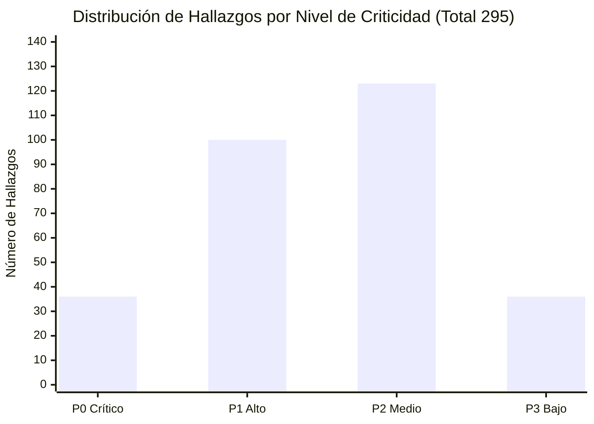
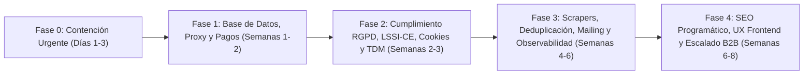

# Auditoría Integral y Plan Maestro de Mejoras — Portal Empleo IT (España / UE)

> **Modo de ejecución**: Solo lectura (`AUDIT ONLY`) sobre el repositorio de código e infraestructura.  
> **Cobertura**: Backend (`backend/`, `scripts/`), Frontend Next.js (`frontend/`), Pasarela Proxy y Despliegue (`db_proxy.php`, `nginx.conf.template`, `docker-compose.yml`, `deploy.sh`), Modelo Relacional, SEO Técnico/Programático y Cumplimiento Normativo (España / UE).  
> **Nota de inventario de esquema**: El archivo `ecosier2_PortalEmpleo.sql` referenciado en las especificaciones originales no existe en disco dentro del repositorio; el esquema efectivo fue auditado directamente sobre [consolidate_production_schema.py](file:///home/raul/proyecto_empleo/backend/consolidate_production_schema.py) (25 tablas MySQL), [database_optimization.sql](file:///home/raul/proyecto_empleo/backend/database_optimization.sql) (21 tablas en sintaxis PostgreSQL) y [userAuth.ts](file:///home/raul/proyecto_empleo/frontend/lib/userAuth.ts).

---

## 1. Dashboard Cuantitativo de Hallazgos

Se documentan **295 hallazgos individuales verificados** (sin agrupación artificial), superando todas las cuotas mínimas exigidas en las cinco disciplinas evaluadas:

| Documento / Área Auditada | Archivo del Informe | Total Ítems | Cuota Exigida | P0 - Crítico | P1 - Alto | P2 - Medio | P3 - Mejora/Bajo | % del Total |
| :--- | :--- | :---: | :---: | :---: | :---: | :---: | :---: | :---: |
| **1. Bugs, Errores y Calidad de Código** | [01_BUGS_ERRORES_Y_CALIDAD_CODIGO.md](file:///home/raul/proyecto_empleo/docs/auditoria/01_BUGS_ERRORES_Y_CALIDAD_CODIGO.md) | **65** | 60 – 100 | 6 | 27 | 28 | 4 | 22.0% |
| **2. Seguridad y Resiliencia** | [02_SEGURIDAD_Y_RESILIENCIA.md](file:///home/raul/proyecto_empleo/docs/auditoria/02_SEGURIDAD_Y_RESILIENCIA.md) | **65** | 60 – 100 | 2 | 14 | 36 | 13 | 22.0% |
| **3. SEO y Crecimiento Orgánico** | [03_SEO_Y_CRECIMIENTO_ORGANICO.md](file:///home/raul/proyecto_empleo/docs/auditoria/03_SEO_Y_CRECIMIENTO_ORGANICO.md) | **65** | 60 – 100 | 4 | 15 | 28 | 18 | 22.0% |
| **4. Funcionalidades, UX y Arquitectura** | [04_FUNCIONALIDADES_UX_Y_ARQUITECTURA.md](file:///home/raul/proyecto_empleo/docs/auditoria/04_FUNCIONALIDADES_UX_Y_ARQUITECTURA.md) | **65** | 60 – 100 | 10 | 31 | 23 | 1 | 22.0% |
| **5. Legalidad, RGPD y Cumplimiento UE** | [05_LEGALIDAD_RGPD_Y_CUMPLIMIENTO_UE.md](file:///home/raul/proyecto_empleo/docs/auditoria/05_LEGALIDAD_RGPD_Y_CUMPLIMIENTO_UE.md) | **35** | 30 – 60 | 14 | 13 | 8 | 0 | 11.9% |
| **TOTAL CONSOLIDADO** | **5 módulos auditados** | **295** | **270 – 460** | **36** | **100** | **123** | **36** | **100%** |

### Distribución por Criticidad

- **P0 - Crítico (`36` ítems / `12.2%`)**: Fallos bloqueantes en producción (crashes en webhooks Stripe, inserciones rotas sin PK `id`, bloqueo total de moderación `/admin`, bypass de seguridad en proxy SQL/CSP, incumplimientos legales graves RGPD/LSSI-CE/TRLGDCU/TDM).
- **P1 - Alto (`100` ítems / `33.9%`)**: Degradación severa de datos, pérdida de cobertura de scraping, errores de indexación Google for Jobs, fallos funcionales en informes/referidos/paginación y riesgos normativos relevantes.
- **P2 - Medio (`123` ítems / `41.7%`)**: Deuda técnica estructural, cuellos de botella de rendimiento, falta de caché/observabilidad, UX incompleta y refuerzos legales preventivos.
- **P3 - Mejora/Bajo (`36` ítems / `12.2%`)**: Pulido técnico, automatizaciones secundarias y optimizaciones incrementales.

---

## 2. Top 10 Fallos Críticos Inmediatos (`P0`)

Estos diez bloqueos exigen intervención prioritaria antes de escalar tráfico, campañas comerciales o captación orgánica:

| Prioridad | ID(s) Vinculados | Archivo Afectado | Diagnóstico Resumido y Bloqueo en Producción |
| :---: | :--- | :--- | :--- |
| **1** | `BUG-002` / `FUNC-002` | [db.ts](file:///home/raul/proyecto_empleo/frontend/lib/db.ts#L337-L340) y [webhooks/stripe/route.ts](file:///home/raul/proyecto_empleo/frontend/app/api/webhooks/stripe/route.ts#L113-L116) | **Colapso de transacciones Stripe sobre proxy HTTP**: `db.ts` lanza error ante `SELECT`/`SHOW` dentro de transacciones proxy, rompiendo la activación post-pago de ofertas, newsletter, informes y planes Premium. |
| **2** | `SEC-001` | [db_proxy.php](file:///home/raul/proyecto_empleo/db_proxy.php#L335-L344) | **Superficie crítica `UPDATE` en proxy SQL**: ausencia de lista blanca estricta de tablas y riesgo de bypass en cláusula `WHERE`, agravado por truncamiento silencioso `$max_rows = 1000` (`FUNC-001`). |
| **3** | `BUG-001` / `BUG-005` / `BUG-007` / `FUNC-012` | [main.py](file:///home/raul/proyecto_empleo/backend/main.py#L78-L167), [pipelines.py](file:///home/raul/proyecto_empleo/backend/job_aggregator/pipelines.py#L48-L87), [scraper_infoempleo.py](file:///home/raul/proyecto_empleo/backend/scraper_infoempleo.py#L94-L112) | **Ingesta rota en `jobs`**: los tres caminos de inserción omiten la PK obligatoria `id`, `dedup_hash` y `work_mode`; Scrapy además contradice `autocommit=True` y reactiva ofertas rechazadas/expiradas. |
| **4** | `BUG-003` / `BUG-004` / `FUNC-014` | [api/admin/jobs/route.ts](file:///home/raul/proyecto_empleo/frontend/app/api/admin/jobs/route.ts#L17-L50) y [admin/page.tsx](file:///home/raul/proyecto_empleo/frontend/app/admin/page.tsx#L73) | **Moderación administrativa inoperante**: castear UUID a `Number()` produce `NaN` y las consultas emplean `RETURNING id` no soportado por el adaptador MySQL, bloqueando aprobar o rechazar ofertas. |
| **5** | `LEG-005` / `LEG-006` / `LEG-004` | [mailer.py](file:///home/raul/proyecto_empleo/backend/mailer.py) y scripts `backend/send_*.py` | **Envíos masivos sin respetar bajas ni exclusiones**: ninguno de los 8 scripts consulta `email_suppression_list`, 5 scripts ignoran `users.email_notifications_enabled = FALSE` y se omite exigir `confirmed_at IS NOT NULL`. |
| **6** | `LEG-002` / `LEG-003` / `FUNC-046` | [actions.ts](file:///home/raul/proyecto_empleo/frontend/app/actions.ts#L384-L403) | **Alta de alertas sin Double Opt-In y pérdida de prueba**: la Server Action `subscribeUser` activa correos sin verificación previa y, en fallback SQL, elimina `consent_timestamp`, `consent_ip_hash` y `consent_policy_version`. |
| **7** | `LEG-010` / `LEG-012` / `LEG-013` / `FUNC-015` | [api/unsubscribe/route.ts](file:///home/raul/proyecto_empleo/frontend/app/api/unsubscribe/route.ts#L43-L55) y [api/admin/gdpr/route.ts](file:///home/raul/proyecto_empleo/frontend/app/api/admin/gdpr/route.ts#L45-L95) | **Derechos RGPD y bajas rotos por desfase de esquema**: consultan tablas/columnas inexistentes (`alerts`, `saved_jobs_reminders.is_active`) y el borrado RGPD omite `users`, sesiones, leads, patrocinadores y denuncias. |
| **8** | `LEG-008` | [tracking.py](file:///home/raul/proyecto_empleo/backend/logic/tracking.py#L21-L59) y mailers de retención | **Exposición de email PII en URLs**: enlaces de tracking, reactivación y onboarding incluyen `?email=` en claro o Base64 reversible, filtrando datos personales en logs de proxy, navegador y cabeceras `Referer`. |
| **9** | `LEG-017` / `LEG-018` / `SEC-002` | [CookieBanner.tsx](file:///home/raul/proyecto_empleo/frontend/components/CookieBanner.tsx), [layout.tsx](file:///home/raul/proyecto_empleo/frontend/app/layout.tsx#L181-L250), [middleware.ts](file:///home/raul/proyecto_empleo/frontend/middleware.ts#L16-L20) | **Consentimiento ePrivacy inválido y CSP en colisión**: bandera `cookies_accepted = 'true'` agrupa analítica y publicidad sin granularidad real; doble cabecera CSP entre middleware y `next.config.ts` bloquea recursos. |
| **10** | `LEG-001` / `LEG-023` / `LEG-028` / `FUNC-048` | [legalConfig.ts](file:///home/raul/proyecto_empleo/frontend/lib/legalConfig.ts#L9-L10), [tdm.py](file:///home/raul/proyecto_empleo/backend/logic/tdm.py#L39-L41), [checkout/report/route.ts](file:///home/raul/proyecto_empleo/frontend/app/api/checkout/report/route.ts#L23-L46) | **Incumplimientos críticos LSSI-CE, TDM, Consumo y producto Enterprise**: NIF/domicilio con marcadores placeholder, verificador `robots.txt` en modo fail-open, bypass del desistimiento Art. 103.m TRLGDCU y plan `enterprise` no diferenciado. |

### Índice Completo de los 36 Hallazgos `P0 - Crítico`

- **Bugs (`6`)**: `BUG-001`, `BUG-002`, `BUG-003`, `BUG-004`, `BUG-005`, `BUG-007` en [01_BUGS_ERRORES_Y_CALIDAD_CODIGO.md](file:///home/raul/proyecto_empleo/docs/auditoria/01_BUGS_ERRORES_Y_CALIDAD_CODIGO.md).
- **Seguridad (`2`)**: `SEC-001`, `SEC-002` en [02_SEGURIDAD_Y_RESILIENCIA.md](file:///home/raul/proyecto_empleo/docs/auditoria/02_SEGURIDAD_Y_RESILIENCIA.md).
- **SEO (`4`)**: `SEO-001`, `SEO-002`, `SEO-003`, `SEO-004` en [03_SEO_Y_CRECIMIENTO_ORGANICO.md](file:///home/raul/proyecto_empleo/docs/auditoria/03_SEO_Y_CRECIMIENTO_ORGANICO.md).
- **Funcionalidades y Arquitectura (`10`)**: `FUNC-001`, `FUNC-002`, `FUNC-006`, `FUNC-012`, `FUNC-014`, `FUNC-015`, `FUNC-045`, `FUNC-046`, `FUNC-048`, `FUNC-050` en [04_FUNCIONALIDADES_UX_Y_ARQUITECTURA.md](file:///home/raul/proyecto_empleo/docs/auditoria/04_FUNCIONALIDADES_UX_Y_ARQUITECTURA.md).
- **Legalidad España/UE (`14`)**: `LEG-001`, `LEG-002`, `LEG-003`, `LEG-004`, `LEG-005`, `LEG-006`, `LEG-008`, `LEG-010`, `LEG-012`, `LEG-013`, `LEG-017`, `LEG-018`, `LEG-023`, `LEG-028` en [05_LEGALIDAD_RGPD_Y_CUMPLIMIENTO_UE.md](file:///home/raul/proyecto_empleo/docs/auditoria/05_LEGALIDAD_RGPD_Y_CUMPLIMIENTO_UE.md).

---

## 3. Estructura Modular de Entrega (Índice Navegable)

1. **[01_BUGS_ERRORES_Y_CALIDAD_CODIGO.md](file:///home/raul/proyecto_empleo/docs/auditoria/01_BUGS_ERRORES_Y_CALIDAD_CODIGO.md)** (`BUG-001` – `BUG-065`):
   Excepciones no controladas, incompatibilidades MySQL/PostgreSQL, fugas de conexiones y cursores, fallos en adaptadores (`psycopg2.py`, `db.ts`), condiciones de carrera en cron/webhooks, roturas silenciosas en scrapers y errores React/hidratación.
2. **[02_SEGURIDAD_Y_RESILIENCIA.md](file:///home/raul/proyecto_empleo/docs/auditoria/02_SEGURIDAD_Y_RESILIENCIA.md)** (`SEC-001` – `SEC-065`):
   Superficie SQL y controles en `db_proxy.php`, cabeceras CSP/Nginx (`nginx.conf.template`), protección SSRF (`ssrf.py`, `urlSafetyServer.ts`), validación de webhooks Stripe, autenticación/sesiones (`userAuth.ts`), rate limiting (`rate-limit.ts`) y gestión de secretos.
3. **[03_SEO_Y_CRECIMIENTO_ORGANICO.md](file:///home/raul/proyecto_empleo/docs/auditoria/03_SEO_Y_CRECIMIENTO_ORGANICO.md)** (`SEO-001` – `SEO-065`):
   Datos estructurados `JobPosting` (`baseSalary`, `validThrough`, `ItemList`), cobertura y thin content en `sitemap.ts` / `sitemap-news.xml` / `sitemap-images.xml`, gestión de ofertas caducadas (`410` vs redirección), SEO programático (`/trabajos/[sector]`, `/salarios`, `/tendencias`), IndexNow, Google Search Console y Core Web Vitals.
4. **[04_FUNCIONALIDADES_UX_Y_ARQUITECTURA.md](file:///home/raul/proyecto_empleo/docs/auditoria/04_FUNCIONALIDADES_UX_Y_ARQUITECTURA.md)** (`FUNC-001` – `FUNC-065`):
   Consistencia de esquema, proxy SQL, resiliencia y cobertura de scrapers (`job_spider.py`, `scraper_http.py`), deduplicación fuzzy + modalidad, normalización salarial EUR, UX de búsqueda (`AISearchBar`, `LoadMoreJobs`, `SaveJobButton`), checkout B2B/B2C, generador PDF, sistema de referidos, mailing/bots y `/api/health`.
5. **[05_LEGALIDAD_RGPD_Y_CUMPLIMIENTO_UE.md](file:///home/raul/proyecto_empleo/docs/auditoria/05_LEGALIDAD_RGPD_Y_CUMPLIMIENTO_UE.md)** (`LEG-001` – `LEG-035`):
   LSSI-CE Art. 10, consentimiento Double Opt-In y trazabilidad probatoria, `email_suppression_list`, RFC 8058 y `/api/unsubscribe`, derechos ARSOLP (`/api/admin/gdpr`), retención efectiva (`cleanup_retention.py`), cookies granulares AEPD/ePrivacy (`CookieBanner`), Directiva TDM (UE) 2019/790, TRLGDCU Art. 103.m, Directiva de Transparencia Retributiva (UE) 2023/970, Ley 15/2022, Ley 11/2023 y Reglamento IA (UE) 2024/1689 Art. 50.

---

## 4. Plan Maestro Secuencial de Resolución por Fases

La ejecución debe respetar estrictamente las dependencias entre infraestructura de datos, cumplimiento legal bloqueante y optimización funcional/SEO:

### Fase 0: Contención Urgente de Seguridad, Pagos y Riesgos Legales Inmediatos (Días 1–3)
- **Objetivos**: Detener fugas PII, blindar perímetro proxy/CSP y frenar riesgos sancionadores inmediatos de envío comercial no autorizado y consumo.
- **Acciones clave**:
  1. Configurar NIF/CIF real, razón social y domicilio físico en entorno de producción para `legalConfig.ts` y `backend/logic/legal.py`, añadiendo comprobación de arranque fail-fast (`LEG-001`).
  2. Aplicar lista blanca estricta y contención de `UPDATE` en `db_proxy.php` (`SEC-001`) y unificar `Content-Security-Policy` eliminando la colisión entre `middleware.ts` y `next.config.ts` (`SEC-002`).
  3. Cambiar `backend/logic/tdm.py` a comportamiento estricto **fail-closed** ante fallos de red/timeout (`LEG-023`).
  4. Corregir la validación de renuncia al desistimiento (`waiver_accepted !== true`) en `checkout/report/route.ts` (`LEG-028`) y suspender temporalmente la comercialización del tier `enterprise` hasta entregar diferenciación real (`FUNC-048`, `LEG-030`).
  5. Pausar envíos no esenciales hasta parchear filtros de supresión (`email_suppression_list`), `confirmed_at IS NOT NULL`, `email_notifications_enabled = TRUE` (`LEG-004`, `LEG-005`, `LEG-006`) y sustituir email en claro/Base64 en `backend/logic/tracking.py` por tokens opacos HMAC (`LEG-008`).

### Fase 1: Unificación de Esquema, Estabilidad de BD y Flujos Transaccionales (Semanas 1–2)
- **Objetivos**: Garantizar integridad ACID en Stripe/admin y erradicar errores de inserción en ingesta y moderación.
- **Acciones clave**:
  1. Consolidar las 25 tablas reales en migraciones SQL MySQL 8 versionadas e idempotentes (`FUNC-006`, `FUNC-009`), alinear `docker-compose.yml` con MySQL 8 (`FUNC-007`) y retirar DDL en tiempo de ejecución dentro de `userAuth.ts` (`FUNC-008`).
  2. Habilitar conexión MySQL directa (con singleton `globalThis`, `ROLLBACK` automático en `release()` y eliminación de sintaxis `RETURNING` PostgreSQL) para webhooks Stripe y `/api/admin/jobs`, eliminando el bloqueo `SELECT`/`SHOW` en transacciones y el truncamiento silencioso `$max_rows = 1000` (`BUG-002`, `BUG-004`, `FUNC-001`–`FUNC-005`).
  3. Corregir tipo UUID frente a `Number()` en `admin/page.tsx` y `/api/admin/jobs` (`BUG-003`, `FUNC-014`).
  4. Alinear `main.py`, Scrapy `pipelines.py` (`autocommit=False`, preservación de bajas manuales) y `scraper_infoempleo.py` a un repositorio único que genere PK `id`, `dedup_hash` con `work_mode` y fechas válidas (`BUG-001`, `BUG-005`, `BUG-007`, `FUNC-011`–`FUNC-013`).
  5. Mover borradores pre-pago de `/api/checkout` a tabla `pending_checkouts`/`sponsored_job_orders` con `type: 'sponsored_job'` (`FUNC-045`) y corregir concesión transaccional de `is_premium = TRUE` en referidos confirmados (`FUNC-050`).

### Fase 2: Cumplimiento Normativo Integral RGPD, Cookies, Propiedad Intelectual e IA (Semanas 2–3)
- **Objetivos**: Alinear el comportamiento efectivo del software con los textos legales y directivas europeas.
- **Acciones clave**:
  1. Retirar inserción directa y fallback sin metadatos de consentimiento en `subscribeUser` (`actions.ts`), enrutando todo formulario por Double Opt-In (`LEG-002`, `LEG-003`, `FUNC-046`) con comprobación de `email_suppression_list` (`LEG-007`).
  2. Reparar nombres de tabla y atomicidad en `POST /api/unsubscribe` (soporte pleno RFC 8058) y en `/api/admin/gdpr` cubriendo exportación y supresión en todas las tablas personales (`LEG-010`–`LEG-013`, `FUNC-015`), así como las consultas rotas de `backend/cleanup_retention.py` (`LEG-014`, `FUNC-016`).
  3. Eliminar el fallback `cookies_accepted === 'true'` en `CookieBanner.tsx` y `layout.tsx`, corregir `handleSaveCustom` y ejecutar revocación efectiva incluyendo `OneSignal.User.PushSubscription.optOut()` (`LEG-017`–`LEG-019`, `FUNC-062`).
  4. Corregir falsas menciones a PayPal en `/privacy` y `/aviso-legal` (`LEG-015`), alinear `/cookies` (`LEG-020`), documentar transferencias internacionales y proxy de Clearbit (`LEG-016`), activar canal Notice-and-Takedown (`LEG-027`) y aplicar etiquetado transparente Art. 50 AI Act (`LEG-033`).

### Fase 3: Resiliencia de Scrapers, Deduplicación Inteligente, Mailing y Bots (Semanas 4–6)
- **Objetivos**: Escalar cobertura de ofertas limpias sin duplicados y profesionalizar mensajería y editorial.
- **Acciones clave**:
  1. Paralelizar scrapers fuera del cuello de botella secuencial de `180s` en `main.py` / `run_all.py`, sustituir espera síncrona por `httpx.AsyncClient` con circuit breaker persistente y añadir tabla `scraper_runs` + `/api/health/deep` (`FUNC-017`, `FUNC-021`–`FUNC-024`, `FUNC-065`).
  2. Ampliar paginación y extracción de detalle en Tecnoempleo (`job_spider.py`) con parsers resilientes y cobertura TDM obligatoria en `scraper_http.py` (`FUNC-018`–`FUNC-020`, `LEG-024`–`LEG-026`).
  3. Implantar deduplicación en dos fases (hash con `work_mode` + similitud fuzzy por empresa normalizada ampliada) y columnas indexadas `salary_min_eur` / `salary_max_eur` con cálculo correcto por jornada (`220` días) y tasas BCE (`FUNC-025`–`FUNC-031`).
  4. Rediseñar el despacho de correo con cursores por lote, idempotencia en `email_deliveries`, webhooks de rebotes SMTP, frecuencia coordinada Web Push/Email y reparación de `send_reactivation.py` (`FUNC-051`–`FUNC-055`).
  5. Consolidar bots sociales duplicados (`backend/` vs `scripts/`), añadir `social_posts_log`, pasar contenido IA por verificación factual SQL y estado `draft` (`FUNC-056`–`FUNC-059`), y reemplazar `buildSimplePdfBuffer` por generador UTF-8 profesional con diferenciación real `enterprise` (`FUNC-047`–`FUNC-049`).

### Fase 4: SEO Programático de Alto Tráfico, UX de Producto y Rendimiento (Semanas 6–8)
- **Objetivos**: Desbloquear captación orgánica limpia en Google / Google for Jobs y optimizar conversión de candidatos y empresas.
- **Acciones clave**:
  1. Corregir Schema.org `JobPosting` (`baseSalary` para `"40k"` y periodicidad real, retirada de `JobPosting` dentro de `ItemList` en categorías) (`SEO-001`, `SEO-002`).
  2. Depurar Thin Content del producto cartesiano de `/salarios/...` (`sitemap/0.xml`), alinear ventana de activos >30 días en `sitemap/1` y `sitemap/2`, unificar política HTTP `410 Gone` vs redirección semántica en caducadas y orquestar cola de IndexNow / Google Indexing (`SEO-003`, `SEO-004`, `FUNC-060`).
  3. Eliminar `MOCK_JOBS` y contador `9197` (`FUNC-033`, `LEG-030`), soportar tokens técnicos (`C#`, `C++`, `Go`, `.NET`, `AI`) (`FUNC-034`), dotar `AISearchBar` de autocompletado + sincronización URL con debounce (`FUNC-035`, `FUNC-036`) y corregir dependencias, `useRef` y `AbortController` en `LoadMoreJobs.tsx` (`FUNC-037`, `FUNC-038`).
  4. Restaurar guardado local anónimo sincronizable (`SaveJobButton.tsx` en `FUNC-039`), desbloquear preferencia `theme` (`FUNC-040`, `LEG-034`), optimizar `Footer.tsx` + caché invalidable por tags (`FUNC-041`, `FUNC-064`), añadir paginación/acciones en `/admin` (`FUNC-042`), habilitar portal B2B de anunciantes (`FUNC-063`) e incorporar requisitos de transparencia salarial UE 2023/970 y filtros antidiscriminación (`LEG-031`, `LEG-032`).
