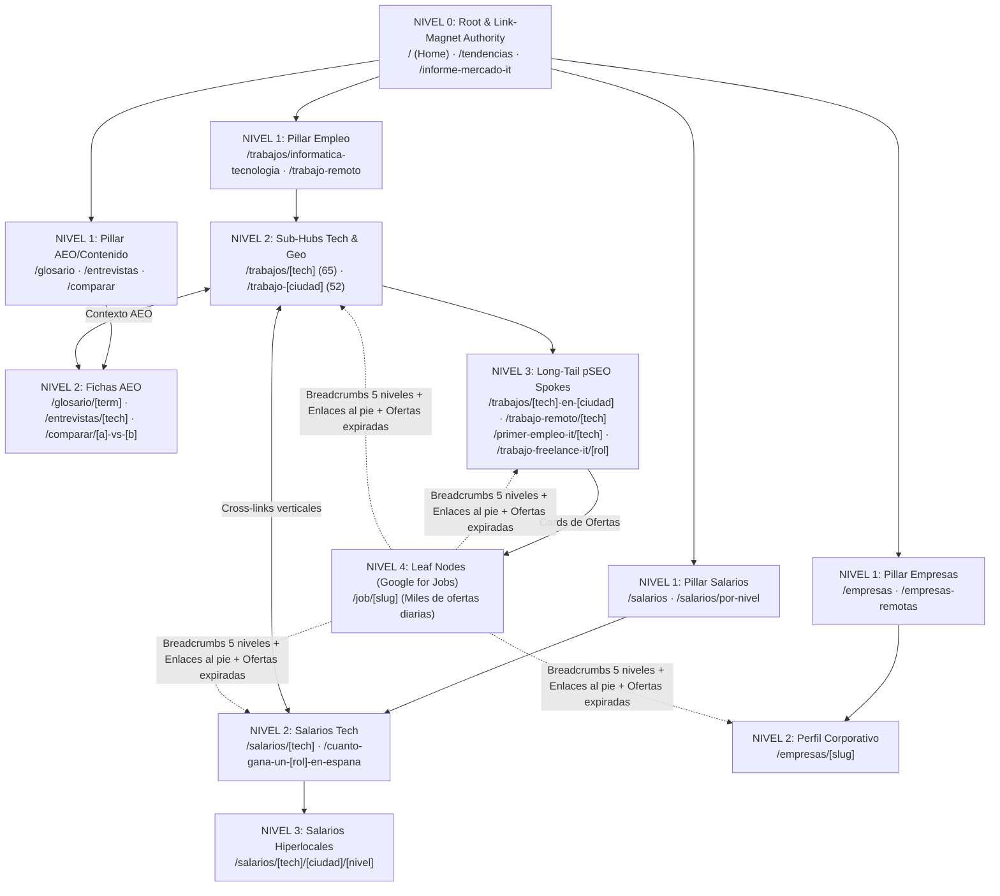
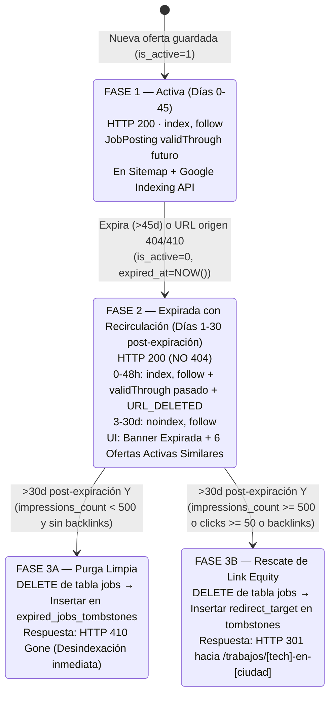

# PLAN MAESTRO DE DOMINANCIA SEO, pSEO Y TRÁFICO ORGÁNICO MASIVO (ESPAÑA / UE)

> **Auditoría Forense de Código, Arquitectura de SEO Programático (pSEO), Google for Jobs, Preservación de Crawl Budget, Indexación en Tiempo Real, Enlazado Interno y AEO (Answer Engine Optimization)**  
> **Dominio auditado:** `portalempleoit.com` (`Portal Trabajo IT`)  
> **Alcance del repositorio:** `frontend/app/`, `frontend/components/`, `frontend/lib/`, `frontend/middleware.ts`, `frontend/next.config.ts`, `backend/*.py`, `backend/database_optimization.sql`, `backend/consolidate_production_schema.py`  
> **Modo:** *Audit & Blueprint* (Sin modificación de código fuente existente)  
> **Fecha de auditoría:** Noviembre 2026  

---

## Tabla de Contenidos

1. [Diagnóstico y Estado Actual del SEO del Proyecto (Auditoría Forense)](#1-diagnóstico-y-estado-actual-del-seo-del-proyecto-auditoría-forense)
2. [Matriz de Oportunidades de SEO Programático (pSEO) Masivo (Pilar 2)](#2-matriz-de-oportunidades-de-seo-programático-pseo-masivo-pilar-2)
3. [Especificación Técnica de Schemas JSON-LD y Google for Jobs (Pilar 1)](#3-especificación-técnica-de-schemas-json-ld-y-google-for-jobs-pilar-1)
4. [Arquitectura de Sitemaps y Pipeline de Indexación Automática (Pilar 4)](#4-arquitectura-de-sitemaps-y-pipeline-de-indexación-automática-pilar-4)
5. [Política de Enlazado Interno y Distribución de PageRank (Pilar 6)](#5-política-de-enlazado-interno-y-distribución-de-pagerank-pilar-6)
6. [Protocolo de URLs Expiradas y Preservación de Crawl Budget (Pilar 3)](#6-protocolo-de-urls-expiradas-y-preservación-de-crawl-budget-pilar-3)
7. [Optimización del CTR (Pilar 5), Estrategia AEO (Pilar 7) y Roadmap Priorizado](#7-optimización-del-ctr-pilar-5-estrategia-aeo-pilar-7-y-roadmap-priorizado)

---

## 1. Diagnóstico y Estado Actual del SEO del Proyecto (Auditoría Forense)

### 1.1. Fortalezas Arquitectónicas Detectadas en el Código

El repositorio actual parte con una base de ingeniería SEO superior al promedio de portales de empleo agregados. Se han verificado en código las siguientes capacidades ya operativas:

1. **Motor Programático Multivariable en `frontend/app/trabajos/[sector]/page.tsx`:**
   - La función `parseSector(sectorSlug)` (líneas `291–373`) descompone slugs compuestos combinando tecnología (`tec`), ciudad (`ciudad`), experiencia (`junior`, `mid`, `senior`, `sin-experiencia`), modalidad (`hibrido`, `remoto`), tipo de contrato (`contrato-indefinido`, `contrato-temporal`, `contrato-practicas`, `freelance`) y filtros salariales (`salario-mas-de-30k`, `salario-40k-60k`).
   - Incluye lógica de revalidación ISR (`export const revalidate = 900`, línea `15`), renderizado condicional de estadísticas salariales (`calculateStats`), texto editorial segmentado por seniority (`getEditorialIntro`, líneas `842–960`) y bloque de `Occupation` + `MonetaryAmountDistribution` (líneas `1136–1155`).

2. **Filtro Anti-Thin Content en `frontend/app/sitemap.ts`:**
   - En el shard `id === 0`, las combinaciones programáticas de `/trabajos/*` solo entran al XML si alcanzan un mínimo de **5 ofertas activas** (`count >= 5`, líneas `437–441`), y las páginas de `/salarios/[tech]`, `/salarios/[tech]/[ciudad]` y `/salarios/[tech]/[ciudad]/[nivel]` aplican el mismo umbral sobre ofertas con salario visible (líneas `574–603`).

3. **Ecosistema Semántico Satélite y Calculadoras:**
   - `frontend/app/salarios/page.tsx`: implementa schemas `Dataset`, `WebApplication` y `BreadcrumbList` (líneas `67–151`).
   - `frontend/app/glosario/[term]/page.tsx` y `frontend/lib/glosario.ts`: cuenta con **155 términos técnicos** definidos, schema `DefinedTerm`, `DefinedTermSet` en `/glosario`, cruce con vacantes activas y salario medio en tiempo real.
   - `frontend/app/entrevistas/[tech]/page.tsx` y `frontend/lib/entrevistas.ts`: banco de preguntas por niveles (`junior`, `mid`, `senior`) para **18 tecnologías**, con schemas `FAQPage`, `Article` y `HowTo`.
   - `frontend/app/convertirse-en/[profesion]/page.tsx`: guías de carrera con `HowTo` + `FAQPage` + métricas de BD.
   - `frontend/app/comparar/[slug]/page.tsx`: **57 comparativas** (`react-vs-angular`, `madrid-vs-barcelona`, etc.) alimentadas con datos reales de BD y `FAQPage`.
   - `frontend/app/tendencias/page.tsx`: dashboard en vivo con `Dataset` + `FAQPage` que agrega tasa de teletrabajo, top tecnologías y salarios.

4. **Normalización Edge y Seguridad Crawler-Friendly (`frontend/middleware.ts`):**
   - Redirección `301` automática a minúsculas para rutas taxonómicas públicas `/trabajos`, `/salarios`, `/empresas`, `/glosario`, `/certificaciones` (líneas `218–226`), evitando duplicación por casing.
   - Protección con `X-Robots-Tag: noindex, nofollow` en rutas privadas (`/admin`, `/login`, `/registro`, `/mi-perfil`, `/ofertas-guardadas`, `/empresa-dashboard`, líneas `249` y `274–286`).

5. **Infraestructura Base de Indexación Activa y Open Graph Dinámico:**
   - `frontend/lib/googleIndexing.ts` y `frontend/app/api/index-job/route.ts`: firma JWT RS256 nativa para Google Indexing API (`URL_UPDATED` y `URL_DELETED`) protegida por `CRON_SECRET` con `crypto.timingSafeEqual` y validación de dominio.
   - `backend/logic/indexnow.py`: envío por lotes de hasta 5.000 URLs a `https://api.indexnow.org/indexnow` con verificación mediante `frontend/next.config.ts` (`/:key([a-fA-F0-9]{16,64}).txt` → `/api/indexnow-key`).
   - `frontend/app/job/[id]/opengraph-image.tsx`: generación dinámica en Edge Runtime con `next/og` (`ImageResponse`, `1200x630`, `revalidate = 86400`) consultando `db_proxy.php`.

---

### 1.2. Cuellos de Botella Críticos, Fugas de Crawl Budget y Riesgos de Penalización

La auditoría línea por línea ha revelado **9 fallos críticos/altos** que actualmente están frenando la indexación masiva, provocando desperdicio severo de *crawl budget* y exponiendo al dominio a desindexación o acciones manuales de Google:

#### Hallazgo #1 [CRÍTICO — Riesgo de Acción Manual]: `EmployerAggregateRating` Sintético / Inventado
- **Archivo afectado:** `frontend/app/empresas/[slug]/[categoria]/page.tsx` (líneas `372–377` y `404–415`).
- **Evidencia en código:**
  ```ts
  // frontend/app/empresas/[slug]/[categoria]/page.tsx:372-377
  const baseRatingVal = 3.8 + (slug.charCodeAt(0) % 13) / 10;
  const baseReviewCount = 5 + (slug.charCodeAt(slug.length - 1) % 25);
  const realReviewsCount = reviews.length;
  const realReviewsSum = reviews.reduce((sum: number, r: any) => sum + r.rating, 0);
  const reviewCount = baseReviewCount + realReviewsCount;
  const ratingValue = ((baseRatingVal * baseReviewCount + realReviewsSum) / reviewCount).toFixed(1);
  ```
- **Impacto SEO:** Mientras que `frontend/app/empresas/[slug]/page.tsx` (líneas `265–270` y `437–451`) fue corregido para emitir `EmployerAggregateRating` exclusivamente cuando `reviewCount > 0`, la subruta `/empresas/[slug]/[categoria]` sigue generando ratings deterministas falsos basados en `charCodeAt()` e inyectándolos en JSON-LD. Esto infringe directamente las políticas de *Spammy Structured Data* de Google y puede invalidar los *Rich Results* de todo el dominio.

#### Hallazgo #2 [CRÍTICO — Violación Google for Jobs]: Múltiples Schemas `JobPosting` en Páginas de Listado
- **Archivos afectados:**
  - `frontend/components/CityLandingPage.tsx` (líneas `198–233` y `254–260`)
  - `frontend/app/empresas/[slug]/page.tsx` (líneas `529–564` y `584–590`)
- **Evidencia en código:** Ambas páginas iteran `top3Jobs = jobs.slice(0, 3)` e inyectan 3 `<script type="application/ld+json">` con `@type: 'JobPosting'` dentro de páginas agregadoras/categoría, además sin `validThrough`, sin `employmentType` y sin `applicantLocationRequirements` cuando `isRemote === true`.
- **Impacto SEO:** Google Search Central exige que `JobPosting` resida **exclusivamente en la página de detalle individual** de cada oferta (`/job/[slug]`). Incluir múltiples `JobPosting` en páginas de listado provoca errores masivos de validación en Search Console (*Missing field "validThrough"*, *JobPosting on listing page*) y degrada la elegibilidad del sitio en Google for Jobs.

#### Hallazgo #3 [CRÍTICO — Triple Canibalización Geográfica]: 3 URLs Indexables Compitiendo por la Misma Intención
Para cada capital española (Madrid, Barcelona, Valencia, Málaga, Sevilla, Bilbao, Zaragoza), el proyecto mantiene simultáneamente **tres rutas distintas indexables**:
1. **Ruta A:** `/trabajo-madrid` (`frontend/app/trabajo-madrid/page.tsx` → `CityLandingPage.tsx`), `canonical: ${BASE_URL}/trabajo-madrid`, incluida en `BASE_PAGES` de `sitemap.ts` (línea `38`).
2. **Ruta B:** `/empleo-tech/madrid` (`frontend/app/empleo-tech/[ciudad]/page.tsx`), `canonical: ${BASE_URL}/empleo-tech/madrid`, `robots: { index: activeCount >= 3, follow: true }`. Ruta huérfana ausente de `sitemap.ts`, pero con enlaces cruzados internos entre las 7 ciudades (línea `332`).
3. **Ruta C:** `/trabajos/informatica-tecnologia-en-madrid` (`frontend/app/trabajos/[sector]/page.tsx`), `canonical: ${BASE_URL}/trabajos/informatica-tecnologia-en-madrid`, enlazada activamente desde `frontend/app/tendencias/page.tsx` (línea `574`) y desde el CTA principal de `frontend/app/empleo-tech/[ciudad]/page.tsx` (línea `307`).
- **Impacto SEO:** El *link equity* interno y las impresiones se dividen en tres URLs que atacan `"trabajo informática/IT en [ciudad]"`, impidiendo que ninguna alcance el Top 3 frente a InfoJobs o Indeed.

#### Hallazgo #4 [CRÍTICO — Fuga Masiva de Crawl Budget]: URLs Redirigidas 308 Inyectadas en `sitemap.ts`
- **Archivos afectados:** `frontend/app/sitemap.ts` (líneas `659–673`), `frontend/next.config.ts` (líneas `107–110`), `frontend/app/trabajo/[ciudad]/[tech]/page.tsx` (línea `202`).
- **Evidencia en código:**
  - `sitemap.ts` genera `cityTechUrls` (`${BASE_URL}/trabajo-${city}/${tech}`) para toda combinación con `>= 1` oferta (`activeCityTechKeys.has(...)`, sin respetar el umbral de `>= 5` de la línea `438`), produciendo hasta `21 × 44 = 924` URLs adicionales en el Sitemap 0.
  - Al solicitar `/trabajo-madrid/react`, `next.config.ts` realiza un rewrite hacia `/trabajo/madrid/react`.
  - Inmediatamente, `frontend/app/trabajo/[ciudad]/[tech]/page.tsx` (línea `202`) ejecuta `permanentRedirect('/trabajos/react-en-madrid')` (HTTP 308), haciendo inalcanzable todo el JSX renderizado debajo de la línea `203` y enviando a Googlebot a seguir redirecciones 308 hacia URLs que **ya estaban** en `activeProgrammaticPages` (línea `355`).
- **Impacto SEO:** Desperdicio directo de cientos/miles de peticiones de rastreo por ciclo y señal de baja calidad de sitemaps en Search Console (*Redirect error / Page with redirect*).

#### Hallazgo #5 [CRÍTICO — Hreflang Roto (HTTP 404) e i18n Dual Inconsistente]
- **Archivos afectados:** `frontend/app/sitemap.ts` (líneas `508–513`, `665–671`, `681–687`, `726–732`), `frontend/app/page.tsx` (líneas `131`, `151`), `frontend/app/en/`.
- **Evidencia en código:**
  - `frontend/app/page.tsx` y `frontend/app/sitemap.ts` declaran `hreflang="en"` apuntando a `https://portalempleoit.com/en`. Sin embargo, **no existe `frontend/app/en/page.tsx`** (el directorio `frontend/app/en/` solo contiene `trabajos/`, `glosario/` y `entrevistas/`). Cualquier bot que siga `hreflang="en"` en la Home recibe un **HTTP 404**.
  - Adicionalmente, `sitemap.ts` mezcla dos estrategias incompatibles: subdirectorio `/en/trabajos/[sector]` en las líneas `508–514`, pero parámetro `?lang=en` en `/job/[slug]?lang=en` (línea `729`), `/empresas/[slug]?lang=en` (línea `787`) y `/trabajo-[city]/[tech]?lang=en` (línea `668`). Para colmo, en `sitemap.ts` línea `511` se genera `/en/trabajos/...` aunque no existe `/en/trabajos/[sector]/page.tsx` para rutas con `?lang=en` en enlaces de paginación, y en `frontend/app/trabajos/[sector]/page.tsx` los idiomas `ca-ES` y `eu-ES` existen solo para Barcelona y Bilbao en `/ca/trabajo-barcelona` y `/eu/trabajo-bilbao`.

#### Hallazgo #6 [CRÍTICO — Pérdida de Autoridad y Soft/Hard 404 Masivo en Ofertas Expiradas]
- **Archivos afectados:** `frontend/app/job/[id]/page.tsx` (líneas `485–508` y `941–959`) y `backend/deactivate_expired_jobs.py` (líneas `201–247`).
- **Evidencia en código:**
  - En `frontend/app/job/[id]/page.tsx`, cuando `job.is_active` pasa a `false` (sea por caducidad de 100 días o por el dead-link checker tras 7 días), las líneas `485–508` comprueban si el visitante tiene sesión de usuario y la oferta guardada en `user_saved_jobs`. Como Googlebot y los usuarios orgánicos no tienen sesión con la oferta guardada, el servidor ejecuta `notFound()` (**HTTP 404**). El elegante aviso visual de expiración de las líneas `941–959` es código muerto para el tráfico orgánico.
  - Simultáneamente, `backend/deactivate_expired_jobs.py` (líneas `210–246`) ejecuta `DELETE FROM jobs WHERE created_at < 100 days` justo cuando expira, destruyendo el registro e impidiendo servir una página de transición, un `HTTP 410 Gone` intencional o una redirección `301` para enlaces externos entrantes.

#### Hallazgo #7 [ALTO — Regla Defectuosa en `robots.ts` para Bots de IA (`OAI-SearchBot`, `PerplexityBot`)]
- **Archivo afectado:** `frontend/app/robots.ts` (líneas `55–59`).
- **Evidencia en código:**
  ```ts
  {
    userAgent: ['OAI-SearchBot', 'PerplexityBot'],
    allow: ['/', '/salarios', '/tendencias', '/noticias', '/trabajos', '/job'],
    disallow: ['/api/', '/admin', '/redirect/', '/ref/'],
  }
  ```
- **Impacto SEO / Crawl Budget:** Conforme al RFC 9309, un bloque específico de `User-agent` **anula e ignora por completo las directivas del bloque `User-agent: *`**. Por tanto, `OAI-SearchBot` y `PerplexityBot` no heredan las restricciones de parámetros (`/*?q=`, `/*?modality=`, `/*?min_salary=`, `/*?sort=`, etc.) definidas en las líneas `37–52`, permitiéndoles rastrear millones de URLs facetadas y saturar los workers SSR/MySQL. Además, bloquean `/api/` completo (lo cual puede impedir cargar recursos si algún endpoint público como `/api/company-logo` se usara en renderizado), y faltan `ChatGPT-User`, `ClaudeBot` y `Google-Extended`.

#### Hallazgo #8 [ALTO — Discrepancias SQL, Cálculo Salarial sobre Slice Paginado y Fallos de Rendimiento]
- **Archivos afectados:**
  - `frontend/app/trabajos/[sector]/page.tsx` (líneas `437`, `549`, `712`, `807–840`)
  - `frontend/app/salarios/[tecnologia]/page.tsx` (líneas `23–31`)
  - `frontend/app/salarios/[tecnologia]/[ciudad]/page.tsx` (líneas `23–31`)
- **Evidencia en código:**
  1. En `trabajos/[sector]/page.tsx`, `calculateStats(jobs)` (línea `549`) calcula el salario medio mostrado en `<meta description>`, JSON-LD `Occupation` y tarjetas visuales únicamente sobre las **20 ofertas de la página actual (`LIMIT 20`)** en lugar de agregar sobre toda la categoría en SQL. Si la página 1 tiene 20 ofertas sin salario, la categoría muestra `N/A` y pierde el `MonetaryAmountDistribution`.
  2. Para tecnologías fuera de `categoryMap` (como `python`, `react`, `aws`, `docker`), la query SQL solo filtra `title ILIKE '%tec%'` (líneas `437` y `712`), ignorando `description_snippet` y perdiendo ofertas como *"Backend Engineer (Python/FastAPI)"*. Además, `LIKE '%...%'` con comodín inicial impide usar índices B-Tree (los índices `ft_jobs_search` FULLTEXT definidos en `consolidate_production_schema.py:569` están infrautilizados).
  3. En `salarios/[tecnologia]/page.tsx:23-31`, la consulta omite `WHERE is_active = TRUE` (aunque mezcle histórico, debería acotar ventana temporal, ej. `180 DAY`), ignora las columnas normalizadas `salary_min` / `salary_max` / `salary_currency` y parsea únicamente la cadena textual `salary`.
  4. En `frontend/app/empresas/[slug]/page.tsx:92-99` y `frontend/app/empresas/[slug]/[categoria]/page.tsx:136-143`, para resolver una empresa se ejecuta `SELECT DISTINCT company FROM jobs` completo y se busca el slug en JavaScript (`resCompanies.rows.find(...)`) en cada renderizado sin usar la tabla normalizada `companies` (`slug UNIQUE`) definida en `consolidate_production_schema.py:424`.

#### Hallazgo #9 [ALTO — `<lastmod>` Inexacto en Sitemaps, Desalineación `sitemap` vs Hubs y Bugs de Scripts Python]
- **Archivos afectados:** `frontend/app/sitemap.ts` (líneas `13`, `537`, `549`, `639`, `781`, `808`), `backend/index_now.py` (líneas `2`, `27`), `backend/monitor_search_console.py` (líneas `7`, `169`), `backend/run_all.py` (líneas `130–148`), `frontend/app/api/admin/jobs/route.ts`.
- **Evidencia en código:**
  1. `sitemap.ts` usa `SITE_LAST_STRUCTURAL_UPDATE = new Date('2026-11-14T00:00:00Z')` fijo para todas las landings dinámicas (`/trabajos/*`, `/salarios/*`), haciendo que Google ignore cuándo realmente entraron vacantes nuevas; pero en el Sitemap 3 (`/empresas/*`) usa `new Date()` (líneas `781` y `808`), mintiendo al afirmar que todas las empresas se modificaron en el instante exacto de cada rastreo.
  2. Desalineación entre el código y `sitemap.ts`: `comparar/[slug]/page.tsx` define **57 comparativas**, pero `sitemap.ts` solo lista **47** (`COMPARATIVAS`, líneas `125–173`), dejando fuera las comparativas de ciudades (`madrid-vs-barcelona`, etc.). `entrevistas.ts` define **18 tecnologías**, pero `sitemap.ts` solo lista **13** (`BASE_PAGES`, líneas `69–81`). Además, `sitemap-images.xml/route.ts` asigna la misma imagen genérica `${BASE_URL}/og-image.png` a las 5.000 ofertas (línea `51`) a pesar de que existe `frontend/app/job/[id]/opengraph-image.tsx`.
  3. `backend/index_now.py` (líneas `2`, `20`, `27`) importa `psycopg2` (PostgreSQL) pero ejecuta sintaxis MySQL (`NOW() - INTERVAL 12 HOUR`), y en `backend/run_all.py` (líneas `131–138`) se ejecuta justo después de `index_new_jobs.py` (que ya envió esas mismas URLs a IndexNow en su línea `110`), duplicando peticiones innecesarias. Lo mismo ocurre en `backend/monitor_search_console.py:7` (`import psycopg2` contra una BD MySQL vía `db_helper.py`).
  4. Ni `backend/main.py` ni `frontend/app/api/admin/jobs/route.ts` ni `frontend/app/api/webhooks/stripe/route.ts` disparan Google Indexing API en tiempo real al publicar/aprobar una oferta.

---

## 2. Matriz de Oportunidades de SEO Programático (pSEO) Masivo (Pilar 2)

### 2.1. Consolidación Previa de Rutas y Eliminación de Canibalizaciones

Antes de expandir el árbol de landings programáticas, se debe ejecutar una consolidación canónica estricta para eliminar competencia interna:

| Conflicto Actual | Rutas Duplicadas / Canibalizadoras | URL Canónica Única Elegida | Acción Técnica Requerida |
| :--- | :--- | :--- | :--- |
| **Empleo IT General por Ciudad** | 1. `/trabajo-[ciudad]` (`CityLandingPage.tsx`)<br>2. `/empleo-tech/[ciudad]` (`empleo-tech/[ciudad]/page.tsx`)<br>3. `/trabajos/informatica-tecnologia-en-[ciudad]` (`trabajos/[sector]/page.tsx`) | **`/trabajo-[ciudad]`** | Redirigir `301` desde `/empleo-tech/:ciudad` y `/trabajos/informatica-tecnologia-en-:ciudad` hacia `/trabajo-:ciudad`. Actualizar enlaces en `tendencias/page.tsx:574` y `sitemap.ts`. |
| **Tecnología × Ciudad** | 1. `/trabajos/[tech]-en-[ciudad]`<br>2. `/trabajo-[ciudad]/[tech]` (`trabajo/[ciudad]/[tech]/page.tsx` + rewrite `next.config.ts:108`) | **`/trabajos/[tech]-en-[ciudad]`** (y `/trabajos/[tech]-remoto`) | Eliminar `cityTechUrls` de `sitemap.ts:659-673`. Convertir el rewrite de `next.config.ts:108` en `redirects()` `301` directo `/trabajo-:ciudad/:tech` → `/trabajos/:tech-en-:ciudad` (y caso especial `remoto` → `/trabajos/:tech-remoto`). |
| **Empresas por Sector / Tech** | 1. `/trabajos/[sector]/empresas` (`trabajos/[sector]/empresas/page.tsx`)<br>2. `/empleadores/[sector]` (`empleadores/[sector]/page.tsx`) | **`/trabajos/[sector]/empresas`** | Redirigir `301` `/empleadores/:sector` → `/trabajos/:sector/empresas` y eliminar `activeEmployersPages` de `sitemap.ts:464-471`. |
| **Idioma Inglés (`hreflang`)** | 1. `/en/trabajos/[sector]`<br>2. `/?lang=en`, `/job/[id]?lang=en`, `/trabajo-[ciudad]?lang=en` | **Subdirectorio limpio `/en/...`** (solo en rutas con traducción real 100%) | Crear `frontend/app/en/page.tsx` o retirar `hreflang="en"` de páginas sin ruta `/en/...` real. Eliminar `?lang=en` del sitemap y canonicalizar `?lang=en` en rutas no traducidas hacia la versión `es-ES` hasta migrar a subdirectorio `/en/job/[id]`. |

---

### 2.2. Tabla Maestra de Oportunidades de SEO Programático (pSEO)

El diseño de expansión cubre **5 grandes ejes transaccionales e informacionales**, proyectando **>12.500 landings programáticas indexables** de alta conversión en España y UE (activadas dinámicamente según masa crítica real en BD):

| Eje / Cluster pSEO | Patrón de URL Canónica | Archivo Route Handler (`frontend/app/...`) | Intención de Búsqueda (Keyword Principal + Variantes) | Volumen Mensual Est. (ES/UE) & Nº Landings | Campos Dinámicos Requeridos de BD (SQL / Tablas) | Template de Metadatos (`<title>` y `<meta description>`) |
| :--- | :--- | :--- | :--- | :--- | :--- | :--- |
| **1. Geo × Rol / Tech (Pillar)** | `/trabajos/[rol]` | `trabajos/[sector]/page.tsx` | *"trabajo programador python"*, *"ofertas empleo react"*, *"empleo devops españa"* | ~180.000 búsquedas/mes<br>(65–100 landings) | `jobs.title`, `jobs.category`, `jobs.salary_min/max`, `COUNT(*)`, `AVG(salary)`, top empresas | **Title:** `"{Count} Ofertas de Empleo de {Rol} en España [Sueldo Medio {AvgSal}€ · {Mes} {Año}]"`<br>**Desc:** `"Explora {Count} vacantes activas de {Rol}. Salario medio: {AvgSal}€/año ({RemotePct}% remoto). Empresas contratando hoy: {Top3Companies}."` |
| **2. Geo × Rol × Ciudad** | `/trabajos/[rol]-en-[ciudad]` | `trabajos/[sector]/page.tsx` | *"trabajo python madrid"*, *"ofertas react barcelona"*, *"empleo java malaga"* | ~240.000 búsquedas/mes<br>(65 roles × 52 provincias = hasta 3.380; ~900 activas) | `jobs.location`, `jobs.work_mode`, `jobs.salary_min/max`, `seo_category_metrics` | **Title:** `"{Count} Ofertas de {Rol} en {Ciudad} [Hasta {MaxSal}€ · {Mes} {Año}]"`<br>**Desc:** `"Aplica a {Count} empleos activos de {Rol} en {Ciudad}. Horquilla salarial real: {P25}€–{P75}€/año. Filtra por remoto, híbrido o presencial."` |
| **3. Geo Hub Provincial** | `/trabajo-[ciudad]` | `trabajo-[ciudad]/page.tsx` → `components/CityLandingPage.tsx` (extender a dinámica `[ciudad]`) | *"trabajo informatica madrid"*, *"empleo tecnologico barcelona"*, *"ofertas IT valencia"* | ~110.000 búsquedas/mes<br>(52 provincias + 10 hubs europeos) | `COUNT(*)` ciudad, `AVG(salary)` ciudad, top 10 techs locales, top 10 empresas | **Title:** `"{Count} Ofertas de Trabajo IT y Programación en {Ciudad} [{Mes} {Año}]"`<br>**Desc:** `"Descubre {Count} empleos tecnológicos en {Ciudad}. Sueldo medio local: {AvgSal}€. Top stacks demandados: {Top3Techs}. Actualizado cada 6h."` |
| **4. Salarial por Rol / Tech** | `/salarios/[profesion]` y alias AEO `/cuanto-gana-un-[rol]-en-espana` | `salarios/[tecnologia]/page.tsx` + nueva ruta `cuanto-gana-un-[rol]-en-espana/page.tsx` (o redirect/render unificado) | *"cuanto gana un programador python en españa"*, *"sueldo devops españa"*, *"salario frontend developer"* | ~140.000 búsquedas/mes<br>(80–120 roles) | `jobs.salary_min`, `salary_max`, `salary_currency`, P25/P50/P75/P90, cálculo IRPF neto (12/14 pagas) | **Title:** `"¿Cuánto gana un {Rol} en España [{Año}]? Sueldo Medio: {AvgSal}€/año (Neto y Bruto)"`<br>**Desc:** `"Salario real de {Rol} en España basado en {SampleCount} ofertas: Junior {P25}€, Mid {P50}€, Senior {P75}€. Incluye cálculo de sueldo neto mensual y comparativa remoto."` |
| **5. Salarial × Ciudad × Nivel** | `/salarios/[profesion]/[ciudad]` y `/salarios/[profesion]/[ciudad]/[nivel]` | `salarios/[tecnologia]/[ciudad]/page.tsx` y `[nivel]/page.tsx` | *"sueldo java senior madrid"*, *"cuanto cobra un react junior barcelona"* | ~95.000 búsquedas/mes<br>(60 roles × 20 ciudades × 3 niveles ≈ 1.500–3.600) | `jobs.salary_min/max`, `work_mode`, `location`, percentiles por experiencia | **Title:** `"Sueldo {Rol} {Nivel} en {Ciudad} [{Año}]: {AvgSal}€ Brutos/Año"`<br>**Desc:** `"Análisis salarial de {Rol} ({Nivel}) en {Ciudad}: rango {Min}€–{Max}€ brutos/año. Comparativa frente a la media nacional y vacantes abiertas."` |
| **6. Experiencia: Remoto por Tech** | `/trabajo-remoto/[tech]` (canónica o alias consolidado con `/trabajos/[tech]-remoto`) | **NUEVA:** `trabajo-remoto/[tech]/page.tsx` (reutiliza motor de `trabajos/[sector]`) | *"trabajo remoto python"*, *"empleo react teletrabajo españa"*, *"remote aws jobs spain"* | ~85.000 búsquedas/mes<br>(65 tecnologías + subfiltros UE/USA) | `jobs.work_mode = 'remote'`, `salary_currency` (EUR/USD/GBP), empresas 100% remotas | **Title:** `"{Count} Ofertas de Trabajo Remoto {Tech} [100% Teletrabajo · Hasta {MaxSal}€]"`<br>**Desc:** `"Trabaja desde casa como {Tech}: {Count} vacantes 100% remotas en España y Europa. Sueldo medio en remoto: {AvgSal}€. Sin presencialidad."` |
| **7. Experiencia: Primer Empleo / Junior** | `/primer-empleo-it/[tech]` y `/junior/[rol]` | **NUEVAS:** `primer-empleo-it/[tech]/page.tsx` y `junior/[rol]/page.tsx` (consolidadas con `/trabajos/[tech]-junior`) | *"primer empleo programador java"*, *"trabajo python sin experiencia"*, *"ofertas react junior madrid"* | ~65.000 búsquedas/mes<br>(65 tecnologías + prácticas DAW/DAM) | `jobs` filtrados por `junior/trainee/beca/practicas/sin experiencia`, `AVG(salary)` junior | **Title:** `"Primer Empleo y Ofertas Junior de {Tech} [{Count} Vacantes Sin Experiencia · {Año}]"`<br>**Desc:** `"Consigue tu primer trabajo IT en {Tech}: {Count} ofertas junior, trainee y prácticas remuneradas en España. Consejos de CV, portfolio y salario inicial ({P25}€)."` |
| **8. Modalidad: Freelance / Contractor** | `/trabajo-freelance-it/[rol]` | **NUEVA:** `trabajo-freelance-it/[rol]/page.tsx` (extiende `trabajo-freelance-it/page.tsx`) | *"programador freelance python"*, *"proyectos freelance react españa"*, *"contractor devops tarifa"* | ~38.000 búsquedas/mes<br>(50 roles IT) | `jobs` con `CONTRACTOR` / `freelance` / `autónomo`, tarifa media día/hora, proyectos internacionales | **Title:** `"Trabajo Freelance {Rol} [{Count} Proyectos Autónomo y Contractor · {Mes} {Año}]"`<br>**Desc:** `"Proyectos freelance y contratos B2B para {Rol}. Tarifas orientativas por hora/día, clientes internacionales en remoto y vacantes activas hoy."` |
| **9. Modalidad: Híbrido / Jornada** | `/trabajos/[rol]-hibrido-en-[ciudad]` y `/trabajos/[rol]-contrato-indefinido` | `trabajos/[sector]/page.tsx` | *"trabajo java hibrido madrid"*, *"empleo devops contrato indefinido barcelona"* | ~28.000 búsquedas/mes<br>(~400 activas) | `jobs.work_mode = 'hybrid'`, `description_snippet` contrato indefinido | **Title:** `"{Count} Ofertas de {Rol} Híbrido en {Ciudad} [{Mes} {Año}]"`<br>**Desc:** `"Vacantes híbridas (teletrabajo parcial) para {Rol} en {Ciudad}. Horarios flexibles y contrato indefinido."` |
| **10. Empresas: Perfil y Empleos** | `/empresas/[slug]` y `/empresas/[slug]/empleos` | `empresas/[slug]/page.tsx` + alias `empleos` o subcategorías `[categoria]` | *"trabajar en glovo opiniones"*, *"empleos it indra"*, *"salarios mercadona tech"* | ~130.000 búsquedas/mes<br>(1.000–3.000 empresas activas) | `companies.*`, `jobs` activos por empresa, `company_reviews` reales (`AVG(rating)`), stack top | **Title:** `"Empleo en {Empresa} ({Count} Ofertas Activas) · Opiniones y Salarios [{Año}]"`<br>**Desc:** `"¿Cómo es trabajar en {Empresa}? {Count} vacantes IT abiertas, {RemoteRatio}% teletrabajo, salario medio {AvgSal}€ y opiniones reales de empleados."` |
| **11. Empresas por Departamento** | `/empresas/[slug]/[categoria]` | `empresas/[slug]/[categoria]/page.tsx` | *"ofertas backend bbva"*, *"trabajo react telefonica"*, *"empleos data santander"* | ~40.000 búsquedas/mes<br>(Top 200 empresas × 10 stacks) | `jobs` filtrados por `company` + `category`/`tech`, salario departamental | **Title:** `"Empleo de {Categoria} en {Empresa} ({Count} Vacantes · {Mes} {Año})"`<br>**Desc:** `"Ofertas activas de {Categoria} en {Empresa}. Salario estimado {AvgSal}€, tasa de teletrabajo {RemoteRatio}% y tecnologías requeridas."` |
| **12. Empresas Remotas por Stack** | `/empresas-remotas` y `/empresas-remotas/[tech]` | `empresas-remotas/page.tsx` + **NUEVA:** `empresas-remotas/[tech]/page.tsx` | *"empresas que contratan en remoto python"*, *"mejores empresas teletrabajo españa IT"* | ~35.000 búsquedas/mes<br>(45 stacks) | Ranking agregado de `companies` con `work_mode = 'remote'` filtrado por tech | **Title:** `"Top Empresas que Contratan en Remoto para {Tech} [{Año}]"`<br>**Desc:** `"Ranking de {CompCount} empresas con teletrabajo 100% que buscan perfiles {Tech}. Compara salarios medios y ofertas activas."` |
| **13. Entrevistas Técnicas** | `/entrevistas/[tech]` y alias `/preguntas-entrevista/[tech]` | `entrevistas/[tech]/page.tsx` + `preguntas-entrevista/[tech]/page.tsx` (301 o canónica unificada) | *"preguntas entrevista react"*, *"prueba tecnica python senior"*, *"preguntas entrevista java spring boot"* | ~90.000 búsquedas/mes<br>(Expandir de 18 a 65 tecnologías) | Banco estructurado Junior/Mid/Senior + live `AVG(salary)` y `COUNT(*)` ofertas de esa tech | **Title:** `"{QCount}+ Preguntas de Entrevista {Tech} [{Año}] con Respuestas (Junior a Senior)"`<br>**Desc:** `"Prepara tu entrevista técnica de {Tech} con {QCount} preguntas reales y respuestas explicadas. Incluye salarios de mercado y {JobsCount} ofertas activas."` |
| **14. Glosario Técnico Masivo** | `/glosario/[term]` | `glosario/[term]/page.tsx` | *"que es kubernetes"*, *"que es ci cd"*, *"que es terraform y para que sirve"* | ~220.000 búsquedas/mes<br>(Expandir de 155 a +500 términos) | `GLOSSARY_TERMS` (o tabla BD `glossary_terms`), `AVG(salary)` y top 5 ofertas reales del término | **Title:** `"Qué es {Term}: Definición, Salario Medio ({AvgSal}€) y Ofertas IT | Glosario"`<br>**Desc:** `"Explicación clara de qué es {Term}, usos en producción, herramientas relacionadas, sueldo medio en España y {JobsCount} ofertas activas."` |
| **15. Comparativas Tech y Ciudad** | `/comparar/[slug]` | `comparar/[slug]/page.tsx` | *"react vs angular salarios"*, *"python vs go"*, *"madrid vs barcelona programadores"* | ~75.000 búsquedas/mes<br>(Expandir de 57 a 250 pares) | `COUNT(*)` ofertas, `AVG(salary)`, `% remoto`, top 4 empresas de A vs B | **Title:** `"{TechA} vs {TechB} [{Año}]: ¿Cuál paga más y tiene más empleo en España?"`<br>**Desc:** `"Comparativa en vivo de {TechA} vs {TechB}: {CountA} vs {CountB} ofertas, sueldo medio ({SalA}€ vs {SalB}€) y tasa de teletrabajo."` |
| **16. Certificaciones & Roadmaps** | `/certificaciones/[slug]` y `/convertirse-en/[profesion]` | `certificaciones/[slug]/page.tsx` y `convertirse-en/[profesion]/page.tsx` | *"certificacion aws vale la pena"*, *"como ser devops"*, *"roadmap data engineer"* | ~55.000 búsquedas/mes<br>(~80 landings) | `CERTIFICATIONS`, `PROFESSIONS`, demanda de esa certificación en `jobs.description_snippet` | **Title:** `"Cómo Convertirse en {Profesion} [{Año}]: Hoja de Ruta, Sueldo ({AvgSal}€) y Empleo"`<br>**Desc:** `"Guía paso a paso para trabajar como {Profesion} en España: skills clave, certificaciones, salario medio y {Count} ofertas activas."` |

---

### 2.3. Estrategia Anti-Thin Content & Enriquecimiento Dinámico desde Base de Datos

Para evitar que Google clasifique las landings programáticas como *Doorway Pages* o *Thin Content* (y evitar también consultas `LIKE '%...%'` pesadas en cada request SSR), se define un sistema de **Indexation Gate** acoplado a una tabla materializada de métricas SEO.

#### A. Regla de Umbral de Indexación (Indexation Gate)
Cada página programática evalúa su densidad real de contenido antes de emitir `<meta name="robots">`:
- **Nivel Oro (`active_count >= 5`)**: `robots: { index: true, follow: true }`. Entra automáticamente en `sitemap-categories-pseo.xml` / `sitemap-salaries.xml` y se enlaza en los hubs internos.
- **Nivel Plata (`3 <= active_count <= 4` Y `historical_180d_count >= 10`)**: `robots: { index: true, follow: true }` (gracias a que muestra estadísticas salariales históricas sólidas, empresas que han contratado recientemente y análisis de mercado), pero se mantiene **fuera de los sitemaps principales** hasta superar 5 ofertas activas.
- **Nivel Bronce / Thin (`active_count < 3` Y `historical_180d_count < 10`)**: `robots: { index: false, follow: true }`. Se muestra fallback útil de ofertas relacionadas al usuario (remoto / nacional), pero **no consume índice de Google**.

#### B. Los 6 Bloques Obligatorios de Contenido Único en Cada Landing pSEO
Toda página en `/trabajos/[sector]`, `/trabajo-remoto/[tech]`, `/primer-empleo-it/[tech]` y `/trabajo-freelance-it/[rol]` debe renderizar dinámicamente estos 6 módulos alimentados por BD:
1. **Panel KPI en Tiempo Real:** Total de vacantes activas, vacantes publicadas en las últimas 72h y tasa de variación mensual vs. los 30 días anteriores.
2. **Distribución Salarial Completa (SQL Agregado Real, no sobre 20 filas):** Percentil 25 (Junior), Mediana (P50), Media Aritmética, Percentil 75 (Senior) y Máximo observado, calculados sobre ofertas activas + ventana histórica de 180 días (para estabilidad estadística).
3. **Top 5 Empresas Contratando en Ese Segmento:** Listado real con conteo de vacantes activas, salario medio ofrecido y enlace directo a `/empresas/[slug]`.
4. **Distribución de Modalidad (`work_mode`):** Gráfico CSS/HTML server-rendered (`% 100% Remoto`, `% Híbrido`, `% Presencial`) que cambia según ciudad/stack.
5. **Mapa de Co-ocurrencia de Skills (Stack Complementario):** Top 6 tecnologías secundarias más repetidas dentro de las ofertas de esa combinación (ej. en `/trabajos/python-en-madrid`: `FastAPI 42%`, `Docker 61%`, `AWS 49%`, `PostgreSQL 55%`), cada una enlazando a su hub correspondiente.
6. **FAQs Dinámicas con Cifras Reales (`FAQPage`):** 4 preguntas con respuestas que inyectan cifras únicas extraídas de MySQL (ej. *"El salario medio de Python en Madrid es de 46.200€ brutos/año, con empresas activas como Cabify y BBVA y un 58% de modalidad híbrida/remota"*).

#### C. Migración SQL Propuesta: Tabla Precalculada `seo_category_metrics` y Columna `skills_json`
Añadir en `backend/consolidate_production_schema.py` y ejecutar cada 6 horas al final de `backend/run_all.py` un agregador (`backend/build_seo_metrics.py`) que evite hacer escaneos `FULLTEXT`/`LIKE` en cada petición web:

```sql
-- 1. Enriquecimiento de la tabla jobs para indexación y facetas rápidas
ALTER TABLE jobs
  ADD COLUMN IF NOT EXISTS skills_json JSON NULL,
  ADD COLUMN IF NOT EXISTS normalized_city VARCHAR(100) NULL,
  ADD COLUMN IF NOT EXISTS seniority_level ENUM('junior', 'mid', 'senior', 'lead') NULL,
  ADD COLUMN IF NOT EXISTS expired_at TIMESTAMP NULL,
  ADD INDEX idx_jobs_city_active (normalized_city, is_active, created_at DESC),
  ADD INDEX idx_jobs_seniority_active (seniority_level, is_active, created_at DESC),
  ADD INDEX idx_jobs_expired_at (is_active, expired_at);

-- 2. Tabla materializada de métricas SEO para pSEO anti-thin-content y <lastmod> real
CREATE TABLE IF NOT EXISTS seo_category_metrics (
    slug VARCHAR(180) PRIMARY KEY,            -- Ej: 'react-en-madrid', 'python-remoto', 'salarios:react:madrid'
    route_type ENUM('jobs_sector', 'city_hub', 'salary', 'remote_tech', 'junior_tech', 'freelance_tech', 'company') NOT NULL,
    tech_slug VARCHAR(80) NULL,
    city_slug VARCHAR(80) NULL,
    seniority_slug VARCHAR(40) NULL,
    active_count INT NOT NULL DEFAULT 0,
    new_72h_count INT NOT NULL DEFAULT 0,
    historical_180d_count INT NOT NULL DEFAULT 0,
    salary_sample_count INT NOT NULL DEFAULT 0,
    salary_avg INT NULL,
    salary_median INT NULL,
    salary_p25 INT NULL,
    salary_p75 INT NULL,
    salary_min_observed INT NULL,
    salary_max_observed INT NULL,
    remote_pct TINYINT UNSIGNED NOT NULL DEFAULT 0,
    hybrid_pct TINYINT UNSIGNED NOT NULL DEFAULT 0,
    onsite_pct TINYINT UNSIGNED NOT NULL DEFAULT 0,
    top_companies_json JSON NULL,             -- [{"name":"Glovo","slug":"glovo","count":8,"avgSalary":54000}]
    related_skills_json JSON NULL,            -- [{"skill":"TypeScript","slug":"typescript","pct":74}]
    last_job_created_at TIMESTAMP NULL,       -- Fuente exacta para <lastmod> en sitemaps
    updated_at TIMESTAMP DEFAULT CURRENT_TIMESTAMP ON UPDATE CURRENT_TIMESTAMP,
    INDEX idx_seo_route_active (route_type, active_count DESC),
    INDEX idx_seo_lastmod (last_job_created_at DESC)
) ENGINE=InnoDB DEFAULT CHARSET=utf8mb4 COLLATE=utf8mb4_unicode_ci;
```

#### D. Helper TypeScript de Consulta Rápida (`getProgrammaticMarketInsights`)
```ts
// Ejemplo de arquitectura para frontend/lib/seoInsights.ts (consumido por /trabajos/[sector] y /salarios/*)
import pool from '@/lib/db';

export interface ProgrammaticMarketInsights {
  activeCount: number;
  new72hCount: number;
  historical180dCount: number;
  salarySampleCount: number;
  salaryAvg: number | null;
  salaryMedian: number | null;
  salaryP25: number | null;
  salaryP75: number | null;
  remotePct: number;
  hybridPct: number;
  onsitePct: number;
  topCompanies: Array<{ name: string; slug: string; count: number; avgSalary: number | null }>;
  relatedSkills: Array<{ skill: string; slug: string; pct: number }>;
  lastJobCreatedAt: Date | null;
  isIndexable: boolean;
  includeInSitemap: boolean;
}

export async function getProgrammaticMarketInsights(slug: string): Promise<ProgrammaticMarketInsights | null> {
  const res = await pool.query(
    `SELECT * FROM seo_category_metrics WHERE slug = $1 LIMIT 1`,
    [slug.toLowerCase()]
  );
  const row = res.rows?.[0];
  if (!row) return null;

  const activeCount = Number(row.active_count || 0);
  const historical180dCount = Number(row.historical_180d_count || 0);

  return {
    activeCount,
    new72hCount: Number(row.new_72h_count || 0),
    historical180dCount,
    salarySampleCount: Number(row.salary_sample_count || 0),
    salaryAvg: row.salary_avg ? Number(row.salary_avg) : null,
    salaryMedian: row.salary_median ? Number(row.salary_median) : null,
    salaryP25: row.salary_p25 ? Number(row.salary_p25) : null,
    salaryP75: row.salary_p75 ? Number(row.salary_p75) : null,
    remotePct: Number(row.remote_pct || 0),
    hybridPct: Number(row.hybrid_pct || 0),
    onsitePct: Number(row.onsite_pct || 0),
    topCompanies: typeof row.top_companies_json === 'string' ? JSON.parse(row.top_companies_json) : (row.top_companies_json || []),
    relatedSkills: typeof row.related_skills_json === 'string' ? JSON.parse(row.related_skills_json) : (row.related_skills_json || []),
    lastJobCreatedAt: row.last_job_created_at ? new Date(row.last_job_created_at) : null,
    // Indexation Gate estricto anti-thin-content
    isIndexable: activeCount >= 5 || (activeCount >= 3 && historical180dCount >= 10),
    includeInSitemap: activeCount >= 5,
  };
}
```

---

## 3. Especificación Técnica de Schemas JSON-LD y Google for Jobs (Pilar 1)

### 3.1. Auditoría Línea a Línea de `JobPosting` en `frontend/app/job/[id]/page.tsx`

| Campo `JobPosting` | Estado Actual en `frontend/app/job/[id]/page.tsx` | Fallo / Oportunidad de Mejora | Corrección Obligatoria |
| :--- | :--- | :--- | :--- |
| `title` (línea `744`) | Usa `displayTitle` directo (`job.title_es \|\| job.title`). | Algunos scrapers traen prefijos spam (`[URGENTE]`, `(100% Remoto)`, emojis o `Empresa - Puesto`). Google rechaza Rich Results por títulos promocionales. | Sanitizar título con regex eliminando etiquetas entre corchetes, emojis y nombres de empresa redundantes. |
| `description` (línea `745`) | Usa `textToHtml(displayDesc)` (líneas `81–96`), solo detecta `-` y `*` para `<li>`. | No limpia el prefijo `[Fuente: ...]` ni convierte encabezados (`Requisitos:`, `Ofrecemos:`, `Responsabilidades:`) en `<h3>` / `<p>` bien estructurados. Si `displayDesc` es corto (`< 150` chars), Google descarta la oferta por descripción insuficiente. | Enriquecer `formatJobDescriptionHtml()` limpiando `[Fuente: ...]`, convirtiendo bloques clave en `<h3>`, garantizando HTML válido (`<p>`, `<ul>`, `<li>`, `<br>`) y añadiendo bloque estándar estructurado con modalidad y rango salarial cuando exista. |
| `datePosted` / `validThrough` (líneas `583–584`, `746–747`) | `validThrough` se fija a `created_at + 100 días` incluso si `!job.is_active`. | 100 días excede la frescura recomendada (30–45 días). Además, si `isExpired === true` y se renderizara la página, emitir un `validThrough` futuro viola las directrices de Google for Jobs. | Calcular `validThrough = featured_expires_at` o `created_at + 45 días`. Si `!job.is_active`, emitir `validThrough = job.expired_at \|\| job.updated_at` (en el pasado). |
| `hiringOrganization` (líneas `748–759`) | Solo asigna `logo: .../logo.png` cuando `hiringOrgName === 'Portal Trabajo IT'`. No incluye `sameAs`. | El 99% de ofertas carecen de `logo` y `sameAs` en `hiringOrganization`. Sin `logo`, Google for Jobs muestra un icono gris genérico reduciendo el CTR hasta un 35%. | Hacer `LEFT JOIN companies c ON (jobs.company_id = c.id OR LOWER(jobs.company) = LOWER(c.canonical_name))`. Usar `c.logo_url` o `${BASE_URL}/api/company-logo?domain=${c.domain}`, y `sameAs: c.domain ? "https://" + c.domain : "${BASE_URL}/empresas/" + slug`. |
| `jobLocation` (líneas `718–731`) | Si `isRemote === true`, omite `addressLocality` y `addressRegion`. Si es presencial, usa `job.location` crudo (ej. `"Madrid (Híbrido)"`). No incluye `postalCode`. | 1) Search Console emite warning por ausencia de `postalCode`. 2) En ofertas **híbridas**, omitir `jobLocation.addressLocality` oculta la oferta en búsquedas locales (*"Python Madrid"*). 3) `job.location` sin limpiar rompe el geocoder de Google. | Limpiar ciudad (`"Madrid"`), mapear `addressRegion` y `postalCode` capital provincial de referencia (`28001` Madrid, `08001` Barcelona, etc.). En híbridas (`work_mode === 'hybrid'`), emitir **ambos**: `jobLocation` físico completo + `jobLocationType: 'TELECOMMUTE'`. |
| `jobLocationType` y `applicantLocationRequirements` (líneas `794–803`) | Cuando `isRemote` es true, emite `applicantLocationRequirements` como un único `Country` (`countryCode \|\| 'ES'`), aunque `isWorldwide` sea true. | Si la oferta permite trabajar desde toda la UE o Worldwide, limitarlo a un solo país reduce impresiones en Google for Jobs Europa; si es para España, `ES` es correcto, pero en formato ISO completo (`name: 'Spain'` / `'España'`). | Soportar array de países (`['ES', 'PT', 'FR', 'DE', ...]`) o `{ '@type': 'Country', name: 'ES' }` y en ofertas híbridas usar `{ '@type': 'AdministrativeArea', name: addressRegion \|\| 'España' }`. |
| `baseSalary` (líneas `586–618`) | Prioriza `salary_min/max` asumiendo `unitText: "YEAR"` y luego cae a `parseSalarySchema(job.salary)`. | Si `salary_min` en BD se guardó con valor mensual (`< 6000`) o por error `minVal > maxVal`, se emite `YEAR` incorrecto o se anula el bloque. | Validar normalización anual (`minVal >= 12000`) y garantizar `minValue <= maxValue` en `QuantitativeValue`. |
| `directApply` (líneas `735–739`, `767`) | `isDirectNativeJob` es true si hay `company_email`, `stripe_session_id` o `portalempleoit.com`. | Google exige que si `directApply: true`, el usuario pueda completar la candidatura **dentro de nuestro dominio** sin ser redirigido a un ATS de terceros. Si el botón aplica vía `mailto:` o URL externa, debe marcarse `directApply: false`. | Solo emitir `directApply: true` en ofertas con formulario de candidatura in-page nativo (`ApplyModal` con envío a BD/email corporativo desde backend). En todas las agregadas: `directApply: false`. |

#### Estrategia de Marcado: Ofertas Agregadas vs. Ofertas Directas Publicadas en el Portal
1. **Ofertas Directas (Publicadas vía `/publicar-oferta` o patrocinadas con formulario nativo):**
   - `directApply: true`.
   - `identifier`: `{ "@type": "PropertyValue", "name": "Portal Trabajo IT", "value": "direct-" + job.id }`.
   - `hiringOrganization.sameAs`: URL oficial de la empresa + `${BASE_URL}/empresas/${companySlug}`.
   - Prioridad máxima en `index_new_jobs.py` (`ORDER BY is_featured DESC, direct_apply DESC`).
2. **Ofertas Agregadas (Scrapers `JobFluent`, `Tecnoempleo`, `Stratos`, `Remotive`, `WeWorkRemotely`, `RemoteOK`, `Himalayas`, `WorkingNomads`, `Python.org`):**
   - `directApply: false` (el usuario finaliza la postulación en la plataforma origen vía `/redirect/[id]` o `ApplyButton`).
   - `identifier`: `{ "@type": "PropertyValue", "name": sourceLabel, "value": job.dedup_hash || "agg-" + job.id }`.
   - **Prohibición estricta:** Eliminar los bloques `jobPostingSchemas` de `frontend/components/CityLandingPage.tsx` (líneas `198–233`, `254–260`) y `frontend/app/empresas/[slug]/page.tsx` (líneas `529–564`, `584–590`), sustituyéndolos exclusivamente por `ItemList` apuntando a `/job/${getJobSlug(job)}`.

---

### 3.2. Templates Completos de Schemas JSON-LD Validados

#### Template 1: `JobPosting` Perfecto (`frontend/lib/schemas/jobPosting.ts`)

```typescript
import { BASE_URL } from '@/lib/constants';
import { getJobSlug, slugify } from '@/lib/slug';

const PROVINCIAL_GEO_MAP: Array<{ regex: RegExp; locality: string; region: string; postalCode: string }> = [
  { regex: /\bmadrid\b/i, locality: 'Madrid', region: 'Comunidad de Madrid', postalCode: '28001' },
  { regex: /\bbarcelona\b|\bbcn\b/i, locality: 'Barcelona', region: 'Cataluña', postalCode: '08001' },
  { regex: /\bvalencia\b/i, locality: 'Valencia', region: 'Comunitat Valenciana', postalCode: '46001' },
  { regex: /\bsevilla\b/i, locality: 'Sevilla', region: 'Andalucía', postalCode: '41001' },
  { regex: /\bm[aá]laga\b/i, locality: 'Málaga', region: 'Andalucía', postalCode: '29001' },
  { regex: /\bbilbao\b|\bbizkaia\b|\bvizcaya\b/i, locality: 'Bilbao', region: 'País Vasco', postalCode: '48001' },
  { regex: /\bzaragoza\b/i, locality: 'Zaragoza', region: 'Aragón', postalCode: '50001' },
  { regex: /\balicante\b/i, locality: 'Alicante', region: 'Comunitat Valenciana', postalCode: '03001' },
  { regex: /\bmurcia\b/i, locality: 'Murcia', region: 'Región de Murcia', postalCode: '30001' },
  { regex: /\bpalma\b|\bmallorca\b/i, locality: 'Palma', region: 'Illes Balears', postalCode: '07001' },
  { regex: /\blas palmas\b/i, locality: 'Las Palmas de Gran Canaria', region: 'Canarias', postalCode: '35001' },
  { regex: /\bcoru[nñ]a\b/i, locality: 'A Coruña', region: 'Galicia', postalCode: '15001' },
  { regex: /\bvigo\b/i, locality: 'Vigo', region: 'Galicia', postalCode: '36201' },
  { regex: /\bgranada\b/i, locality: 'Granada', region: 'Andalucía', postalCode: '18001' },
  { regex: /\bdonostia\b|\bsan sebasti[aá]n\b/i, locality: 'San Sebastián', region: 'País Vasco', postalCode: '20001' },
  { regex: /\bpamplona\b|\bnavarra\b/i, locality: 'Pamplona', region: 'Navarra', postalCode: '31001' },
  { regex: /\bvalladolid\b/i, locality: 'Valladolid', region: 'Castilla y León', postalCode: '47001' },
  { regex: /\boviedo\b|\bgij[oó]n\b|\basturias\b/i, locality: 'Oviedo', region: 'Principado de Asturias', postalCode: '33001' },
  { regex: /\bsantander\b|\bcantabria\b/i, locality: 'Santander', region: 'Cantabria', postalCode: '39001' },
];

function cleanJobTitleForSchema(rawTitle: string): string {
  return rawTitle
    .replace(/\[[^\]]*(urgente|remoto|remote|híbrido|hibrido|new|nuevo)[^\]]*\]/gi, '')
    .replace(/[\u{1F300}-\u{1FAFF}]/gu, '')
    .replace(/\s+/g, ' ')
    .trim();
}

function formatJobDescriptionHtml(rawDesc: string | null | undefined, fallbackTitle: string, orgName: string): string {
  if (!rawDesc || rawDesc.trim().length < 40) {
    return `<p>Oferta de empleo para el puesto de <strong>${fallbackTitle}</strong> en <strong>${orgName}</strong>. Consulta los detalles completos e inscríbete a través de Portal Trabajo IT.</p>`;
  }

  // Eliminar prefijo [Fuente: ...] y normalizar saltos de línea
  const cleaned = rawDesc
    .replace(/^\[Fuente:\s*.+?\]\s*/i, '')
    .replace(/&/g, '&amp;')
    .replace(/</g, '&lt;')
    .replace(/>/g, '&gt;');

  const lines = cleaned.split('\n').map(l => l.trim()).filter(Boolean);
  const htmlBlocks: string[] = [];
  let inList = false;

  for (const line of lines) {
    if (/^(requisitos|requirements|responsabilidades|responsibilities|qué ofrecemos|ofrecemos|beneficios|benefits|funciones|sobre el puesto)[:：]?$/i.test(line)) {
      if (inList) { htmlBlocks.push('</ul>'); inList = false; }
      htmlBlocks.push(`<h3>${line.replace(/[:：]$/, '')}</h3>`);
    } else if (/^[-•*]/.test(line)) {
      if (!inList) { htmlBlocks.push('<ul>'); inList = true; }
      htmlBlocks.push(`<li>${line.replace(/^[-•*]\s*/, '')}</li>`);
    } else {
      if (inList) { htmlBlocks.push('</ul>'); inList = false; }
      htmlBlocks.push(`<p>${line}</p>`);
    }
  }
  if (inList) htmlBlocks.push('</ul>');

  return htmlBlocks.join('');
}

export function buildJobPostingJsonLd(params: {
  job: any;
  companyRecord?: { canonical_name?: string; domain?: string | null; logo_url?: string | null } | null;
  companyRating?: { ratingValue: string; reviewCount: number } | null;
  baseSalaryObj: any | null;
  employmentTypes: string[];
  skills: string[];
  countryCode: string;
  isEnglish: boolean;
}) {
  const { job, companyRecord, companyRating, baseSalaryObj, employmentTypes, skills, countryCode, isEnglish } = params;

  const rawTitle = isEnglish ? job.title : (job.title_es || job.title);
  const cleanTitle = cleanJobTitleForSchema(rawTitle);
  const rawDesc = isEnglish ? job.description_snippet : (job.description_snippet_es || job.description_snippet);
  const correctSlug = getJobSlug(job);
  const jobUrl = `${BASE_URL}/job/${correctSlug}`;

  const hiringOrgName = companyRecord?.canonical_name ||
    (job.company && job.company !== 'Desconocida' ? job.company : 'Portal Trabajo IT');
  const companySlug = slugify(hiringOrgName);

  // Logo obligatorio para Rich Results visuales en Google for Jobs
  const orgLogo = companyRecord?.logo_url
    ? companyRecord.logo_url
    : companyRecord?.domain
      ? `${BASE_URL}/api/company-logo?domain=${encodeURIComponent(companyRecord.domain)}`
      : `${BASE_URL}/logo.png`;

  const orgSameAs = companyRecord?.domain
    ? [`https://${companyRecord.domain}`, `${BASE_URL}/empresas/${companySlug}`]
    : [`${BASE_URL}/empresas/${companySlug}`];

  const datePosted = new Date(job.created_at);
  // 45 días de validez óptima (o fecha de expiración real si la oferta ya fue desactivada)
  const validThroughDate = !job.is_active
    ? new Date(job.expired_at || job.updated_at || Date.now() - 3600_000)
    : job.featured_expires_at
      ? new Date(job.featured_expires_at)
      : new Date(datePosted.getTime() + 45 * 24 * 60 * 60 * 1000);

  const workMode = job.work_mode || (
    /remoto|remote|teletrabajo/i.test(`${job.location || ''} ${job.title || ''}`)
      ? (/h[ií]brido|hybrid/i.test(`${job.location || ''} ${job.description_snippet || ''}`) ? 'hybrid' : 'remote')
      : 'onsite'
  );

  const geoMatch = PROVINCIAL_GEO_MAP.find(g => g.regex.test(job.location || ''));
  const isRemoteOnly = workMode === 'remote';
  const isHybrid = workMode === 'hybrid';

  const isDirectNativeJob = Boolean(
    (job.company_email || job.stripe_session_id) &&
    (!job.url_source || String(job.url_source).includes('portalempleoit.com'))
  );

  const schema: Record<string, any> = {
    '@context': 'https://schema.org',
    '@type': 'JobPosting',
    title: cleanTitle,
    description: formatJobDescriptionHtml(rawDesc, cleanTitle, hiringOrgName),
    datePosted: datePosted.toISOString(),
    validThrough: validThroughDate.toISOString(),
    url: jobUrl,
    directApply: isDirectNativeJob,
    employmentType: employmentTypes,
    industry: 'Information Technology & Software',
    identifier: {
      '@type': 'PropertyValue',
      name: hiringOrgName,
      value: job.dedup_hash || `job-${job.id}`,
    },
    hiringOrganization: {
      '@type': 'Organization',
      name: hiringOrgName,
      sameAs: orgSameAs,
      logo: orgLogo,
      ...(companyRating && companyRating.reviewCount > 0 ? {
        aggregateRating: {
          '@type': 'EmployerAggregateRating',
          ratingValue: companyRating.ratingValue,
          bestRating: '5',
          worstRating: '1',
          ratingCount: companyRating.reviewCount,
          reviewCount: companyRating.reviewCount,
        },
      } : {}),
    },
  };

  // Ubicación física (obligatoria en presencial e híbrido; opcional/fallback en remoto)
  if (!isRemoteOnly) {
    schema.jobLocation = {
      '@type': 'Place',
      address: {
        '@type': 'PostalAddress',
        addressLocality: geoMatch?.locality || (job.location || 'Madrid').split(',')[0].split('(')[0].trim(),
        addressRegion: geoMatch?.region || 'España',
        postalCode: geoMatch?.postalCode || '28001',
        addressCountry: countryCode || 'ES',
      },
    };
  } else {
    schema.jobLocation = {
      '@type': 'Place',
      address: {
        '@type': 'PostalAddress',
        addressCountry: countryCode || 'ES',
      },
    };
  }

  // Marcado TELECOMMUTE + applicantLocationRequirements para remoto e híbrido
  if (isRemoteOnly || isHybrid) {
    schema.jobLocationType = 'TELECOMMUTE';
    schema.applicantLocationRequirements = isHybrid && geoMatch
      ? { '@type': 'AdministrativeArea', name: geoMatch.region }
      : { '@type': 'Country', name: countryCode === 'ES' ? 'Spain' : (countryCode || 'Spain') };
    schema.jobBenefits = isEnglish
      ? '100% Remote / Flexible Schedule'
      : 'Teletrabajo flexible, horario adaptable';
  }

  // Salario estructurado EUR
  if (baseSalaryObj?.value) {
    schema.baseSalary = {
      '@type': 'MonetaryAmount',
      currency: baseSalaryObj.currency || 'EUR',
      value: {
        '@type': 'QuantitativeValue',
        ...(baseSalaryObj.value.minValue !== undefined ? {
          minValue: Math.min(baseSalaryObj.value.minValue, baseSalaryObj.value.maxValue ?? baseSalaryObj.value.minValue),
          maxValue: Math.max(baseSalaryObj.value.minValue, baseSalaryObj.value.maxValue ?? baseSalaryObj.value.minValue),
        } : {
          value: baseSalaryObj.value.value,
        }),
        unitText: baseSalaryObj.value.unitText || 'YEAR',
      },
    };
  }

  if (skills.length > 0) {
    schema.skills = skills.join(', ');
  }

  return schema;
}
```

#### Template 2: `BreadcrumbList` Jerárquico (5 Niveles para Oferta Individual)
```json
{
  "@context": "https://schema.org",
  "@type": "BreadcrumbList",
  "itemListElement": [
    {
      "@type": "ListItem",
      "position": 1,
      "name": "Inicio",
      "item": "https://portalempleoit.com/"
    },
    {
      "@type": "ListItem",
      "position": 2,
      "name": "Empleo IT",
      "item": "https://portalempleoit.com/trabajos/informatica-tecnologia"
    },
    {
      "@type": "ListItem",
      "position": 3,
      "name": "Ofertas de Python",
      "item": "https://portalempleoit.com/trabajos/python"
    },
    {
      "@type": "ListItem",
      "position": 4,
      "name": "Python en Madrid",
      "item": "https://portalempleoit.com/trabajos/python-en-madrid"
    },
    {
      "@type": "ListItem",
      "position": 5,
      "name": "Senior Python Backend Engineer"
    }
  ]
}
```

#### Template 3: `FAQPage` Dinámico Hidratado con Datos de BD (Para Landings pSEO y Salarios)
```typescript
export function buildDynamicFaqJsonLd(params: {
  techLabel: string;
  cityLabel: string;
  insights: ProgrammaticMarketInsights;
}) {
  const { techLabel, cityLabel, insights } = params;
  const locText = cityLabel === 'Remoto' ? 'en remoto' : `en ${cityLabel}`;
  const topCompaniesText = insights.topCompanies.slice(0, 3).map(c => c.name).join(', ');

  return {
    '@context': 'https://schema.org',
    '@type': 'FAQPage',
    mainEntity: [
      {
        '@type': 'Question',
        name: `¿Cuál es el sueldo medio de un programador ${techLabel} ${locText} en 2026?`,
        acceptedAnswer: {
          '@type': 'Answer',
          text: insights.salaryAvg
            ? `El salario medio bruto anual para un perfil de ${techLabel} ${locText} es de ${insights.salaryAvg.toLocaleString('es-ES')}€. El percentil 25 (Junior) se sitúa en ${insights.salaryP25?.toLocaleString('es-ES')}€ y el percentil 75 (Senior) alcanza los ${insights.salaryP75?.toLocaleString('es-ES')}€ brutos al año, calculado sobre ${insights.salarySampleCount} ofertas verificadas.`
            : `Las bandas salariales de ${techLabel} ${locText} oscilan habitualmente entre 28.000€ para perfiles junior y 65.000€+ para arquitectos y perfiles senior.`,
        },
      },
      {
        '@type': 'Question',
        name: `¿Cuántas ofertas activas de ${techLabel} hay ${locText} actualmente?`,
        acceptedAnswer: {
          '@type': 'Answer',
          text: `Actualmente hay ${insights.activeCount} ofertas de empleo activas de ${techLabel} ${locText} (${insights.new72hCount} publicadas en las últimas 72 horas). El ${insights.remotePct}% son 100% remoto y el ${insights.hybridPct}% en modalidad híbrida.`,
        },
      },
      {
        '@type': 'Question',
        name: `¿Qué empresas están contratando desarrolladores ${techLabel} ${locText}?`,
        acceptedAnswer: {
          '@type': 'Answer',
          text: topCompaniesText
            ? `Entre las empresas con procesos de selección activos destacan ${topCompaniesText}. Puedes consultar sus valoraciones y condiciones completas en nuestro directorio de empresas IT.`
            : `Consultoras tecnológicas, fintechs y empresas de producto digital publican diariamente vacantes para ${techLabel} ${locText}.`,
        },
      },
    ],
  };
}
```

#### Template 4: `Occupation` + `MonetaryAmountDistribution` + `Dataset` (Sustituto Oficial de `SalaryEstimate`)
> **Nota técnica de Google Search Central:** Schema.org y Google deprecaron el tipo experimental `SalaryEstimate` en favor de `Occupation` con la propiedad `estimatedSalary` (`MonetaryAmountDistribution`) para estimaciones salariales por puesto/región y `Dataset` para estudios salariales agregados. En `frontend/app/salarios/[tecnologia]/page.tsx` y `[ciudad]/page.tsx` actualmente **no** se emite `Occupation` ni `MonetaryAmountDistribution` (solo `BreadcrumbList` y `FAQPage`). Debe añadirse el siguiente template en todas las rutas `/salarios/*`:

```typescript
export function buildOccupationSalaryJsonLd(params: {
  roleName: string;
  description: string;
  cityName: string; // 'España' | 'Madrid' | 'Barcelona' ...
  isCountry: boolean;
  p25: number;
  median: number;
  p75: number;
  sampleCount: number;
  url: string;
}) {
  return {
    '@context': 'https://schema.org',
    '@type': 'Occupation',
    name: `Desarrollador / Programador ${params.roleName}`,
    description: params.description,
    mainEntityOfPage: params.url,
    occupationLocation: {
      '@type': params.isCountry ? 'Country' : 'City',
      name: params.cityName,
    },
    estimatedSalary: [
      {
        '@type': 'MonetaryAmountDistribution',
        name: 'Salario Bruto Anual Base',
        currency: 'EUR',
        duration: 'P1Y',
        percentile25: params.p25,
        median: params.median,
        percentile75: params.p75,
        sampleSize: params.sampleCount,
      },
    ],
  };
}
```

---

## 4. Arquitectura de Sitemaps y Pipeline de Indexación Automática (Pilar 4)

### 4.1. Reestructuración de `sitemap_index.xml` y Particionado Semántico (<10.000 URLs)

Se reemplaza el sistema genérico `/sitemap/0.xml`..`/sitemap/3.xml` por un índice semántico particionado donde cada archivo tiene **máximo 10.000 URLs** y un `<lastmod>` calculado con precisión desde MySQL (`MAX(created_at)` o `updated_at`), eliminando por completo tanto las fechas congeladas (`2026-11-14`) como los falsos `new Date()`.

| Archivo XML en `sitemap.xml` | Contenido Exacto | Límite / Sharding | Fuente del `<lastmod>` Real | Frecuencia de Cache / Revalidate |
| :--- | :--- | :--- | :--- | :--- |
| `/sitemap-jobs-today.xml` | Ofertas activas (`is_active = TRUE`) publicadas o actualizadas en las **últimas 48h**. | Max 5.000 URLs | `COALESCE(updated_at, created_at)` exacto | `revalidate = 900` (15 min) |
| `/sitemap-jobs-active-[page].xml` | Resto de ofertas activas (`created_at < NOW() - 48h`, edad `< 45 días`). | **10.000 URLs por shard** (`page = 1, 2...`) | `COALESCE(updated_at, created_at)` exacto | `revalidate = 3600` (1 hora) |
| `/sitemap-cities.xml` | Hubs provinciales `/trabajo-[ciudad]` (solo `active_count >= 3`). | ~60 URLs | `MAX(last_job_created_at)` de `seo_category_metrics` | `revalidate = 3600` |
| `/sitemap-categories-pseo.xml` | Landings `/trabajos/[sector]`, `/trabajo-remoto/[tech]`, `/primer-empleo-it/[tech]`, `/trabajo-freelance-it/[rol]` con **`active_count >= 5`**. | ~2.500–5.000 URLs | `last_job_created_at` de `seo_category_metrics` | `revalidate = 3600` |
| `/sitemap-salaries.xml` | `/salarios`, `/salarios/[tech]`, `/salarios/[tech]/[ciudad]`, `/salarios/[tech]/[ciudad]/[nivel]` con `salary_sample_count >= 5`. | ~1.500–3.000 URLs | `last_job_created_at` de `seo_category_metrics` | `revalidate = 7200` |
| `/sitemap-companies.xml` | `/empresas/[slug]` y `/empresas/[slug]/[categoria]` con `active_count >= 1`. | Max 10.000 URLs/shard | `MAX(jobs.created_at)` agrupado por empresa | `revalidate = 7200` |
| `/sitemap-editorial.xml` | `/blog/*`, `/glosario/*` (155→500), `/entrevistas/*` (18→65), `/comparar/*` (57→250), `/convertirse-en/*`, `/certificaciones/*`. | ~1.200 URLs | `blog_posts.updated_at` / fecha revisión | `revalidate = 14400` |
| `/sitemap-news.xml` | Artículos de `/noticias/*` y `/blog/*` publicados en las últimas **48h** con `<news:news>`. | ~10–100 URLs | `post.date` ISO 8601 | `revalidate = 1800` |
| `/sitemap-images.xml` | Imágenes Open Graph reales (`/job/[slug]/opengraph-image`, `/trabajos/[sector]/opengraph-image`, `/salarios/[tech]/opengraph-image`, `/empresas/[slug]/opengraph-image`). | Max 5.000 URLs | `jobs.created_at` / `last_job_created_at` | `revalidate = 14400` |

#### Implementación de Ejemplo para `frontend/app/sitemap.xml/route.ts` (Índice Dinámico)
```typescript
// frontend/app/sitemap.xml/route.ts (Blueprint)
import { NextResponse } from 'next/server';
import pool from '@/lib/db';
import { BASE_URL } from '@/lib/constants';

export const revalidate = 1800; // Cache 30 minutos

export async function GET() {
  let totalOlderActive = 0;
  let latestJobDate = new Date().toISOString();

  const client = await pool.connect();
  try {
    const res = await client.query(`
      SELECT 
        COUNT(*) as older_count,
        MAX(created_at) as latest_created
      FROM jobs 
      WHERE is_active = TRUE AND created_at < NOW() - INTERVAL 48 HOUR
    `);
    totalOlderActive = Number(res.rows?.[0]?.older_count || 0);
    if (res.rows?.[0]?.latest_created) {
      latestJobDate = new Date(res.rows[0].latest_created).toISOString();
    }
  } finally {
    client.release();
  }

  const shardCount = Math.max(1, Math.ceil(totalOlderActive / 10000));
  const jobActiveShards = Array.from({ length: shardCount }, (_, i) => `
  <sitemap>
    <loc>${BASE_URL}/sitemaps/jobs-active/${i + 1}.xml</loc>
    <lastmod>${latestJobDate}</lastmod>
  </sitemap>`).join('');

  const xml = `<?xml version="1.0" encoding="UTF-8"?>
<sitemapindex xmlns="http://www.sitemaps.org/schemas/sitemap/0.9">
  <sitemap>
    <loc>${BASE_URL}/sitemaps/jobs-today.xml</loc>
    <lastmod>${latestJobDate}</lastmod>
  </sitemap>${jobActiveShards}
  <sitemap>
    <loc>${BASE_URL}/sitemaps/cities.xml</loc>
    <lastmod>${latestJobDate}</lastmod>
  </sitemap>
  <sitemap>
    <loc>${BASE_URL}/sitemaps/categories-pseo.xml</loc>
    <lastmod>${latestJobDate}</lastmod>
  </sitemap>
  <sitemap>
    <loc>${BASE_URL}/sitemaps/salaries.xml</loc>
    <lastmod>${latestJobDate}</lastmod>
  </sitemap>
  <sitemap>
    <loc>${BASE_URL}/sitemaps/companies.xml</loc>
    <lastmod>${latestJobDate}</lastmod>
  </sitemap>
  <sitemap>
    <loc>${BASE_URL}/sitemaps/editorial.xml</loc>
  </sitemap>
  <sitemap>
    <loc>${BASE_URL}/sitemap-news.xml</loc>
    <lastmod>${latestJobDate}</lastmod>
  </sitemap>
  <sitemap>
    <loc>${BASE_URL}/sitemap-images.xml</loc>
    <lastmod>${latestJobDate}</lastmod>
  </sitemap>
</sitemapindex>`.trim();

  return new NextResponse(xml, {
    status: 200,
    headers: {
      'Content-Type': 'application/xml; charset=utf-8',
      'Cache-Control': 'public, max-age=1800, s-maxage=1800, stale-while-revalidate=3600',
    },
  });
}
```

#### Consulta SQL para `<lastmod>` Real de Empresas (`sitemaps/companies.xml`)
Reemplaza `lastModified: new Date()` de `frontend/app/sitemap.ts:781`:
```sql
SELECT
  COALESCE(c.slug, LOWER(REPLACE(j.company, ' ', '-'))) AS company_slug,
  j.company,
  COUNT(*) AS active_jobs,
  MAX(COALESCE(j.updated_at, j.created_at)) AS last_mod
FROM jobs j
LEFT JOIN companies c ON j.company_id = c.id
WHERE j.is_active = TRUE
  AND j.company IS NOT NULL
  AND j.company != 'Desconocida'
  AND j.company != ''
GROUP BY company_slug, j.company
HAVING active_jobs >= 1
ORDER BY active_jobs DESC, last_mod DESC
LIMIT 10000;
```

---

### 4.2. Pipeline de Indexación Instantánea en Tiempo Real (Google Indexing API + IndexNow)

El objetivo es reducir la latencia desde que una oferta entra a MySQL hasta que Googlebot / Bingbot / Perplexity la rastrean de **6–24 horas actuales a < 120 segundos**.

```mermaid
flowchart LR
    A[Fuente de Oferta] -->|1. Scraper Python: main.py / Scrapy / Stratos| B[(MySQL: tabla jobs)]
    A2[Publicación Directa: Stripe Webhook / Admin Approve] --> B
    B -->|Disparo Síncrono / Event-Driven| C[instant_indexer.py / googleIndexing.ts]
    C -->|Cache Token OAuth2 55m| D[Google Indexing API: URL_UPDATED]
    C -->|Batch Único JSON <= 5000 URLs| E[IndexNow API: Bing / Yandex / Seznam]
    C -->|Incluye Hubs Modificados| F[/trabajos/tech + /trabajos/tech-en-ciudad]
    G[Cron Resiliencia / Retry cada 1h] -->|WHERE google_indexed_at IS NULL| C
    H[deactivate_expired_jobs.py] -->|Oferta Expirada| I[Google Indexing API: URL_DELETED + IndexNow]
```

#### Mejora #1: Caché de Token OAuth2 en `frontend/lib/googleIndexing.ts`
Actualmente `frontend/lib/googleIndexing.ts` (líneas `66–83`) ejecuta un `POST https://oauth2.googleapis.com/token` en **cada llamada individual**. Cacheando el token en memoria a nivel de módulo (`exp - 300s`), se elimina el 99% de la latencia OAuth2 cuando se indexan lotes o aprobaciones múltiples:
```typescript
// Caché en memoria (sobrevive entre invocaciones calientes en Node/Serverless)
let cachedAccessToken: { token: string; expiresAt: number } | null = null;

async function getGoogleAccessToken(clientEmail: string, privateKey: string): Promise<string> {
  const nowSec = Math.floor(Date.now() / 1000);
  if (cachedAccessToken && cachedAccessToken.expiresAt > nowSec + 300) {
    return cachedAccessToken.token;
  }
  // ... generar JWT RS256 y solicitar https://oauth2.googleapis.com/token ...
  cachedAccessToken = {
    token: tokenData.access_token,
    expiresAt: nowSec + Number(tokenData.expires_in || 3600),
  };
  return cachedAccessToken.token;
}
```

#### Mejora #2: Disparo Inmediato en Aprobación Admin y Checkout Stripe
- En `frontend/app/api/admin/jobs/route.ts` (tras línea `143` después de `COMMIT`) y en `frontend/app/api/webhooks/stripe/route.ts` (tras activar una oferta patrocinada), invocar de forma no bloqueante:
  1. `requestGoogleIndexing(jobUrl, 'URL_UPDATED')`
  2. `submitUrlsToIndexNow([jobUrl, techHubUrl, cityHubUrl])`
  3. Actualizar `google_indexed_at = NOW()` en `jobs`.

#### Mejora #3: Script Unificado `backend/index_new_jobs.py` (Sustituye también la ejecución duplicada de `index_now.py`)
1. **Eliminar el paso `[5.1/7] python index_now.py`** de `backend/run_all.py` (líneas `136–138`), ya que `index_new_jobs.py` envía el lote completo a IndexNow y el actual `index_now.py` falla por importar `psycopg2` usando sintaxis SQL de MySQL.
2. **Aumentar la cuota diaria de Google Indexing API:** Solicitar en Google Cloud Console el incremento de cuota de *Indexing API* (de 200 req/día por defecto a 2.000–10.000 req/día para `JobPosting` agregados legítimos) y gestionar el presupuesto priorizando:
   - `is_featured = TRUE` (prioridad 1)
   - Ofertas directas (`company_email IS NOT NULL`) (prioridad 2)
   - Ofertas con `salary_min IS NOT NULL` y en España (`location` española) (prioridad 3)
   - Resto de ofertas activas recientes.
3. **Notificación de Hubs en IndexNow:** IndexNow **no** tiene restricción a `JobPosting` (a diferencia de Google Indexing API, que solo admite `JobPosting` y `BroadcastEvent`). Por tanto, el lote de IndexNow debe incluir tanto las URLs de ofertas `/job/[slug]` como las landings pSEO afectadas (`/trabajos/[tech]`, `/trabajos/[tech]-en-[ciudad]`, `/trabajo-[ciudad]`).

```python
# Blueprint mejorado para backend/index_new_jobs.py (compatible 100% PyMySQL vía db_helper.py)
import os
import requests
from datetime import datetime, timedelta
from dotenv import load_dotenv
from db_helper import get_db_connection
from logic.slug import get_job_slug, slugify
from logic.indexnow import submit_urls_to_indexnow

load_dotenv()

def index_new_jobs():
    cron_secret = os.getenv("CRON_SECRET")
    frontend_url = os.getenv("FRONTEND_URL", "https://portalempleoit.com").rstrip("/")
    google_daily_batch_limit = int(os.getenv("GOOGLE_INDEXING_BATCH_LIMIT", "180"))

    if not cron_secret:
        print("❌ Falta CRON_SECRET.")
        return

    conn = get_db_connection()
    cur = conn.cursor()

    # 1. Consultar ofertas pendientes de Google Indexing API (últimas 48h, priorizando valor SEO/negocio)
    forty_eight_hours_ago = datetime.now() - timedelta(hours=48)
    cur.execute("""
        SELECT id, title, title_es, location, company, category, is_featured, salary_min, company_email
        FROM jobs
        WHERE is_active = TRUE
          AND google_indexed_at IS NULL
          AND created_at >= %s
        ORDER BY
          is_featured DESC,
          (company_email IS NOT NULL) DESC,
          (salary_min IS NOT NULL) DESC,
          created_at DESC
        LIMIT 1000
    """, (forty_eight_hours_ago,))
    pending_jobs = cur.fetchall()

    if not pending_jobs:
        print("💤 Sin ofertas pendientes para indexar.")
        conn.close()
        return

    headers = {"Authorization": f"Bearer {cron_secret}", "Content-Type": "application/json"}
    indexnow_urls = set()
    google_sent = 0
    quota_exhausted = False

    for row in pending_jobs:
        job_id, title, title_es, location, company, category, is_featured, salary_min, company_email = row
        job_slug = get_job_slug(job_id, title, location=location, company=company, title_es=title_es)
        job_url = f"{frontend_url}/job/{job_slug}"
        indexnow_urls.add(job_url)

        # Añadir hubs afectados a IndexNow (Bing/Yandex/Seznam)
        if company and company != "Desconocida":
            indexnow_urls.add(f"{frontend_url}/empresas/{slugify(company)}")
        if category:
            cat_slug = slugify(category.split("&")[0].strip())
            if cat_slug:
                indexnow_urls.add(f"{frontend_url}/trabajos/{cat_slug}")

        # Enviar a Google Indexing API respetando el presupuesto de cuota
        if not quota_exhausted and google_sent < google_daily_batch_limit:
            try:
                resp = requests.post(
                    f"{frontend_url}/api/index-job",
                    json={"url": job_url, "type": "URL_UPDATED"},
                    headers=headers,
                    timeout=8,
                )
                if resp.status_code == 200:
                    google_sent += 1
                    cur.execute("UPDATE jobs SET google_indexed_at = NOW() WHERE id = %s", (job_id,))
                elif resp.status_code == 429:
                    quota_exhausted = True
                    print("⛔ Cuota Google Indexing API alcanzada (429). Continuando solo con IndexNow.")
            except requests.RequestException as exc:
                print(f"⚠️ Error de red en Google Indexing ({job_id}): {exc}")

    # 2. Enviar lote único deduplicado a IndexNow (máx 5.000 URLs por POST)
    indexnow_urls.add(f"{frontend_url}/sitemap-news.xml")
    indexnow_urls.add(f"{frontend_url}/tendencias")
    submit_urls_to_indexnow(list(indexnow_urls), frontend_url, timeout=15)

    conn.commit()
    cur.close()
    conn.close()
    print(f"✅ Indexación finalizada: {google_sent} enviadas a Google, {len(indexnow_urls)} URLs a IndexNow.")
```

---

## 5. Política de Enlazado Interno y Distribución de PageRank (Pilar 6)

### 5.1. Arquitectura Silo (Hub-and-Spoke) y Flujo de PageRank

El enlazado interno debe canalizar la autoridad desde las páginas captadoras de enlaces externos (Home, `/tendencias`, `/informe-mercado-it`, `/salarios`, `/glosario`) hacia los hubs transaccionales (`/trabajos/[tech]`, `/trabajo-[ciudad]`) y de estos hacia las landings *long-tail* de alta conversión (`/trabajos/[tech]-en-[ciudad]`, `/salarios/[tech]/[ciudad]/[nivel]`), mientras que las **decenas de miles de hojas `/job/[slug]`** devuelven PageRank hacia arriba mediante breadcrumbs profundos y módulos de recirculación.



### 5.2. Reglas de Breadcrumbs Jerárquicos Profundos (`BreadcrumbList`)

Sustituir el breadcrumb plano de `frontend/app/job/[id]/page.tsx` (líneas `831–850` y `922–928`, que salta directamente de `Ofertas` al título de la oferta) por rutas semánticas de 4–5 niveles:
- **En `/job/[slug]`:**
  `Inicio (/)` → `Empleo IT (/trabajos/informatica-tecnologia)` → `Empleo de {Tech} (/trabajos/{tech})` → `{Tech} {Ciudad/Remoto} (/trabajos/{tech}-en-{ciudad})` → `{Título de la Oferta}`
- **En `/trabajos/[tech]-[nivel]-en-[ciudad]`:**
  `Inicio (/)` → `Empleo IT (/trabajos/informatica-tecnologia)` → `Empleo de {Tech} (/trabajos/{tech})` → `{Tech} en {Ciudad} (/trabajos/{tech}-en-{ciudad})` → `Nivel {Junior/Senior}`
- **En `/salarios/[tech]/[ciudad]/[nivel]`:**
  `Inicio (/)` → `Salarios IT (/salarios)` → `Sueldo {Tech} (/salarios/{tech})` → `{Tech} en {Ciudad} (/salarios/{tech}/{ciudad})` → `{Nivel}`

### 5.3. Reglas de Enlazado Interno en `/job/[id]` y Landings pSEO (PageRank Sculpting)

1. **Bloque 1 — Auto-linking Semántico en Descripción (`autoLinkDescription` en `frontend/app/job/[id]/page.tsx:98-151`):**
   - Limitar a **máximo 4 enlaces internos distintos** por descripción (1 al hub de la tecnología principal `/trabajos/[tech]`, 1 a la segunda skill del stack, 1 a `/salarios/[tech]` y 1 a `/glosario/[term]`).
   - **Prohibido** inyectar las etiquetas `<a>` dentro de `jsonLd.description` (en la arquitectura actual se pasa `textToHtml(displayDesc)` al JSON-LD y `autoLinkDescription(displayDesc)` al HTML visual; mantener esa separación estricta).
2. **Bloque 2 — Módulos de Cierre al Pie de Cada Oferta (`/job/[id]/page.tsx:1051-1209`):**
   - **Carrusel de 6 Ofertas Similares (`getSimilarJobs`):** Ampliar el parámetro `limit` de `3` a `6` y priorizar en el `ORDER BY` la coincidencia triple `(misma tecnología + misma ciudad/remoto + fecha reciente)`.
   - **Panel Contextual de 6 Enlaces Silo:**
     1. `"Todas las ofertas de {Empresa}"` → `/empresas/{companySlug}`
     2. `"Ofertas de {Tech} en {Ciudad}"` → `/trabajos/{tech}-en-{ciudad}` (o `/trabajo-remoto/{tech}`)
     3. `"Sueldo medio de {Tech} en {Ciudad}"` → `/salarios/{tech}/{ciudad}`
     4. `"Preguntas de entrevista {Tech}"` → `/entrevistas/{tech}`
     5. `"Comparativa {Tech} vs {Competidor}"` → `/comparar/{tech}-vs-{rival}`
     6. `"Todas las ofertas en {Ciudad}"` → `/trabajo-{ciudad}`
   - **Eliminación de Enlaces Basura en Footer Global de Ofertas:** En `frontend/app/job/[id]/page.tsx:1266`, retirar el enlace `<Link href="/login">Registrarme como Candidato</Link>` de la matriz de interlinking SEO (las páginas `/login` tienen `noindex` y no deben recibir anchor-juice SEO).
3. **Bloque 3 — Enlazado Condicional Anti-404 / Anti-Thin-Content en `trabajos/[sector]/page.tsx`:**
   - En las líneas `1026–1109` de `frontend/app/trabajos/[sector]/page.tsx`, `relatedLinks` genera ciegamente enlaces a `${tec}-junior-en-${ciudad}`, `${tec}-hibrido-en-${ciudad}`, etc., incluso cuando tienen **0 ofertas** (`noindex`).
   - **Regla estricta:** Consultar `seo_category_metrics` para filtrar `relatedLinks` y emitir **exclusivamente** enlaces a slugs hermanos que tengan `active_count >= 5`. Así se evita que Googlebot siga enlaces internos hacia páginas vacías o `noindex`.

---

## 6. Protocolo de URLs Expiradas y Preservación de Crawl Budget (Pilar 3)

### 6.1. Máquina de Estados del Ciclo de Vida de una Oferta (4 Fases)

Para erradicar el patrón destructivo actual (`notFound()` HTTP 404 inmediato en `frontend/app/job/[id]/page.tsx:506` + `DELETE` en `backend/deactivate_expired_jobs.py:210`), se implementa un ciclo de vida de **4 fases con retención de autoridad**:



### 6.2. Árbol de Decisiones HTTP Detallado (200 vs 410 vs 301 vs Canonical)

| Escenario / Estado de la URL | Código HTTP | `<meta name="robots">` | Tag `<link rel="canonical">` | Acción sobre Schema JSON-LD y UI |
| :--- | :---: | :--- | :--- | :--- |
| **Oferta Activa (`is_active = TRUE`) con slug canónico** | `200 OK` | `index, follow` | `${BASE_URL}/job/${correctSlug}` | `JobPosting` completo (`validThrough = +45d`). |
| **Oferta Activa con URL legacy / slug incompleto** (ej. `/job/123` o `/oferta/123`) | `301` / `308` | N/A | N/A | `permanentRedirect('/job/' + correctSlug)`. |
| **Oferta Recién Expirada (`0–48h` desde `expired_at`)** | `200 OK` | `index, follow` | `${BASE_URL}/job/${correctSlug}` | `JobPosting` con **`validThrough` en el pasado** (`expired_at`) + envío `URL_DELETED` a Google Indexing API. Permite a Googlebot confirmar la baja del widget sin generar error 404. UI muestra aviso + 6 similares. |
| **Oferta Expirada en Recirculación (`Días 3–30` desde `expired_at`)** | `200 OK` | `noindex, follow` | `${BASE_URL}/job/${correctSlug}` | Se retira `JobPosting` (para no mantener ofertas caducadas en el feed) y se muestra **Above-the-Fold**: Banner de cierre + **Carrusel de 6 ofertas activas de `[Tech]` en `[Ciudad]`** + botón a categoría padre. |
| **Oferta Purgada Sin Tráfico/Backlinks (`> 30d` desde `expired_at`, `< 500` impresiones)** | **`410 Gone`** | `noindex, nofollow` (header `X-Robots-Tag`) | N/A | Eliminada de `jobs`, registrada en `expired_jobs_tombstones` con `action = '410'`. Google desindexa en 1–2 rastreos y deja de gastar crawl budget definitivamente. |
| **Oferta Purgada Con Autoridad (`> 30d` desde `expired_at`, `>= 500` impresiones o `>= 50` clics)** | **`301 Moved Permanently`** | N/A | N/A | Eliminada de `jobs`, registrada en `expired_jobs_tombstones` con `action = '301'` y `redirect_path = '/trabajos/tech-en-ciudad'` (o `/trabajos/tech`, o `/empresas/slug`). Transfiere el PageRank acumulado al hub padre. |
| **Categoría pSEO con `>= 5` ofertas (Página 1)** | `200 OK` | `index, follow` | `${BASE_URL}/trabajos/${sector}` | Incluida en sitemap. `ItemList` + `Occupation` + `FAQPage`. |
| **Categoría pSEO Paginada (`?page=2..N` con resultados)** | `200 OK` | `index, follow` (hasta `page <= 5`; `noindex, follow` en `page > 5`) | **Autorreferente:** `${BASE_URL}/trabajos/${sector}?page=${N}` | `<link rel="prev">` y `<link rel="next">`. Nunca combinar `noindex` con canonical a página 1. |
| **Búsqueda con parámetros (`?q=`, `?min_salary=`, `?sort=`) o `0` resultados** | `200 OK` | `noindex, follow` | Apunta a la URL limpia o categoría padre canónica (si existe) | Bloqueado por `robots.ts` para bots; si un bot llega por enlace externo, el `noindex, follow` impide la indexación basura. |
| **Categoría pSEO con `< 3` ofertas activas y `< 10` históricas** | `200 OK` | `noindex, follow` | `${BASE_URL}/trabajos/${sector}` | Excluida de todos los sitemaps y de bloques `relatedLinks`. |

#### Migración SQL y Manejo en Next.js para `410 Gone` / `301` (`expired_jobs_tombstones`)
```sql
CREATE TABLE IF NOT EXISTS expired_jobs_tombstones (
    job_id VARCHAR(255) PRIMARY KEY,
    action ENUM('410', '301') NOT NULL DEFAULT '410',
    redirect_path VARCHAR(500) NULL,
    expired_at TIMESTAMP NOT NULL DEFAULT CURRENT_TIMESTAMP,
    INDEX idx_tombstones_expired (expired_at)
) ENGINE=InnoDB DEFAULT CHARSET=utf8mb4 COLLATE=utf8mb4_unicode_ci;
```
- **En `backend/deactivate_expired_jobs.py`:**
  1. Cambiar el límite de expiración activa de 100 días a **45 días** (o al detectar `404`/`410` en origen con el dead-link checker).
  2. Cuando expira una oferta, hacer `UPDATE jobs SET is_active = FALSE, expired_at = NOW() WHERE id IN (...)` y disparar `URL_DELETED` a Google Indexing API + IndexNow. **NO hacer `DELETE` todavía**.
  3. Ejecutar la purga definitiva (`DELETE FROM jobs`) únicamente cuando **`expired_at < NOW() - INTERVAL 30 DAY`** (y no esté guardada por usuarios en `user_saved_jobs`, o tras 40 días totales), insertando previamente el registro en `expired_jobs_tombstones` (`action = '301'` si `impressions_count >= 500 OR clicks_count >= 50`, o `action = '410'` en caso contrario).
- **En `frontend/app/job/[id]/page.tsx` y un Route Handler o `not-found`:**
  - Si `job` existe en `jobs` con `is_active = FALSE`: **renderizar la página normalmente** con HTTP 200, el banner de expiración prominente, las 6 ofertas similares activas above-the-fold y el control `robots` (`index` primeras 48h, `noindex` días 3–30).
  - Si `job` no existe en `jobs`, consultar `expired_jobs_tombstones WHERE job_id = ?`:
    - Si `action === '301'` y `redirect_path`: ejecutar `permanentRedirect(redirect_path)`.
    - Si `action === '410'`: reescribir/servir respuesta con status **`410 Gone`** (vía Route Handler `/api/job-gone` llamado por `middleware.ts` o proxy cuando el path `/job/*` sea tombstone 410, dado que Next.js App Router `page.tsx` no permite emitir HTTP 410 directo sin Route Handler o Middleware).

---

### 6.3. Control Estricto de Facetas y Blindaje de `frontend/app/robots.ts`

El archivo `frontend/app/robots.ts` actual presenta una brecha grave en las líneas `55–59` porque `OAI-SearchBot` y `PerplexityBot` no heredan las reglas de `User-agent: *`. La especificación definitiva debe unificar las reglas de bloqueo de parámetros de facetas y ordenación en una constante compartida `DISALLOW_COMMON_AND_FACETS`:

```typescript
// frontend/app/robots.ts (Blueprint Blindado RFC 9309)
import type { MetadataRoute } from 'next';
import { BASE_URL } from '@/lib/constants';

const DISALLOW_PRIVATE_ROUTES = [
  '/api/',
  '/admin',
  '/login',
  '/registro',
  '/recuperar-password',
  '/gracias',
  '/darse-de-baja',
  '/perfil',
  '/ofertas-guardadas',
  '/mi-perfil',
  '/empresa-dashboard',
  '/redirect/',
  '/ref/',
];

// Bloqueo estricto de facetas, ordenación y parámetros de tracking (permite ?page= exclusivamente)
const DISALLOW_FACET_PARAMS = [
  '/*?q=', '/*?*q=',
  '/*?modality=', '/*?*modality=',
  '/*?min_salary=', '/*?*min_salary=',
  '/*?max_salary=', '/*?*max_salary=',
  '/*?experience=', '/*?*experience=',
  '/*?date_range=', '/*?*date_range=',
  '/*?sort=', '/*?*sort=',
  '/*?order=', '/*?*order=',
  '/*?with_salary=', '/*?*with_salary=',
  '/*?location=', '/*?*location=',
  '/*?ubicacion=', '/*?*ubicacion=',
  '/*?scope=', '/*?*scope=',
  '/*?utm_', '/*?*utm_',
  '/*?fbclid=', '/*?*fbclid=',
  '/*?gclid=', '/*?*gclid=',
];

const ALLOW_PUBLIC_ASSETS = [
  '/',
  '/_next/static/',
  '/_next/image',
  '/api/company-logo',
];

export default function robots(): MetadataRoute.Robots {
  const isStaging =
    !BASE_URL.includes('portalempleoit.com') &&
    !BASE_URL.includes('localhost') &&
    !BASE_URL.includes('127.0.0.1');

  if (isStaging) {
    return { rules: [{ userAgent: '*', disallow: '/' }] };
  }

  return {
    rules: [
      {
        userAgent: '*',
        allow: ALLOW_PUBLIC_ASSETS,
        disallow: [...DISALLOW_PRIVATE_ROUTES, ...DISALLOW_FACET_PARAMS],
      },
      {
        // Bots de búsqueda con IA: heredan explícitamente las restricciones de facetas
        userAgent: ['OAI-SearchBot', 'ChatGPT-User', 'PerplexityBot', 'ClaudeBot', 'Google-Extended'],
        allow: ['/', '/salarios', '/tendencias', '/noticias', '/trabajos', '/trabajo-', '/job', '/glosario', '/entrevistas', '/comparar', '/llms.txt'],
        disallow: [...DISALLOW_PRIVATE_ROUTES, ...DISALLOW_FACET_PARAMS],
      },
    ],
    sitemap: [
      `${BASE_URL}/sitemap.xml`,
      `${BASE_URL}/sitemap-images.xml`,
      `${BASE_URL}/sitemap-news.xml`,
    ],
  };
}
```

---

## 7. Optimización del CTR (Pilar 5), Estrategia AEO (Pilar 7) y Roadmap Priorizado

### 7.1. Optimización Agresiva del CTR en Google Search (Pilar 5)

#### A. Auditoría y Nuevas Fórmulas Dinámicas de `<title>` y `<meta description>`
Actualmente `frontend/app/job/[id]/page.tsx` (línea `241`) genera un título demasiado escueto (`"{Título} en {Ciudad} | Portal Empleo"`) que omite **empresa, salario y modalidad remota**, tres disparadores clave del CTR en SERPs. Asimismo, `frontend/app/salarios/[tecnologia]/page.tsx` (línea `127`) no consulta la BD en `generateMetadata`, emitiendo el título genérico `"Sueldo de Programador React en España [2026]"` sin la cifra salarial que responde al usuario.

| Tipo de Página | Nuevo Template `<title>` Dinámico (Max ~60-65 chars visibles) | Nuevo Template `<meta description>` (Max ~155 chars) |
| :--- | :--- | :--- |
| **Oferta con Salario (`job/[id]`)** | `"{CleanTitle} en {Empresa} ({SalaryShort} · {Modality}) \| {Ciudad}"`<br>*Ej: "Senior Python Dev en Glovo (55k-68k€ · Remoto) \| Madrid"* | `"💼 Vacante activa: {CleanTitle} en {Empresa} ({Ciudad}). 💰 Sueldo: {Salary}. Modalidad: {Modality}. Requisitos: {Top3Skills}. ¡Postúlate hoy!"` |
| **Oferta sin Salario (`job/[id]`)** | `"{CleanTitle} en {Empresa} · {Modality} en {Ciudad} [{Mes} {Año}]"` | `"💼 Oferta verificada de {CleanTitle} en {Empresa} ({Ciudad}). Horquilla media del sector: {AvgTechSalary}€/año. Consulta requisitos e inscríbete."` |
| **Landing pSEO (`trabajos/[sector]`)** | `"{Count} Ofertas de {Tech} en {Ciudad} [Media: {AvgSal}€ · {Mes} {Año}]"` | `"Aplica a {Count} empleos activos de {Tech} en {Ciudad}. Sueldo medio: {AvgSal}€/año ({RemotePct}% remoto). Empresas top: {Top3Companies}."` |
| **Salarios (`salarios/[tech]/[ciudad]`)** | `"Sueldo {Tech} en {Ciudad} [{Año}]: Media de {AvgSal}€/año (Junior a Senior)"` | `"¿Cuánto cobra un {Tech} en {Ciudad}? Media real: {AvgSal}€/año. Junior (P25): {P25}€ · Senior (P75): {P75}€. Basado en {SampleCount} ofertas."` |
| **Empresas (`empresas/[slug]`)** | `"Empleo en {Empresa}: {Count} Ofertas Activas y Salarios [{Mes} {Año}]"` | `"Trabaja en {Empresa}: {Count} vacantes IT abiertas ({RemoteRatio}% teletrabajo). Salario medio: {AvgSal}€. {Rating ? 'Valoración: ' + Rating + '/5.' : ''}"` |

#### B. Open Graph Dinámico Universal (`next/og`)
Aunque ya existen `opengraph-image.tsx` en `/job/[id]`, `/trabajos/[sector]`, `/empresas/[slug]`, `/blog/[slug]`, `/glosario/[term]`, `/entrevistas/[tech]`, `/noticias/[slug]` y `/salarios`, faltan en las rutas de **mayor compartición orgánica y viralidad en LinkedIn/X/Telegram**:
1. `frontend/app/salarios/[tecnologia]/opengraph-image.tsx` y `[ciudad]/opengraph-image.tsx`: Tarjeta dark-luxury mostrando **Sueldo Medio en grande (`46.500€`)**, barra visual de percentiles `P25 / Mediana / P75` y número de ofertas analizadas.
2. `frontend/app/comparar/[slug]/opengraph-image.tsx`: Tarjeta "Versus" (`Python vs Go`) enfrentando Vacantes Activas, Salario Medio y % Teletrabajo.
3. `frontend/app/tendencias/opengraph-image.tsx`: Infografía dinámica mensual del Mercado IT Español (`+X vacantes`, `% Teletrabajo`, Top 3 stacks).

---

### 7.2. Estrategia AEO (Answer Engine Optimization) para Google AI Overviews, Perplexity y ChatGPT Search (Pilar 7)

Los motores de respuesta generativos (Google AI Overviews, Perplexity, ChatGPT Search / OAI-SearchBot) priorizan fuentes que combinan **datos propios de primera mano verificables**, **estructura HTML "Answer-First"** y **atribución explícita**.

#### A. Patrón HTML "Answer-First" (Pirámide Invertida Citable)
En todas las páginas de `/salarios/*`, `/trabajos/[sector]`, `/tendencias`, `/comparar/*` y `/glosario/*`, insertar justo debajo del Hero y sobre la primera tarjeta un bloque semántico con esta estructura exacta:

```html
<section aria-labelledby="aeo-summary-heading" class="aeo-answer-box">
  <h2 id="aeo-summary-heading">
    ¿Cuál es el salario y demanda de un programador Python en Madrid en 2026?
  </h2>
  <p class="aeo-direct-answer">
    En <strong>noviembre de 2026</strong>, el salario medio bruto anual de un desarrollador
    <strong>Python en Madrid</strong> es de <strong>46.800 €</strong> (unos 2.860 € netos/mes en 12 pagas),
    con un rango desde <strong>31.500 € (Junior P25)</strong> hasta <strong>64.000 € (Senior P75)</strong>.
    Actualmente existen <strong>142 vacantes activas</strong>, de las cuales el <strong>44% ofrece teletrabajo 100% remoto</strong>.
  </p>

  <!-- Tabla HTML semántica rastreada con prioridad por Google AI Overviews y Perplexity -->
  <table>
    <caption>Resumen salarial y de contratación de Python en Madrid (Datos en vivo — Portal Trabajo IT)</caption>
    <thead>
      <tr>
        <th scope="col">Nivel de Experiencia</th>
        <th scope="col">Salario Bruto Anual (EUR)</th>
        <th scope="col">Neto Mensual Est. (12 pagas)</th>
        <th scope="col">% Modalidad Remota/Híbrida</th>
      </tr>
    </thead>
    <tbody>
      <tr><td>Junior (0–2 años · P25)</td><td>31.500 €</td><td>~2.040 €/mes</td><td>38%</td></tr>
      <tr><td>Mid-Level (2–5 años · P50)</td><td>45.200 €</td><td>~2.780 €/mes</td><td>52%</td></tr>
      <tr><td>Senior (+5 años · P75)</td><td>64.000 €</td><td>~3.710 €/mes</td><td>74%</td></tr>
    </tbody>
  </table>
</section>
```

#### B. Implementación del Estándar `/llms.txt` (`frontend/app/llms.txt/route.ts`)
Exponer un manifiesto Markdown en tiempo real en `https://portalempleoit.com/llms.txt` (cacheado 1 hora) que permita a los agentes de ChatGPT Search, Perplexity y Claude consumir los datos agregados y citar las URLs canónicas exactas:

```typescript
// frontend/app/llms.txt/route.ts (Blueprint)
import { NextResponse } from 'next/server';
import pool from '@/lib/db';
import { BASE_URL } from '@/lib/constants';

export const revalidate = 3600;

export async function GET() {
  const client = await pool.connect();
  try {
    const metricsRes = await client.query(`
      SELECT slug, tech_slug, active_count, salary_avg, salary_p25, salary_p75, remote_pct
      FROM seo_category_metrics
      WHERE route_type = 'jobs_sector' AND city_slug IS NULL AND active_count >= 5
      ORDER BY active_count DESC
      LIMIT 25
    `);

    const rows = metricsRes.rows || [];
    const lines = [
      `# Portal Trabajo IT (portalempleoit.com) — Datos del Mercado Laboral Tecnológico en España`,
      `> Fuente primaria de ofertas tecnológicas agregadas y verificadas en España y Europa, actualizada cada 6 horas.`,
      ``,
      `## Secciones Canónicas Principales`,
      `- [Tendencias del Mercado IT en España en Tiempo Real](${BASE_URL}/tendencias)`,
      `- [Calculadora y Estudios de Salarios IT España](${BASE_URL}/salarios)`,
      `- [Trabajo 100% Remoto en Tecnología](${BASE_URL}/trabajo-remoto)`,
      `- [Directorio de Empresas Tecnológicas y Opiniones](${BASE_URL}/empresas)`,
      `- [Glosario de Términos IT](${BASE_URL}/glosario)`,
      ``,
      `## Estadísticas en Vivo por Tecnología (España)`,
      `| Tecnología | Ofertas Activas | Salario Medio Anual | Junior (P25) | Senior (P75) | % Remoto | URL Salarios | URL Empleos |`,
      `| :--- | :---: | :---: | :---: | :---: | :---: | :--- | :--- |`,
      ...rows.map((r: any) =>
        `| ${r.tech_slug || r.slug} | ${r.active_count} | ${r.salary_avg ? r.salary_avg + ' €' : 'N/D'} | ${r.salary_p25 ? r.salary_p25 + ' €' : 'N/D'} | ${r.salary_p75 ? r.salary_p75 + ' €' : 'N/D'} | ${r.remote_pct}% | ${BASE_URL}/salarios/${r.tech_slug || r.slug} | ${BASE_URL}/trabajos/${r.slug} |`
      ),
    ];

    return new NextResponse(lines.join('\n'), {
      status: 200,
      headers: {
        'Content-Type': 'text/markdown; charset=utf-8',
        'Cache-Control': 'public, max-age=3600, s-maxage=3600',
      },
    });
  } finally {
    client.release();
  }
}
```

#### C. Optimización Citable de `/glosario/[term]` y `/recursos`
- Añadir en cada página de `/glosario/[term]/page.tsx`:
  1. Un bloque `<blockquote data-aeo="definition">` con la definición en **una sola oración de < 40 palabras** (máxima probabilidad de captura como *Featured Snippet* y cita directa en Perplexity).
  2. Tabla comparativa con 2–3 tecnologías alternativas enlazando a `/comparar/[term]-vs-[alt]`.
  3. Preguntas de entrevista frecuentes para ese término enlazando a `/entrevistas/[term]`.
- Añadir schema `ItemList` + `HowTo` en `/recursos/guia-entrevistas`, `/recursos/guia-salarios-it`, `/recursos/plantillas-cv` y `/recursos/portfolio`.

---

### 7.3. Roadmap de Implementación Priorizado por Impacto de Tráfico

#### FASE 1: Quick Wins & Higiene Crítica (Semana 1 — Prevención de Penalizaciones y Fugas de Crawl Budget)

| Prioridad | Tarea Ejecutable | Archivos Exactos Afectados | Impacto SEO Esperado |
| :---: | :--- | :--- | :--- |
| **P0** | Eliminar el rating sintético (`baseRatingVal`/`baseReviewCount`) para emitir `EmployerAggregateRating` solo con reseñas reales (`reviewCount > 0`). | `frontend/app/empresas/[slug]/[categoria]/page.tsx` | Elimina riesgo crítico de acción manual por *Spammy Structured Markup*. |
| **P0** | Eliminar los 3 bloques `JobPosting` intrusivos de páginas de listado y conservar solo `ItemList`. | `frontend/components/CityLandingPage.tsx`, `frontend/app/empresas/[slug]/page.tsx` | Cumplimiento 100% con directrices de Google for Jobs y eliminación de warnings en Search Console. |
| **P0** | Eliminar `cityTechUrls` de `sitemap.ts` y convertir el rewrite `/trabajo-:ciudad/:tech` en redirección `301` hacia `/trabajos/:tech-en-:ciudad`. | `frontend/app/sitemap.ts`, `frontend/next.config.ts`, `frontend/app/trabajo/[ciudad]/[tech]/page.tsx` | Recupera ~900+ rastreos desperdiciados por ciclo y unifica la autoridad de combos ciudad×tech. |
| **P0** | Corregir `hreflang="en"` roto (`${BASE_URL}/en` 404) y blindar `robots.ts` para que `OAI-SearchBot` y `PerplexityBot` respeten las exclusiones de facetas. | `frontend/app/robots.ts`, `frontend/app/sitemap.ts`, `frontend/app/page.tsx` | Cierra rastreos infinitos de bots de IA y repara errores `hreflang` en Search Console. |
| **P0** | Reemplazar `notFound()` (404 inmediato) por Fase 2 (HTTP 200 con banner expirado + 6 ofertas similares + `validThrough` pasado) y postergar `DELETE` en cron a +30d tras `expired_at`. | `frontend/app/job/[id]/page.tsx`, `backend/deactivate_expired_jobs.py` | Detiene la pérdida de clics de Google/Telegram y retiene el PageRank de ofertas caducadas. |

#### FASE 2: Dominio Google for Jobs, Indexación Real-Time y CTR (Semanas 2–3)

| Prioridad | Tarea Ejecutable | Archivos Exactos Afectados | Impacto SEO Esperado |
| :---: | :--- | :--- | :--- |
| **P1** | Actualizar `JobPosting` con `buildJobPostingJsonLd()` (`hiringOrganization.logo` vía `companies`, `sameAs`, `postalCode` provincial, soporte híbrido + `TELECOMMUTE`, `validThrough` +45d, `directApply` estricto). | `frontend/app/job/[id]/page.tsx`, `frontend/lib/schemas/jobPosting.ts` | Aumento de elegibilidad en Google for Jobs (+40–70% impresiones en carrusel de empleos). |
| **P1** | Implementar tabla `seo_category_metrics` + script `backend/build_seo_metrics.py` y tabla `expired_jobs_tombstones` con soporte `HTTP 410 Gone` / `301`. | `backend/consolidate_production_schema.py`, `backend/run_all.py`, `frontend/middleware.ts` | Elimina latencia `ILIKE` en SSR, habilita 410/301 limpio y alimenta datos reales anti-thin-content. |
| **P1** | Reestructurar `sitemap.xml` en sitemaps semánticos particionados (`jobs-today`, `jobs-active-N`, `categories-pseo`, `salaries`, `companies`, `editorial`) con `<lastmod>` real de MySQL; actualizar `sitemap-images.xml` a OGs reales. | `frontend/app/sitemap.xml/route.ts`, `frontend/app/sitemap.ts`, `frontend/app/sitemap-images.xml/route.ts` | Acelera la indexación de vacantes frescas y sincroniza los 57 `/comparar` y 18 `/entrevistas`. |
| **P1** | Activar indexación instantánea (caché OAuth2 en `googleIndexing.ts`, disparo en `/api/admin/jobs` y `/api/webhooks/stripe`, unificación de `index_new_jobs.py` con PyMySQL eliminando `index_now.py` duplicado). | `frontend/lib/googleIndexing.ts`, `frontend/app/api/admin/jobs/route.ts`, `frontend/app/api/webhooks/stripe/route.ts`, `backend/index_new_jobs.py`, `backend/run_all.py` | Indexación en Google y Bing/IndexNow en < 2 minutos desde la publicación. |
| **P1** | Aplicar templates CTR de alto impacto en `<title>` / `<meta description>` y desplegar `opengraph-image.tsx` en `/salarios/[tecnologia]`, `/salarios/[tecnologia]/[ciudad]`, `/comparar/[slug]` y `/tendencias`. | `frontend/app/job/[id]/page.tsx`, `frontend/app/salarios/**`, `frontend/app/comparar/**`, `frontend/app/tendencias/**` | Incremento estimado del +20–35% en CTR orgánico en SERPs y redes sociales. |

#### FASE 3: Escalado Masivo pSEO y Dominancia AEO (Semanas 4–8)

| Prioridad | Tarea Ejecutable | Archivos Exactos Afectados | Impacto SEO Esperado |
| :---: | :--- | :--- | :--- |
| **P2** | Consolidar triple canibalización de ciudades (`/empleo-tech/[ciudad]` y `/trabajos/informatica-tecnologia-en-[ciudad]` → `301` a `/trabajo-[ciudad]`) y `/empleadores/[sector]` → `301` a `/trabajos/[sector]/empresas`. | `frontend/next.config.ts`, `frontend/app/tendencias/page.tsx`, `frontend/app/empleo-tech/[ciudad]/page.tsx` | Concentración total de autoridad local para rankear Top 3 en Madrid, Barcelona, Valencia y Málaga. |
| **P2** | Desplegar nuevas matrices pSEO: `/trabajo-remoto/[tech]`, `/primer-empleo-it/[tech]`, `/trabajo-freelance-it/[rol]`, `/cuanto-gana-un-[rol]-en-espana` y `/empresas-remotas/[tech]`. | Nuevas rutas en `frontend/app/` + `frontend/lib/seoInsights.ts` | Expansión a +3.500 nuevas landings transaccionales long-tail protegidas por Indexation Gate. |
| **P2** | Escalar `/glosario` (155 → +500 términos), `/entrevistas` (18 → 65 techs) y `/comparar` (57 → 250 pares) con bloques AEO *Answer-First* y tablas HTML comparativas. | `frontend/lib/glosario.ts`, `frontend/lib/entrevistas.ts`, `frontend/app/comparar/[slug]/page.tsx` | Captura masiva de tráfico informacional TOFU y citaciones en Google AI Overviews / Perplexity. |
| **P2** | Implementar `/llms.txt`, Breadcrumbs de 5 niveles, `Occupation` + `MonetaryAmountDistribution` en `/salarios/*`, `getSimilarJobs` (6 ofertas) y filtrado de `relatedLinks` contra `seo_category_metrics`. | `frontend/app/llms.txt/route.ts`, `frontend/app/job/[id]/page.tsx`, `frontend/app/trabajos/[sector]/page.tsx`, `frontend/app/salarios/**` | Máxima eficiencia en distribución interna de PageRank y visibilidad en buscadores generativos de IA. |
