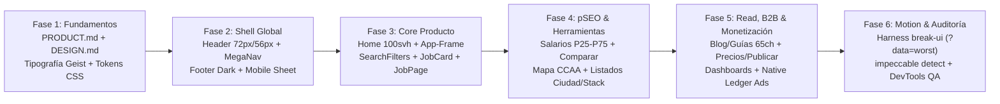

# Auditoría y Plan Maestro de Renovación Visual Completa — Frontend (`Portal Trabajo IT`)

- **Fecha:** 2026-11-20
- **Rol:** Argon Orchestrator — Director de Diseño y Arquitectura Frontend Senior
- **Estado:** Diseño y Arquitectura Completados (Pendiente de aprobación para iniciar Fase 1 — sin cambios en código de aplicación todavía)
- **Alcance:** 100% de las superficies visuales en `frontend/` (Next.js 15 App Router + Tailwind CSS v4)
- **Suites de diseño aplicadas:** `/aaaDiseño1` (Impeccable v4.9.1), `/aaaDiseño3` (Taste Skill 2.5.1) y `/aaaDiseño2` (Emil Kowalski Motion & `break-ui`)

---

## 1. Diagnóstico Anti-Referencia (Qué falla hoy y qué se descarta por completo)

El análisis del código actual en [globals.css](file:///home/raul/proyecto_empleo/frontend/app/globals.css#L1-L156), [layout.tsx](file:///home/raul/proyecto_empleo/frontend/app/layout.tsx#L1-L375), [page.tsx](file:///home/raul/proyecto_empleo/frontend/app/page.tsx#L351-L724) y las 95 rutas de `frontend/app/` revela una interfaz fragmentada en dos épocas incompatibles que incurren en los patrones de *"AI SaaS Slop"* prohibidos por las tres skills:

| Hallazgo Anti-Referencia | Evidencia en Código Actual | Regla Violada (`/aaaDiseño1`, `/aaaDiseño2`, `/aaaDiseño3`) | Qué se descarta al 100% |
| :--- | :--- | :--- | :--- |
| **1. Paleta Indigo/Violeta y gradientes de plantilla IA** | `--accent-primary: #4f46e5` en [globals.css](file:///home/raul/proyecto_empleo/frontend/app/globals.css#L28); `bg-gradient-to-br from-indigo-950 via-indigo-900 to-violet-900` en [salarios/[tecnologia]/page.tsx](file:///home/raul/proyecto_empleo/frontend/app/salarios/[tecnologia]/page.tsx#L298), [comparar/[slug]/page.tsx](file:///home/raul/proyecto_empleo/frontend/app/comparar/[slug]/page.tsx#L231), [blog/page.tsx](file:///home/raul/proyecto_empleo/frontend/app/blog/page.tsx#L76), [precios/page.tsx](file:///home/raul/proyecto_empleo/frontend/app/precios/page.tsx#L50) y [publicar-oferta/page.tsx](file:///home/raul/proyecto_empleo/frontend/app/publicar-oferta/page.tsx#L25). | **`/aaaDiseño3` (`system.md` §Colour & Regla 6):** Prohibido cualquier tono violeta/lavanda (hue OKLCH 270°–330°) en acentos, fondos, bordes o gradientes. **`/aaaDiseño1`:** Cliché #1 de interfaz generada sin dirección de arte. | **100% descartado:** Todo rastro de `indigo-*`, `violet-*`, `purple-*`, `#4f46e5`, `#6366f1`, orbes `blur-3xl` y textos con `bg-clip-text bg-gradient-to-r`. |
| **2. Tipografía genérica `Inter` y abuso de pesos `800/900`** | `Inter` cargada como única fuente de titulares y cuerpo en [layout.tsx](file:///home/raul/proyecto_empleo/frontend/app/layout.tsx#L12-L17); uso masivo de `font-black` (900) y `font-extrabold` (800) en [salarios/[tecnologia]/page.tsx](file:///home/raul/proyecto_empleo/frontend/app/salarios/[tecnologia]/page.tsx#L304) y [mapa-empleo/page.tsx](file:///home/raul/proyecto_empleo/frontend/app/mapa-empleo/page.tsx#L211). | **`/aaaDiseño1` (`new-work.md`):** `Inter` como display es un *training-data default*. **`/aaaDiseño3` (`layout-v4.md` §5):** Prohibido `Inter` y prohibidos los pesos `700`, `800` y `900` en titulares (la jerarquía en `tech/software` se logra con peso `500` y tracking cerrado `-0.035em` a `-0.045em`). | **100% descartado:** La fuente `Inter` y todas las clases `font-bold`, `font-extrabold` y `font-black` en titulares `h1`–`h3`. |
| **3. Hero de la Home como "banner decorativo" en lugar de tesis funcional** | En [page.tsx](file:///home/raul/proyecto_empleo/frontend/app/page.tsx#L351-L406), el Hero es una franja oscura centrada (`py-12 md:py-16`) con título genérico *"Portal Empleo IT"*, botón de Telegram, botón de Publicar Oferta y caja de notificaciones push, mientras el buscador queda empujado hacia abajo con `-mt-6` junto a un leaderboard publicitario. | **`/aaaDiseño1` (`new-work.md` §6):** *"The first viewport is a thesis, not a header. Prove, don't claim."* **`/aaaDiseño3` (Regla 3 & `sections.md`):** *"One section per screen: the hero alone on the first screen (`100svh`)"* mostrando el producto real en vivo (`app-frame`). | **100% descartado:** El hero centrado corto con solapamiento `-mt-6` y la mezcla de 4 acciones compitiendo en el primer pantallazo. |
| **4. Inflación de emojis decorativos y tarjetas anidadas (`>2 boxes deep`)** | Títulos con emojis (`📊 Ficha Salarial`, `📝 Análisis`, `💬 Preguntas Frecuentes`, `⚖️ Comparativa`, `🏆` en tablas, `🗺️ Geografía`) y cajas dentro de cajas dentro de cajas en [salarios/[tecnologia]/page.tsx](file:///home/raul/proyecto_empleo/frontend/app/salarios/[tecnologia]/page.tsx#L325-L374) y [comparar/[slug]/page.tsx](file:///home/raul/proyecto_empleo/frontend/app/comparar/[slug]/page.tsx#L255-L362). | **`/aaaDiseño3` (`sections.md` §1):** *"Two boxes deep at most"*. **`/aaaDiseño1` (`operate.md`):** La autoridad de datos se transmite con tipografía tabular y precisión estructural, nunca con emojis en cada `h2`/`h3`. | **100% descartado:** Todos los emojis en encabezados, badges y tablas, así como el triple anidamiento de contenedores y la mezcla de radios `rounded-xl` / `rounded-2xl` / `rounded-3xl`. |
| **5. Banners de afiliados "arcoíris" y texto sub-13px** | [AdBanner.tsx](file:///home/raul/proyecto_empleo/frontend/components/AdBanner.tsx#L90-L181) define 10 combinaciones de colores (`from-orange-50 to-rose-50`, `from-green-50 to-emerald-50`, etc.) y textos de `10px`; [StickyDesktopAd.tsx](file:///home/raul/proyecto_empleo/frontend/components/StickyDesktopAd.tsx#L67-L78) usa `text-[8px]` y botón de cierre `w-6 h-6` (`24×24px`). | **`/aaaDiseño3` (`system.md`):** *"Nothing under 13px"*, *"Every link and control outside running text 44px tall [tap-size]"*, *"The interface stays 90 to 95% neutral"*. | **100% descartado:** Los estilos multicolor de afiliados, cualquier tamaño de fuente `<13px` (`text-[8px]`, `text-[10px]`, `text-[11px]`) y cualquier control interactivo `<44×44px`. |
| **6. Navegación superior saturada y no-nativa en móvil** | [Header.tsx](file:///home/raul/proyecto_empleo/frontend/components/Header.tsx#L69-L78) apila 8 enlaces en la barra superior + racha + guardadas + perfil + CTA en `h-14` (`56px`), con botones móviles `w-8 h-8` (`32px`) y menú desplegable parcial sin `100dvh`. | **`/aaaDiseño3` (`system.md` §Nav):** 4 a 6 sustantivos de una palabra en el nav (`72px` desktop / `56px` móvil), opaco con hairline de `1px`, sheet móvil a pantalla completa (`56px` por fila) y targets de `44×44px`. | **100% descartado:** La barra translúcida con 8 enlaces sueltos, el logo con gradiente violeta y el menú móvil estrecho. |

---

## 2. Nuevo Mundo Visual y Design System (`PRODUCT.md`, `DESIGN.md` y Tokens CSS)

### 2.1. Concepto Estético y Dirección de Arte (`/aaaDiseño1` + `/aaaDiseño3`)

- **Creative North Star (`/aaaDiseño1`):** **"The Engineering Compensation & Career Ledger"** (*El Libro Mayor de Ingeniería y Transparencia Salarial*).
- **Escena física que dicta el color (`/aaaDiseño1` `new-work.md` §4):** Desarrolladores, SREs, arquitectos de software y Tech Leads en España consultando vacantes técnicas, comparando percentiles salariales brutos anuales (`P25 / P50 / P75`) y leyendo guías de arquitectura durante su jornada laboral en monitores de alta densidad o desde el móvil con luz diurna.
- **Por qué Light-First con Grado Nocturno Técnico Opcional:**
  - Un portal cuyo núcleo es la **transparencia salarial, tablas comparativas, lectura de descripciones técnicas y contenido editorial E-E-A-T** requiere la autoridad y legibilidad instantánea del papel técnico frío (**Light-First** por defecto, 92% neutro).
  - De acuerdo con `/aaaDiseño3` (`system.md` §Colour: *"The grade (light or evening) is chosen once on load or by a click, never by scrolling; the dark evening grade is tech only"*), el sistema ofrece un **Grado Nocturno Técnico (`dark`)** coherente para desarrolladores que tienen su SO en modo oscuro, **eliminando la anomalía actual** en la que páginas como `/precios` o `/publicar-oferta` forzaban fondos negros/púrpuras aislados.
- **Resultado del Deal de `/aaaDiseño3` (`start.mjs` / `palettes.json` / `type.json`):**
  - **Kind declaración:** `<html data-type="software" data-radius="sharp" data-buttons="solid" data-motion="true">` con `<meta name="page-type" content="software">` y `<meta name="site-kind" content="software">`.
  - **Paleta Primaria (Light Grade — `cool-grey-cobalt` de `palettes.json`):** Papel técnico gris frío (`#EEF0F3`) con paneles de superficie blancos puros (`#FFFFFF`) y piedra fría (`#E2E5EA`), tinta carbón profundo (`#0B0C0E`) para máxima nitidez tipográfica, gris pizarra (`#4E5562`, contraste `7.4:1`) para metadatos, y un **único acento de acción: Cobalt Blueprint (`#1F2DE6`)** (hue OKLCH `262°`, azul cobalto ingenieril puro, completamente fuera del espectro prohibido violeta/lavanda `270°–330°`).
  - **Paleta Secundaria (Evening Technical Grade — `blue-black-cornflower` de `palettes.json`):** Pizarra nocturna (`#0A0D14`), superficie (`#131824`), panel elevado (`#1A2130`), tinta plata (`#E9EDF3`), secundario (`#949EB0`, contraste `>5.5:1`) y acento **Cornflower Technical (`#5AB9FC`)** con texto `#0A0D14`.
  - **Semántica de Datos (`/aaaDiseño1` `mode-operate.md`):**
    - **Salario Verificado / Percentil Superior (`--status-emerald`):** Verde Pino Técnico `#0F7D45` (Light) / `#34D399` (Dark).
    - **Destacado / Patrocinado / Percentil Medio (`--status-amber`):** Ocre Bronce `#9A5B13` (Light) / `#F59E0B` (Dark) — sobrio y legible, nunca amarillo chillón.
    - **Urgente / Cierre / Error (`--status-danger`):** Carmín Señal `#C81E1E` (Light) / `#F87171` (Dark).
  - **Emparejamiento Tipográfico (`type.json` de `/aaaDiseño3` + filtro de `/aaaDiseño1`):**
    - **Display & UI Sans (`--font-display`, `--font-text`):** **`Geist`** (Google Fonts, pesos `400`, `500`, `600`). En titulares usa peso `500` (`--display-weight: 500`) y tracking cerrado (`-0.035em` en `h2`/`h3`, `-0.045em` en `h1`), logrando una voz técnica al nivel de Vercel/Linear/Figma sin recurrir a negritas pesadas (`700/800/900`).
    - **Datos, Salarios, Percentiles y Código (`--font-mono`):** **`Geist Mono`** (Google Fonts, pesos `400`, `500`) con `font-variant-numeric: tabular-nums` obligatorio en toda cifra salarial, conteo de vacantes, fecha relativa y tabla comparativa.
  - **Deal estructural (`/aaaDiseño3` `sections.md` §2):**
    - `nav`: `nav-split` con 1 desplegable plano `nav-mega` para `Recursos`
    - `footer`: `footer-dark`
    - `close`: `close-type`
    - `rhythm`: `dark-band` (una única banda inversa `#0B0C0E` en el tercio final de las páginas Persuade)
    - `buttons`: `solid` (`data-buttons="solid"`)
    - `mark`: `stack` (marca geométrica de 3 barras técnicas escalonadas en `#1F2DE6` y `#0B0C0E`)
    - `hero` (Home Persuade): `split` (`assets/layout/hero-split.html` con `app-frame` en vivo a la derecha y tarjeta flotante plana de métrica salarial en la esquina inferior izquierda)

---

### 2.2. Especificación de `frontend/PRODUCT.md` (Fase `init` de `/aaaDiseño1`)

Este archivo se creará en `frontend/PRODUCT.md` durante la Fase 1:

```markdown
# Product

<!-- impeccable:product-schema 1 -->

## Platform

web

## Users
- **Candidatos IT (Primario):** Desarrolladores de software (Frontend, Backend, Fullstack, Mobile), ingenieros de datos/IA, DevOps/SRE y especialistas en ciberseguridad en España y Latinoamérica que buscan empleo tecnológico verificado en España o 100% remoto.
- **Reclutadores Técnicos y Empresas (Secundario B2B):** Startups, consultoras y departamentos de ingeniería que publican vacantes, patrocinan ofertas destacadas y consultan métricas de impresiones/clics en su panel.

## Product Purpose
Agregador e infraestructura de inteligencia laboral tecnológica en España. Indexa, limpia, deduplica y clasifica automáticamente cada 6 horas ofertas de empleo IT, extrayendo stack tecnológico, modalidad (remoto/híbrido/presencial), nivel de experiencia y horquillas salariales para ofrecer búsqueda sin ruido y transparencia retributiva.

## Positioning
A diferencia de los portales generalistas (InfoJobs, LinkedIn) donde las ofertas tecnológicas se mezclan con roles no técnicos y carecen de contexto salarial, Portal Trabajo IT es 100% específico para ingeniería informática y cruza cada vacante en tiempo real con percentiles salariales (P25/P50/P75), comparativas entre stacks y distribución geográfica por comunidad autónoma.

## Operating Context
Consultado diariamente en sesiones rápidas de escaneo (desde escritorio con atajos de teclado `/` o desde móvil vía alertas de Telegram, newsletter y push web) y en sesiones profundas de investigación salarial antes de entrevistas o negociaciones de sueldo.

## Capabilities and Constraints
- **Stack Técnico:** Next.js 15 (App Router, React 19, Server Components + ISR), Tailwind CSS v4, PostgreSQL/MySQL (`pool`), Stripe Checkout para planes B2B/B2C.
- **Restricciones SEO Innegociables:** Mantener intactas todas las URLs canónicas, rutas programáticas pSEO (`/trabajos/[sector]`, `/trabajo-[ciudad]`, `/salarios/[tecnologia]/[ciudad]`, `/comparar/[slug]`), schemas JSON-LD (`JobPosting`, `Occupation`, `Dataset`, `FAQPage`, `BreadcrumbList`, `BlogPosting`), sitemaps XML y soporte multi-idioma (`es`, `en`, `ca`, `eu`).
- **Cumplimiento Legal (RGPD / AEPD / LSSI / TRLGDCU):** Google Consent Mode v2 denegado por defecto; carga diferida de AdSense/GA4/OneSignal condicionada al consentimiento; avisos de primera capa RGPD y transparencia retributiva (Directiva UE 2023/970).

## Brand Commitments
- **Nombre:** Portal Trabajo IT.
- **Voz (`copy-voice.md`):** `technical-dry` — exacta, directa, basada en datos reales de la base de datos, sin hipérboles corporativas, sin emojis decorativos en titulares y con admisión honesta cuando una oferta no publica salario ("Consultar con la empresa").

## Evidence on Hand
- Base de datos en tiempo real de vacantes activas (`jobs`), empresas (`companies`), reseñas (`company_reviews`) y suscriptores (`subscribers`).
- Estadísticas calculadas en vivo: conteo total de vacantes, distribución por CCAA, percentiles salariales P10–P90 por tecnología y ciudad, tasa de teletrabajo y artículos editoriales en `lib/blog.ts`.

## Product Principles
1. **El salario y el stack mandan:** En toda tarjeta o vista de oferta, las tecnologías detectadas, la modalidad y la banda salarial (o su percentil de mercado) tienen prioridad visual absoluta.
2. **Velocidad de herramienta para desarrolladores:** Los flujos de búsqueda, filtrado y navegación por teclado responden al instante (0ms de animación en acciones repetitivas).
3. **Monetización honesta e integrada:** Los anuncios y recomendaciones formativas comparten la cuadrícula y la sobriedad tipográfica del portal, etiquetados siempre con precisión (`Patrocinado`) y con reserva de espacio estático (`CLS = 0`).
4. **Resiliencia ante datos sucios del mundo real:** Títulos importados de 140 caracteres, ubicaciones múltiples, empresas sin logo o salarios nulos nunca rompen la retícula.

## Accessibility & Inclusion
WCAG 2.1 AA como suelo obligatorio (contraste ≥ 7:1 en texto de lectura y ≥ 4.5:1 en metadatos `--text-muted`, navegación completa por teclado con `:focus-visible` inmediato de 2px, objetivos táctiles ≥ 44×44px, soporte `prefers-reduced-motion: reduce`).
```

---

### 2.3. Especificación de `frontend/DESIGN.md` (Formato Oficial Stitch + `/aaaDiseño1` + `/aaaDiseño3`)

Este archivo se creará en `frontend/DESIGN.md` (junto a su sidecar `frontend/.impeccable/design.json`):

```markdown
---
name: Portal Trabajo IT
description: The Engineering Compensation & Career Ledger — precision technical typography, cool stone paper, and cobalt blueprint accents.
colors:
  cobalt-blueprint: "#1f2de6"
  cobalt-hover: "#1722b8"
  cobalt-tint: "#e6e8fc"
  cool-paper: "#eef0f3"
  stone-subtle: "#e2e5ea"
  pure-surface: "#ffffff"
  carbon-ink: "#0b0c0e"
  slate-secondary: "#383e4a"
  slate-muted: "#555c69"
  pine-salary: "#0f7d45"
  pine-tint: "#e3f3ea"
  ochre-featured: "#9a5b13"
  ochre-tint: "#f9efe2"
  signal-crimson: "#c81e1e"
  signal-tint: "#fbe9e9"
  night-canvas: "#0a0d14"
  night-surface: "#131824"
  night-elevated: "#1a2130"
  silver-ink: "#e9edf3"
  cornflower-accent: "#5ab9fc"
typography:
  display:
    fontFamily: "Geist, system-ui, sans-serif"
    fontSize: "4.5rem"
    fontWeight: 500
    lineHeight: 1.02
    letterSpacing: "-0.045em"
  headline:
    fontFamily: "Geist, system-ui, sans-serif"
    fontSize: "3rem"
    fontWeight: 500
    lineHeight: 1.08
    letterSpacing: "-0.035em"
  title:
    fontFamily: "Geist, system-ui, sans-serif"
    fontSize: "1.25rem"
    fontWeight: 500
    lineHeight: 1.35
    letterSpacing: "-0.02em"
  body:
    fontFamily: "Geist, system-ui, sans-serif"
    fontSize: "1rem"
    fontWeight: 400
    lineHeight: 1.625
    letterSpacing: "0em"
  label:
    fontFamily: "Geist Mono, ui-monospace, monospace"
    fontSize: "0.8125rem"
    fontWeight: 500
    lineHeight: 1.25
    letterSpacing: "0em"
rounded:
  sm: "4px"
  md: "6px"
  lg: "8px"
spacing:
  xs: "4px"
  sm: "8px"
  md: "16px"
  lg: "24px"
  xl: "48px"
  2xl: "72px"
  3xl: "120px"
components:
  button-primary:
    backgroundColor: "{colors.cobalt-blueprint}"
    textColor: "{colors.pure-surface}"
    rounded: "{rounded.md}"
    height: "44px"
    padding: "0 24px"
  button-primary-hover:
    backgroundColor: "{colors.cobalt-hover}"
  button-secondary:
    backgroundColor: "{colors.pure-surface}"
    textColor: "{colors.carbon-ink}"
    rounded: "{rounded.md}"
    height: "44px"
    padding: "0 24px"
  card-ledger:
    backgroundColor: "{colors.pure-surface}"
    textColor: "{colors.carbon-ink}"
    rounded: "{rounded.lg}"
    padding: "20px 24px"
---

# Design System: Portal Trabajo IT

## Overview

**Creative North Star: "The Engineering Compensation & Career Ledger"**

Portal Trabajo IT replaces the generic indigo/violet SaaS template look with the authority of a precision technical publication and real-time compensation ledger. Every screen is built on cool architectural paper (`#eef0f3`) and crisp white data sheets (`#ffffff`), structured by 1px hairline rules (`rgba(11, 12, 14, 0.12)`) and tabular monospace figures.

On **Persuade** surfaces (Home, Employer & Pricing landings), the layout follows strict one-section-per-screen discipline (`100svh` / `--h: 1` or `2`), opening with a live interactive `app-frame` of the job and salary engine rather than marketing decoration. On **Operate** surfaces (Job Search, Salary Calculators, Comparisons, Recruiter Dashboards), the world lends its typography, high-contrast neutral palette, compact density, and one signature visual move: the **Salary Percentile Ledger Bar** (`P25 · P50 · P75`). On **Read** surfaces (Career Guides, Blog, Market Reports, Glossary), the world owns the masthead and wayfinding rail while keeping the 65ch reading column calm and distraction-free.

**Key Characteristics:**
- **92% Neutral Architectural Canvas:** Cool paper grounds, white ledger sheets, and near-black carbon ink (`#0b0c0e`) let real company icons, salary badges, and data distributions carry the visual signal.
- **Zero Violet/Lavender:** The entire 270°–330° OKLCH hue range is permanently banned. Cobalt Blueprint (`#1f2de6`) is the sole action accent.
- **Size & Tracking over Boldness:** Headlines never use weights 700, 800, or 900. Weight 500 with tight negative tracking (`-0.035em` to `-0.045em`) creates sharp editorial authority.
- **Tabular Monospace Data:** Every salary, count, percentile, date, and technology tag is set in `Geist Mono` with `tabular-nums`.

## Colors

A high-contrast, light-first technical paper palette with an optional evening slate grade (`dark`) for night reading.

### Primary
- **Cobalt Blueprint** (`#1f2de6` light / `#5ab9fc` dark): Reserved exclusively for the primary action button, active navigation indicators, `:focus-visible` rings, and one inverted closing band.

### Secondary
- **Pine Salary** (`#0f7d45` light / `#34d399` dark): Semantic indicator for verified salary ranges, positive compensation deltas, and active status dots.
- **Ochre Featured** (`#9a5b13` light / `#f59e0b` dark): Semantic indicator for featured vacancies (`3px` left ledger bar) and sponsored educational resources.
- **Signal Crimson** (`#c81e1e` light / `#f87171` dark): Urgent hiring tags, destructive actions, and inline form validation errors.

### Neutral
- **Cool Paper** (`#eef0f3` light / `#0a0d14` dark): Main page ground (`--bg-canvas`).
- **Stone Subtle** (`#e2e5ea` light / `#1a2130` dark): Secondary ground for filter rails, code blocks, and table headers (`--bg-subtle`).
- **Pure Surface** (`#ffffff` light / `#131824` dark): Primary card, table, and `app-frame` surface (`--bg-surface`).
- **Carbon Ink** (`#0b0c0e` light / `#e9edf3` dark): Primary text and structural icons (`>15:1` contrast).
- **Slate Secondary** (`#383e4a` light / `#b4bece` dark): Body copy, snippets, and secondary cells (`>9:1` contrast).
- **Slate Muted** (`#555c69` light / `#8b95a7` dark): Timestamps, breadcrumbs, and helper labels (`≥5.2:1` contrast, passing WCAG AA at 13px).

### Named Rules
**The One Accent Rule.** Cobalt Blueprint (`#1f2de6`) occupies under 3% of any viewport outside an intentional inverted brand band. Never tint card backgrounds or section gradients with the accent color.
**The No-Violet Rule.** Any color token or Tailwind utility in the `indigo`, `violet`, or `purple` families is a build-blocking defect.

## Typography

**Display Font:** Geist (with `system-ui, -apple-system, sans-serif` fallback)
**Body Font:** Geist (with `system-ui, -apple-system, sans-serif` fallback)
**Label/Mono Font:** Geist Mono (with `ui-monospace, SFMono-Regular, Menlo, monospace` fallback)

**Character:** Engineered, open, and unpretentious. `Geist` delivers crisp geometric legibility at 16px while looking architectural at 72px when set at weight 500 with tight tracking; `Geist Mono` turns salary tables and stack tags into scannable technical specifications.

### Hierarchy
- **Display** (`500`, `4.5rem / 72px` desktop · `2.375rem / 38px` mobile, `1.02` line-height, `-0.045em` tracking): Persuade hero `h1` only (max 3 lines, 45 characters).
- **Headline** (`500`, `3rem / 48px` desktop · `1.875rem / 30px` mobile, `1.08` line-height, `-0.035em` tracking): Persuade section `h2` and primary Read/Operate page `h1`.
- **Subheadline / H3** (`500`, `1.75rem / 28px` desktop · `1.375rem / 22px` mobile, `1.2` line-height, `-0.025em` tracking): Section subdivisions and major data card headers.
- **Title / Card Lead** (`500`, `1.125rem / 18px` to `1.25rem / 20px`, `1.35` line-height, `-0.015em` tracking): Job card titles, article titles, and lead paragraphs.
- **Body** (`400`, `1rem / 16px`, `1.625` line-height, max `62ch`–`68ch` measure): All readable descriptions, editorial prose, FAQ answers, and form inputs.
- **Small Meta** (`400`, `0.875rem / 14px`, `1.45` line-height): Company location line, table cells, and form labels.
- **Label / Mono** (`500`, `0.8125rem / 13px`, `1.25` line-height, `tabular-nums`, sentence case): Technology tags, salary pills, timestamps, and table column headers.

### Named Rules
**The 13px Floor Rule.** No text anywhere in the DOM—including legal notices, ad labels, badges, or keyboard shortcuts—may render below `13px` (`0.8125rem`).
**The Sentence Case & Weight 500 Rule.** Headings and labels use sentence case (except proper acronyms like `AWS`, `SQL`, `IT`, `RGPD`). Weights `700`, `800`, and `900` are banned on headings.

## Layout

- **Container (`.wrap`):** `width: min(100% - 2 * var(--gut), 1280px)` where `--gut` is `80px` on desktop (`≥1024px`), `48px` on tablet (`640px–1023px`), and `24px` on mobile (`<640px`). Equal left and right content edges on every section.
- **12-Column Grid (`.grid-12`):** 12 columns with a `24px` gap on desktop/tablet and `12px` gap on mobile.
- **Two Text Lines:** Every page establishes two vertical text alignments: the left `.wrap` line and the split line (column 6 start on 5/7 splits, or column 7 start on 6/6 splits). Centered text blocks wider than 6 columns are forbidden.
- **Mode-Specific Section Rhythm:**
  - **Persuade Surfaces:** Strict one-section-per-screen (`height: calc(var(--h, 1) * 100svh)` on desktop, growing naturally on mobile if stacked content exceeds 1 screen). Top padding `--padt: 120px` (`96px` mobile), bottom padding `--padb: 72px` (`48px` mobile).
  - **Operate & Read Surfaces:** Task-driven continuous vertical flow with `24px` grid gaps, sticky filter/TOC rails (`top: 88px`), and `48px` section breaks parted by full-width ground shifts (`--bg-canvas` to `--bg-surface`) or `1px` hairlines.

## Elevation & Depth

Surfaces are **flat by default**, separated by tonal ground steps (`#eef0f3` → `#ffffff` → `#e2e5ea`) and crisp `1px` borders (`rgba(11, 12, 14, 0.12)`). Decorative drop shadows, colored glows, and blurred glass panels are excluded.

### Shadow Vocabulary
- **Rest (`--shadow-none`):** `none`. All cards, tables, and inputs sit flat at rest with a `1px` border.
- **Interactive Lift (`--shadow-lift`):** `0 4px 12px -2px rgba(11, 12, 14, 0.08), 0 1px 2px 0 rgba(11, 12, 14, 0.04)`. Applied only on `@media (hover: hover) and (pointer: fine)` when a linked card lifts `translateY(-2px)`.
- **Overlay / Popover (`--shadow-overlay`):** `0 12px 32px -4px rgba(11, 12, 14, 0.16), 0 2px 6px -1px rgba(11, 12, 14, 0.08)`. Applied only to floating autocomplete menus, user profile popovers, and command menus.

### Named Rules
**The Two-Box Depth Rule.** Never nest more than two bordered containers deep (e.g., a section card holding an inner metric box). If a card holds an inner UI panel, the inner panel runs flush or drops its border.

## Shapes

Sharp technical geometry (`data-radius="sharp"`):
- **Small Controls & Badges (`--r-sm`):** `4px` (technology chips, salary badges, keyboard `<kbd>` hints).
- **Buttons, Inputs & Popovers (`--r-md`, `--r-btn`):** `6px` (all `44px` buttons and `48px` form fields).
- **Cards, Tables & App Frames (`--r-lg`):** `8px` (`JobCard`, `app-frame`, data tables, drawers).
- **Full Pills:** Banned on buttons and cards; allowed only on `6px` status indicator dots (`border-radius: 9999px`).

## Components

### Buttons
One button pair across the entire portal, minimum `44px` height (`48px` in mobile action bars and forms), `16px` label at weight `500`, `24px` horizontal padding, verb + object copy ("Explorar vacantes", "Publicar oferta", "Calcular percentil").
- **Primary (`.btn-primary`):** Solid Cobalt Blueprint (`#1f2de6`) background, `#ffffff` text, `6px` radius. Hover steps to `#1722b8`; `:active` scales to `scale(0.97)` in `120ms var(--ease-out)`.
- **Secondary (`.btn-secondary`):** `#ffffff` background (`#131824` dark), `1px solid var(--border-strong)`, `#0b0c0e` text. Hover shifts background to `--bg-subtle` (`#e2e5ea`).
- **Text Link (`.link-arrow`):** `#0b0c0e` or `#1f2de6` text at weight `500` with a `1px` underline that draws from left to right on hover and an inline `→` glyph.

### Chips & Badges
- **Technology Chip:** `Geist Mono` `13px/500`, `4px` radius, `1px solid var(--border-subtle)`, `--bg-subtle` fill, `min-height: 28px` inside cards (`44px` tap target when standalone in filter bars).
- **Salary Badge:** `Geist Mono` `13px/500`, `tabular-nums`, `4px` radius. When salary is known: `--status-emerald-tint` (`#e3f3ea`) background, `#0f7d45` text, `1px solid rgba(15, 125, 69, 0.28)`. When unknown ("Consultar"): `--bg-subtle` background, `--text-muted` text.

### Cards / Containers (`JobCard` & Ledger Rows)
- **Corner Style:** `8px` (`--r-lg`).
- **Background:** `--bg-surface` (`#ffffff` light / `#131824` dark).
- **Border:** `1px solid var(--border-subtle)`, shifting to `--border-strong` on hover with `translateY(-2px)` (gated by `@media (hover: hover) and (pointer: fine)`).
- **Featured / Sponsored Variant:** Adds a `3px` solid left border bar in `--status-amber` (`#9a5b13`) and a `13px` `Geist Mono` label `Destacada` or `Patrocinado · [Proveedor]`.

### Inputs / Fields
- **Style:** `48px` height, `6px` radius, `1px solid var(--border-strong)`, `--bg-surface` background, `16px` font size (prevents iOS auto-zoom).
- **Labels:** Visible `<label>` above every field at `14px/500` in `--text-primary`. Placeholders never replace labels.
- **Focus:** Instant `2px` outline in `--accent-primary` (`#1f2de6`) with `offset: 1px`; never animated.
- **Error:** Checked on submit; `1px solid var(--status-danger)` with `.field-error` message at `13px` directly beneath the field via `aria-describedby`.

### Navigation (`header.nav`)
- **Fixed Top Bar:** `position: fixed`, `height: 72px` desktop (`56px` mobile), opaque `--bg-surface` ground (no glass blur), `1px solid var(--border-subtle)` bottom hairline from first paint.
- **Items:** Logo mark + wordmark on the left `.wrap` line; 5 one-word nouns (`Empleos`, `Remoto`, `Salarios`, `Empresas`, `Recursos`) in the center at `15px/500`; account trigger + 1 primary button (`Publicar oferta`, `44px`) on the right `.wrap` line.
- **Mobile (`<640px`):** `44×44px` menu toggle opens a full-screen `100dvh` sheet with `56px` rows. Fixed bottom `nav.actionbar` (`64px + env(safe-area-inset-bottom)`) appears on Job Detail and Persuade pages once the hero CTA scrolls out of view.

### Signature Component: Salary Percentile Ledger Bar
Used across `salarios/`, `comparar/`, `job/[id]`, and `app-frame` previews. A flat `8px`-tall horizontal track in `--bg-subtle` showing the `P25` to `P75` interquartile band filled in `--status-emerald` (`#0f7d45`), a `2px` vertical carbon marker at the `P50` median (or the specific job's offered salary), and `Geist Mono` `13px` tabular figures aligned below the `Min`, `P25`, `Mediana`, `P75`, and `Max` ticks.

## Do's and Don'ts

### Do:
- **Do** use `Geist Mono` with `font-variant-numeric: tabular-nums` for every number, salary, percentage, date, and count.
- **Do** keep every interactive control at a minimum `44×44px` hit area (`48px` height on form inputs) and `16px` input font size.
- **Do** gate all `:hover` transforms and style shifts behind `@media (hover: hover) and (pointer: fine)`.
- **Do** render all monetization units (`AdBanner`, `AffiliateCourseCard`, `AmazonBooksWidget`) using the unified neutral ledger card with a `2px` ochre left rule and explicit `min-height` reservation.

### Don't:
- **Don't** use `indigo`, `violet`, or `purple` hues anywhere in CSS variables, Tailwind classes, or SVG illustrations.
- **Don't** place emojis (`📊`, `🚀`, `🔥`, `💼`, `🏆`, `⚖️`) inside headings, badges, table cells, or button labels.
- **Don't** animate keyboard-triggered actions (`/` search focus, autocomplete lists, instant filter toggles) or use scroll-triggered fade-ins (`whileInView`) on cards and rows.
- **Don't** nest bordered boxes more than 2 levels deep or render any text smaller than `13px`.
```

---

### 2.4. Tokens CSS Propuestos para `frontend/app/globals.css`

Reemplazo completo y limpio para [globals.css](file:///home/raul/proyecto_empleo/frontend/app/globals.css) (manteniendo compatibilidad de nombres de variables con los componentes existentes durante la migración por fases):

```css
@import "tailwindcss";

@variant dark (.dark &);

:root {
  /* Rhythm & Layout Tokens (/aaaDiseño3 system.md) */
  --nav: 72px;
  --padt: 120px;
  --padb: 72px;
  --gut: 80px;
  --hgap: 48px;
  --hpadb: 64px;
  --bar: 0px;

  /* Radius Scale (data-radius="sharp") */
  --r-sm: 4px;
  --r-md: 6px;
  --r-lg: 8px;
  --r-btn: 6px;

  /* Spacing Scale */
  --s-1: 4px;
  --s-2: 8px;
  --s-3: 12px;
  --s-4: 16px;
  --s-5: 24px;
  --s-6: 32px;
  --s-7: 48px;
  --s-8: 64px;
  --s-9: 96px;
  --s-10: 128px;

  /* Palette: Cool Grey & Cobalt Blueprint (Light-First Default) */
  --p-bg: #eef0f3;
  --p-surface: #ffffff;
  --p-subtle: #e2e5ea;
  --p-ink: #0b0c0e;
  --p-secondary: #383e4a;
  --p-muted: #555c69;
  --p-accent: #1f2de6;
  --p-accent-hover: #1722b8;
  --p-accent-ink: #ffffff;
  --p-action: #1f2de6;
  --p-action-ink: #ffffff;

  /* Inverse Band (dark-band rhythm & footer-dark) */
  --p-inv-bg: #0b0c0e;
  --p-inv-surface: #15181e;
  --p-inv-ink: #eef0f3;
  --p-inv-muted: #949eb0;
  --p-inv-accent: #5ab9fc;
  --p-inv-accent-ink: #0b0c0e;

  /* Semantic Aliases for App Components */
  --background: var(--p-bg);
  --foreground: var(--p-ink);
  --bg-canvas: var(--p-bg);
  --bg-subtle: var(--p-subtle);
  --bg-surface: var(--p-surface);
  --bg-elevated: #ffffff;
  --bg-inverse: var(--p-inv-bg);

  /* Hairline Borders (12% to 22% of Carbon Ink) */
  --border-subtle: rgba(11, 12, 14, 0.12);
  --border-strong: rgba(11, 12, 14, 0.24);
  --border-accent: rgba(31, 45, 230, 0.35);
  --border-featured: rgba(154, 91, 19, 0.38);

  /* Typography Hierarchy */
  --text-primary: var(--p-ink);
  --text-secondary: var(--p-secondary);
  --text-muted: var(--p-muted);
  --display-weight: 500;
  --display-tracking: -0.035em;
  --display-tracking-xl: -0.045em;

  /* Type Scale (/aaaDiseño3 layout-v4.md) */
  --t-h1: clamp(2.375rem, 3.8vw + 1rem, 4.5rem);
  --t-h2: clamp(1.875rem, 2.2vw + 1rem, 3rem);
  --t-h3: clamp(1.375rem, 1.1vw + 1rem, 1.75rem);
  --t-lead: clamp(1.125rem, 0.3vw + 1rem, 1.25rem);
  --t-card: 1.125rem;
  --t-body: 1rem;
  --t-small: 0.875rem;
  --t-label: 0.8125rem;
  --t-stat: clamp(1.75rem, 1.5vw + 1rem, 2.375rem);

  /* Semantic Status & Compensation Tokens */
  --accent-primary: var(--p-accent);
  --accent-hover: var(--p-accent-hover);
  --accent-tint: #e6e8fc;
  --status-emerald: #0f7d45;
  --status-emerald-tint: #e3f3ea;
  --status-amber: #9a5b13;
  --status-amber-tint: #f9efe2;
  --status-danger: #c81e1e;
  --status-danger-tint: #fbe9e9;

  /* Flat-By-Default Elevation */
  --shadow-card: none;
  --shadow-card-hover: 0 4px 12px -2px rgba(11, 12, 14, 0.08), 0 1px 2px 0 rgba(11, 12, 14, 0.04);
  --shadow-overlay: 0 12px 32px -4px rgba(11, 12, 14, 0.16), 0 2px 6px -1px rgba(11, 12, 14, 0.08);

  /* Emil Kowalski Motion Tokens (/aaaDiseño2) */
  --ease-out: cubic-bezier(0.23, 1, 0.32, 1);
  --ease-spring: cubic-bezier(0.16, 1, 0.3, 1);
  --ease-in-out: cubic-bezier(0.77, 0, 0.175, 1);
  --ease-drawer: cubic-bezier(0.32, 0.72, 0, 1);
}

@media (max-width: 1023px) {
  :root {
    --gut: 48px;
  }
}

@media (max-width: 639px) {
  :root {
    --nav: 56px;
    --padt: 96px;
    --padb: 48px;
    --gut: 24px;
    --hgap: 40px;
    --hpadb: 24px;
  }
}

.dark {
  /* Evening Technical Grade: Blue-Black & Cornflower */
  --p-bg: #0a0d14;
  --p-surface: #131824;
  --p-subtle: #1a2130;
  --p-ink: #e9edf3;
  --p-secondary: #b4bece;
  --p-muted: #8b95a7;
  --p-accent: #5ab9fc;
  --p-accent-hover: #7cc8fd;
  --p-accent-ink: #0a0d14;
  --p-action: #5ab9fc;
  --p-action-ink: #0a0d14;

  --background: var(--p-bg);
  --foreground: var(--p-ink);
  --bg-canvas: var(--p-bg);
  --bg-subtle: var(--p-subtle);
  --bg-surface: var(--p-surface);
  --bg-elevated: #1e2638;

  --border-subtle: rgba(233, 237, 243, 0.11);
  --border-strong: rgba(233, 237, 243, 0.24);
  --border-accent: rgba(90, 185, 252, 0.4);
  --border-featured: rgba(245, 158, 11, 0.4);

  --accent-primary: var(--p-accent);
  --accent-hover: var(--p-accent-hover);
  --accent-tint: rgba(90, 185, 252, 0.14);
  --status-emerald: #34d399;
  --status-emerald-tint: rgba(52, 211, 153, 0.14);
  --status-amber: #f59e0b;
  --status-amber-tint: rgba(245, 158, 11, 0.14);
  --status-danger: #f87171;
  --status-danger-tint: rgba(248, 113, 113, 0.14);

  --shadow-card: none;
  --shadow-card-hover: 0 8px 20px -4px rgba(0, 0, 0, 0.5);
  --shadow-overlay: 0 16px 36px -4px rgba(0, 0, 0, 0.65);
}

/* Mobile-Native Platform Baseline (/aaaDiseño2 mobile-native) */
html {
  box-sizing: border-box;
  -webkit-tap-highlight-color: transparent;
  -webkit-text-size-adjust: 100%;
  scroll-padding-top: var(--nav);
}

*, *::before, *::after {
  box-sizing: inherit;
}

body {
  margin: 0;
  background: var(--bg-canvas);
  color: var(--text-primary);
  font-family: var(--font-geist-sans), system-ui, sans-serif;
  font-size: var(--t-body);
  line-height: 1.625;
}

input, textarea, select {
  font-size: 16px;
}

button, a, [role="button"] {
  touch-action: manipulation;
}

button, [role="button"], .chip, .tab {
  user-select: none;
  -webkit-user-select: none;
  -webkit-touch-callout: none;
}

@theme inline {
  --font-sans: var(--font-geist-sans), ui-sans-serif, system-ui, sans-serif;
  --font-mono: var(--font-geist-mono), ui-monospace, SFMono-Regular, Menlo, Monaco, Consolas, monospace;

  --color-background: var(--background);
  --color-foreground: var(--foreground);
  --color-canvas: var(--bg-canvas);
  --color-subtle: var(--bg-subtle);
  --color-surface: var(--bg-surface);
  --color-elevated: var(--bg-elevated);
  --color-inverse: var(--bg-inverse);
  --color-accent: var(--accent-primary);
  --color-accent-hover: var(--accent-hover);

  --radius-sm: var(--r-sm);
  --radius-md: var(--r-md);
  --radius-lg: var(--r-lg);
}

/* Equal Edges Container, Grid & Reading Measure */
.wrap {
  width: min(100% - 2 * var(--gut), 1280px);
  margin-inline: auto;
}

.grid-12 {
  display: grid;
  grid-template-columns: repeat(12, minmax(0, 1fr));
  gap: 24px;
}

@media (max-width: 639px) {
  .grid-12 {
    grid-template-columns: minmax(0, 1fr);
    gap: 12px;
  }
}

.measure {
  max-width: 65ch;
}

/* Accessibility Focus Ring & Skip Link (/aaaDiseño3 system.md) */
:focus-visible {
  outline: 2px solid var(--accent-primary);
  outline-offset: 2px;
}

.skip-link {
  position: absolute;
  left: -9999px;
  top: 12px;
  z-index: 60;
  display: inline-flex;
  align-items: center;
  min-height: 44px;
  padding: 0 16px;
  border-radius: var(--r-btn);
  background: var(--bg-surface);
  color: var(--text-primary);
  border: 2px solid var(--accent-primary);
  font-size: 14px;
  font-weight: 500;
  text-decoration: none;
}

.skip-link:focus {
  left: var(--gut);
}

/* Unified Button Pair (min-height 44px, weight 500, solid cobalt / outlined secondary) */
.btn-primary,
.btn-secondary {
  display: inline-flex;
  align-items: center;
  justify-content: center;
  gap: 8px;
  min-height: 44px;
  padding: 0 24px;
  border-radius: var(--r-btn);
  font-size: 16px;
  font-weight: 500;
  line-height: 1.25;
  cursor: pointer;
  transition: transform 120ms var(--ease-out), background-color 140ms ease, border-color 140ms ease, color 140ms ease;
}

.btn-primary {
  background-color: var(--p-action);
  color: var(--p-action-ink);
  border: 1px solid transparent;
}

.btn-secondary {
  background-color: var(--bg-surface);
  color: var(--text-primary);
  border: 1px solid var(--border-strong);
}

.btn-primary:active,
.btn-secondary:active,
.ui-btn-press:active {
  transform: scale(0.97);
}

.ui-btn-press {
  transition: transform 120ms var(--ease-out), background-color 140ms ease, border-color 140ms ease, color 140ms ease;
}

/* Directional Link Underline */
.link-arrow {
  position: relative;
  display: inline-flex;
  align-items: center;
  gap: 6px;
  font-weight: 500;
  color: var(--text-primary);
  text-decoration: none;
}

.link-arrow::after {
  content: "";
  position: absolute;
  left: 0;
  right: 0;
  bottom: -2px;
  height: 1px;
  background-color: currentColor;
  transform: scaleX(0);
  transform-origin: left;
  transition: transform 180ms var(--ease-out);
}

/* Flat-By-Default Ledger Card (compatibilidad con .ui-card) */
.ledger-card,
.ui-card {
  background-color: var(--bg-surface);
  border: 1px solid var(--border-subtle);
  border-radius: var(--r-lg);
  box-shadow: var(--shadow-card);
  transition: transform 180ms var(--ease-out), border-color 180ms var(--ease-out), box-shadow 180ms var(--ease-out), background-color 180ms var(--ease-out);
}

/* Hover Gating: Solo puntero fino con capacidad hover (/aaaDiseño2 mobile-native) */
@media (hover: hover) and (pointer: fine) {
  .btn-primary:hover {
    background-color: var(--accent-hover);
  }
  .btn-secondary:hover {
    background-color: var(--bg-subtle);
    border-color: var(--text-primary);
  }
  .link-arrow:hover {
    color: var(--accent-primary);
  }
  .link-arrow:hover::after {
    transform: scaleX(1);
  }
  .ledger-card-interactive:hover,
  .ui-card-interactive:hover {
    transform: translateY(-2px);
    border-color: var(--border-strong);
    box-shadow: var(--shadow-card-hover);
  }
}

/* Persuade Hero One-Shot Entrance (/aaaDiseño3 + /aaaDiseño2 choreograph) */
@keyframes hero-enter-rise {
  from {
    opacity: 0;
    transform: translateY(10px);
  }
  to {
    opacity: 1;
    transform: translateY(0);
  }
}

[data-motion="true"] [data-enter="lead"] {
  animation: hero-enter-rise 450ms var(--ease-out) both;
}

[data-motion="true"] [data-enter="support"] {
  animation: hero-enter-rise 400ms var(--ease-out) 70ms both;
}

@media (prefers-reduced-motion: reduce) {
  .btn-primary,
  .btn-secondary,
  .ui-btn-press,
  .ledger-card,
  .ui-card,
  .link-arrow::after {
    transition-duration: 0ms !important;
  }
  .btn-primary:active,
  .btn-secondary:active,
  .ui-btn-press:active,
  .ledger-card-interactive:hover,
  .ui-card-interactive:hover {
    transform: none !important;
  }
  [data-motion="true"] [data-enter="lead"],
  [data-motion="true"] [data-enter="support"] {
    animation: none !important;
    opacity: 1 !important;
    transform: none !important;
  }
}
```

---

### 2.5. Especificación de `frontend/.impeccable/config.json` y `frontend/.impeccable/design.json` (Sidecar `schemaVersion: 2`)

Para que `/aaaDiseño1` y herramientas compatibles con el estándar `DESIGN.md` dispongan del registro completo de rampas tonales, tokens de movimiento, breakpoints y snippets autocontenidos `ds-*`, se crearán estos dos archivos en Fase 1:

#### `frontend/.impeccable/config.json`
```json
{
  "buildPath": "code",
  "platform": "web"
}
```

#### `frontend/.impeccable/design.json`
```json
{
  "schemaVersion": 2,
  "generatedAt": "2026-11-20T21:30:00Z",
  "title": "Design System: Portal Trabajo IT",
  "extensions": {
    "colorMeta": {
      "cobalt-blueprint": {
        "role": "primary",
        "displayName": "Cobalt Blueprint",
        "canonical": "oklch(48% 0.24 264)",
        "tonalRamp": ["#0b1047", "#111973", "#1722b8", "#1f2de6", "#4d59ec", "#858ef3", "#c3c7fa", "#e6e8fc"]
      },
      "cool-paper": {
        "role": "neutral",
        "displayName": "Cool Paper",
        "canonical": "oklch(95% 0.004 240)",
        "tonalRamp": ["#202328", "#383e4a", "#555c69", "#8b95a7", "#c1c7d0", "#e2e5ea", "#eef0f3", "#ffffff"]
      },
      "carbon-ink": {
        "role": "neutral",
        "displayName": "Carbon Ink",
        "canonical": "oklch(16% 0.005 240)",
        "tonalRamp": ["#0b0c0e", "#15181e", "#262b34", "#383e4a", "#555c69", "#7b8391", "#b4bece", "#e9edf3"]
      },
      "pine-salary": {
        "role": "secondary",
        "displayName": "Pine Salary",
        "canonical": "oklch(50% 0.14 155)",
        "tonalRamp": ["#06331c", "#0a5730", "#0f7d45", "#189d5a", "#34d399", "#6ee7b7", "#a7f3d0", "#e3f3ea"]
      },
      "ochre-featured": {
        "role": "secondary",
        "displayName": "Ochre Featured",
        "canonical": "oklch(52% 0.12 65)",
        "tonalRamp": ["#422405", "#6e3f0b", "#9a5b13", "#c9791c", "#f59e0b", "#fbbf24", "#fde68a", "#f9efe2"]
      },
      "signal-crimson": {
        "role": "secondary",
        "displayName": "Signal Crimson",
        "canonical": "oklch(48% 0.19 25)",
        "tonalRamp": ["#540b0b", "#8f1313", "#c81e1e", "#e03b3b", "#f87171", "#fca5a5", "#fecaca", "#fbe9e9"]
      },
      "night-canvas": {
        "role": "neutral",
        "displayName": "Night Canvas",
        "canonical": "oklch(16% 0.015 255)",
        "tonalRamp": ["#05070a", "#0a0d14", "#131824", "#1a2130", "#252f45", "#3b4966", "#8b95a7", "#e9edf3"]
      }
    },
    "typographyMeta": {
      "display": { "displayName": "Display", "purpose": "Persuade hero headlines only (max 3 lines, 45ch)." },
      "headline": { "displayName": "Headline", "purpose": "Section openers and Operate/Read page h1." },
      "title": { "displayName": "Title", "purpose": "Job card headings, article cards, and lead lines." },
      "body": { "displayName": "Body", "purpose": "Readable descriptions, prose (65ch), and form values (16px floor)." },
      "label": { "displayName": "Label Mono", "purpose": "Tabular salaries, counts, stack tags, and table headers (13px floor)." }
    },
    "shadows": [
      { "name": "rest", "value": "none", "purpose": "Default flat elevation separated by 1px carbon hairlines." },
      { "name": "interactive-lift", "value": "0 4px 12px -2px rgba(11, 12, 14, 0.08), 0 1px 2px 0 rgba(11, 12, 14, 0.04)", "purpose": "Pointer-fine hover elevation on linked cards." },
      { "name": "overlay-popover", "value": "0 12px 32px -4px rgba(11, 12, 14, 0.16), 0 2px 6px -1px rgba(11, 12, 14, 0.08)", "purpose": "Anchored autocomplete lists, user menu popovers, and mega panels." }
    ],
    "motion": [
      { "name": "ease-out", "value": "cubic-bezier(0.23, 1, 0.32, 1)", "purpose": "Primary UI entrances, exits, press feedback, and hover lift." },
      { "name": "ease-spring", "value": "cubic-bezier(0.16, 1, 0.3, 1)", "purpose": "Gesture-like settles and interactive card shifts." },
      { "name": "ease-in-out", "value": "cubic-bezier(0.77, 0, 0.175, 1)", "purpose": "On-screen morphs and layout transitions." },
      { "name": "ease-drawer", "value": "cubic-bezier(0.32, 0.72, 0, 1)", "purpose": "Mobile full-screen navigation sheet and filter drawers." }
    ],
    "breakpoints": [
      { "name": "xs", "value": "320px" },
      { "name": "sm", "value": "640px" },
      { "name": "md", "value": "768px" },
      { "name": "tablet-portrait", "value": "820px" },
      { "name": "lg", "value": "1024px" },
      { "name": "xl", "value": "1280px" },
      { "name": "2xl", "value": "1440px" }
    ]
  },
  "components": [
    {
      "name": "Primary Button",
      "kind": "button",
      "refersTo": "button-primary",
      "description": "Single filled cobalt action button per screen (44px min height, weight 500).",
      "html": "<button class=\"ds-btn-primary\" type=\"button\">Explorar vacantes →</button>",
      "css": ".ds-btn-primary { display: inline-flex; align-items: center; justify-content: center; min-height: 44px; padding: 0 24px; border-radius: var(--r-btn, 6px); background: var(--p-action, #1f2de6); color: var(--p-action-ink, #ffffff); border: 1px solid transparent; font-family: var(--font-geist-sans, system-ui, sans-serif); font-size: 16px; font-weight: 500; cursor: pointer; transition: transform 120ms cubic-bezier(0.23, 1, 0.32, 1), background-color 140ms ease; } .ds-btn-primary:hover { background: var(--accent-hover, #1722b8); } .ds-btn-primary:active { transform: scale(0.97); } .ds-btn-primary:focus-visible { outline: 2px solid var(--p-action, #1f2de6); outline-offset: 2px; }"
    },
    {
      "name": "Secondary Button",
      "kind": "button",
      "refersTo": "button-secondary",
      "description": "High-contrast outlined button for secondary actions.",
      "html": "<button class=\"ds-btn-secondary\" type=\"button\">Publicar oferta</button>",
      "css": ".ds-btn-secondary { display: inline-flex; align-items: center; justify-content: center; min-height: 44px; padding: 0 24px; border-radius: var(--r-btn, 6px); background: var(--bg-surface, #ffffff); color: var(--text-primary, #0b0c0e); border: 1px solid var(--border-strong, rgba(11,12,14,0.24)); font-family: var(--font-geist-sans, system-ui, sans-serif); font-size: 16px; font-weight: 500; cursor: pointer; transition: transform 120ms cubic-bezier(0.23, 1, 0.32, 1), background-color 140ms ease, border-color 140ms ease; } .ds-btn-secondary:hover { background: var(--bg-subtle, #e2e5ea); border-color: var(--text-primary, #0b0c0e); } .ds-btn-secondary:active { transform: scale(0.97); } .ds-btn-secondary:focus-visible { outline: 2px solid var(--p-action, #1f2de6); outline-offset: 2px; }"
    },
    {
      "name": "Ledger Job Card",
      "kind": "card",
      "refersTo": "card-ledger",
      "description": "Flat 8px job row card with tabular salary pill, max 2 boxes deep.",
      "html": "<article class=\"ds-ledger-card\"><div class=\"ds-ledger-head\"><div class=\"ds-logo-fallback\">CB</div><div class=\"ds-ledger-meta\"><h3 class=\"ds-ledger-title\">Senior Go Engineer</h3><p class=\"ds-ledger-sub\">Cabify · Remoto · hace 2h</p></div></div><div class=\"ds-ledger-tags\"><span class=\"ds-salary-pill\">65.000€ – 80.000€ / año</span><span class=\"ds-tech-chip\">Go</span><span class=\"ds-tech-chip\">Kubernetes</span></div></article>",
      "css": ".ds-ledger-card { background: var(--bg-surface, #ffffff); border: 1px solid var(--border-subtle, rgba(11,12,14,0.12)); border-radius: var(--r-lg, 8px); padding: 20px 24px; display: flex; flex-direction: column; gap: 12px; transition: transform 180ms cubic-bezier(0.23, 1, 0.32, 1), border-color 180ms cubic-bezier(0.23, 1, 0.32, 1), box-shadow 180ms cubic-bezier(0.23, 1, 0.32, 1); } .ds-ledger-card:hover { transform: translateY(-2px); border-color: var(--border-strong, rgba(11,12,14,0.24)); box-shadow: 0 4px 12px -2px rgba(11,12,14,0.08); } .ds-ledger-head { display: flex; align-items: flex-start; gap: 14px; } .ds-logo-fallback { width: 40px; height: 40px; flex-shrink: 0; border-radius: 6px; background: var(--bg-subtle, #e2e5ea); border: 1px solid var(--border-subtle, rgba(11,12,14,0.12)); display: flex; align-items: center; justify-content: center; font-family: var(--font-geist-mono, monospace); font-size: 13px; font-weight: 500; color: var(--text-primary, #0b0c0e); } .ds-ledger-meta { min-width: 0; flex: 1; } .ds-ledger-title { margin: 0; font-size: 17px; font-weight: 500; line-height: 1.35; color: var(--text-primary, #0b0c0e); } .ds-ledger-sub { margin: 4px 0 0; font-size: 14px; color: var(--text-secondary, #383e4a); } .ds-ledger-tags { display: flex; flex-wrap: wrap; gap: 8px; align-items: center; } .ds-salary-pill { font-family: var(--font-geist-mono, monospace); font-variant-numeric: tabular-nums; font-size: 13px; font-weight: 500; padding: 3px 8px; border-radius: 4px; background: var(--status-emerald-tint, #e3f3ea); color: var(--status-emerald, #0f7d45); border: 1px solid rgba(15,125,69,0.28); } .ds-tech-chip { font-family: var(--font-geist-mono, monospace); font-size: 13px; font-weight: 500; padding: 3px 8px; border-radius: 4px; background: var(--bg-subtle, #e2e5ea); color: var(--text-secondary, #383e4a); border: 1px solid var(--border-subtle, rgba(11,12,14,0.12)); }"
    },
    {
      "name": "Salary Percentile Ledger Bar",
      "kind": "custom",
      "refersTo": "card-ledger",
      "description": "Signature compensation band widget displaying P25-P75 interquartile range and P50 median.",
      "html": "<div class=\"ds-salary-bar\"><div class=\"ds-salary-track\"><div class=\"ds-salary-iqr\" style=\"left:28%;width:44%\"></div><div class=\"ds-salary-median\" style=\"left:48%\"></div></div><div class=\"ds-salary-ticks\"><span>Min 28.000€</span><span>P25 36.000€</span><span>Mediana 46.500€</span><span>P75 58.000€</span><span>Max 78.000€</span></div></div>",
      "css": ".ds-salary-bar { display: flex; flex-direction: column; gap: 8px; } .ds-salary-track { position: relative; height: 8px; background: var(--bg-subtle, #e2e5ea); border-radius: 4px; overflow: hidden; } .ds-salary-iqr { position: absolute; top: 0; bottom: 0; background: var(--status-emerald, #0f7d45); } .ds-salary-median { position: absolute; top: 0; bottom: 0; width: 2px; background: var(--text-primary, #0b0c0e); } .ds-salary-ticks { display: flex; justify-content: space-between; flex-wrap: wrap; gap: 8px; font-family: var(--font-geist-mono, monospace); font-variant-numeric: tabular-nums; font-size: 13px; color: var(--text-secondary, #383e4a); }"
    },
    {
      "name": "Text Input Field",
      "kind": "input",
      "refersTo": "button-secondary",
      "description": "48px tall accessible input with visible 14px label above and 16px input font to prevent iOS zoom.",
      "html": "<div class=\"ds-field\"><label class=\"ds-label\" for=\"ds-email\">Correo de contacto</label><input id=\"ds-email\" class=\"ds-input\" type=\"email\" placeholder=\"equipo@empresa.es\" /></div>",
      "css": ".ds-field { display: flex; flex-direction: column; gap: 6px; } .ds-label { font-size: 14px; font-weight: 500; color: var(--text-primary, #0b0c0e); } .ds-input { min-height: 48px; padding: 0 14px; border-radius: 6px; border: 1px solid var(--border-strong, rgba(11,12,14,0.24)); background: var(--bg-surface, #ffffff); color: var(--text-primary, #0b0c0e); font-size: 16px; } .ds-input:focus-visible { outline: 2px solid var(--p-action, #1f2de6); outline-offset: 1px; border-color: var(--p-action, #1f2de6); }"
    }
  ],
  "narrative": {
    "northStar": "The Engineering Compensation & Career Ledger",
    "overview": "Portal Trabajo IT replaces the generic indigo/violet SaaS template look with the authority of a precision technical publication and real-time compensation ledger. Every screen is built on cool architectural paper (#eef0f3) and crisp white data sheets (#ffffff), structured by 1px hairline rules (rgba(11, 12, 14, 0.12)) and tabular monospace figures.",
    "keyCharacteristics": [
      "92% Neutral Architectural Canvas: Cool paper grounds, white ledger sheets, and near-black carbon ink (#0b0c0e) let real company icons, salary badges, and data distributions carry the visual signal.",
      "Zero Violet/Lavender: The entire 270°–330° OKLCH hue range is permanently banned. Cobalt Blueprint (#1f2de6) is the sole action accent.",
      "Size & Tracking over Boldness: Headlines never use weights 700, 800, or 900. Weight 500 with tight negative tracking (-0.035em to -0.045em) creates sharp editorial authority.",
      "Tabular Monospace Data: Every salary, count, percentile, date, and technology tag is set in Geist Mono with tabular-nums."
    ],
    "rules": [
      { "name": "The One Accent Rule", "body": "Cobalt Blueprint (#1f2de6) occupies under 3% of any viewport outside an intentional inverted brand band. Never tint card backgrounds or section gradients with the accent color.", "section": "colors" },
      { "name": "The No-Violet Rule", "body": "Any color token or Tailwind utility in the indigo, violet, or purple families is a build-blocking defect.", "section": "colors" },
      { "name": "The 13px Floor Rule", "body": "No text anywhere in the DOM—including legal notices, ad labels, badges, or keyboard shortcuts—may render below 13px (0.8125rem).", "section": "typography" },
      { "name": "The Sentence Case & Weight 500 Rule", "body": "Headings and labels use sentence case (except proper acronyms like AWS, SQL, IT, RGPD). Weights 700, 800, and 900 are banned on headings.", "section": "typography" },
      { "name": "The Two-Box Depth Rule", "body": "Never nest more than two bordered containers deep (e.g., a section card holding an inner metric box). If a card holds an inner UI panel, the inner panel runs flush or drops its border.", "section": "elevation" }
    ],
    "dos": [
      "Do use Geist Mono with font-variant-numeric: tabular-nums for every number, salary, percentage, date, and count.",
      "Do keep every interactive control at a minimum 44x44px hit area (48px height on form inputs) and 16px input font size.",
      "Do gate all :hover transforms and style shifts behind @media (hover: hover) and (pointer: fine).",
      "Do render all monetization units (AdBanner, AffiliateCourseCard, AmazonBooksWidget) using the unified neutral ledger card with a 2px ochre left rule and explicit min-height reservation."
    ],
    "donts": [
      "Don't use indigo, violet, or purple hues anywhere in CSS variables, Tailwind classes, or SVG illustrations.",
      "Don't place emojis (📊, 🚀, 🔥, 💼, 🏆, ⚖️) inside headings, badges, table cells, or button labels.",
      "Don't animate keyboard-triggered actions (/ search focus, autocomplete lists, instant filter toggles) or use scroll-triggered fade-ins (whileInView) on cards and rows.",
      "Don't nest bordered boxes more than 2 levels deep or render any text smaller than 13px."
    ]
  }
}
```

---

### 2.6. Especificación de Surface Briefs (`frontend/.impeccable/surfaces/*.md`)

Cada superficie clave tendrá su `Surface Brief` persistido con los 6 bloques normativos de `## Direction contract` (`/aaaDiseño1` `new-work.md` §5):

#### `frontend/.impeccable/surfaces/home.md`
```markdown
# Surface Brief: Home (`app/page.tsx` y `app/en/page.tsx`)

- **Mode:** Persuade (Estado Portada sin query) -> Operate (Estado Filtrado con `?q=` / `?location=`)
- **Audience & Job:** Desarrolladores IT en España buscando vacantes verificadas con visibilidad salarial y empleadores evaluando dónde publicar ofertas técnicas.
- **Primary Action:** Explorar vacantes (ancla al explorador en pantalla 2) / Publicar oferta (secundario en hero).

## Direction contract
- **THESIS:** Portal Trabajo IT no es un tablón genérico envuelto en un hero oscuro morado; demuestra en el primer pantallazo cómo cruza ofertas reales activas en España con su banda salarial y percentil retributivo.
- **OWN-WORLD:** Papel técnico frío `#eef0f3`, paneles blancos `#ffffff` con bordes `1px` en `rgba(11,12,14,0.12)`, tipografía `Geist` peso `500` y `Geist Mono` tabular, acento único `#1f2de6` y barra ocre `#9a5b13` para vacantes patrocinadas.
- **STORY:** El visitante ve el conteo real de vacantes activas y un `app-frame` vivo con 3 ofertas reales y la Oferta del Día; baja a filtrar en `0ms` por stack o ciudad; consulta percentiles P25–P75; y lee guías E-E-A-T y FAQ abiertas antes del cierre inverso `#0b0c0e`.
- **FIRST VIEWPORT:** Hero Split `100svh` sobre `--bg-canvas` con texto cols 1–5 (badge tabular, `h1` 72px/500 en 3 líneas, lead 20px, 2 botones de 44px — 68 palabras) y `app-frame` HTML vivo cols 7–12 (`628×716px`, barra `/` simulada + 3 `LedgerCard` reales + 1 tarjeta flotante plana `Oferta del Día`).
- **FORM:** `hero-split` (posición 1) con `nav-split`, `footer-dark`, `close-type`, `dark-band`, `buttons: solid`, `mark: stack`. `seed: pending (ejecutar concept-seed tras crear PRODUCT.md en Fase 1)`.
- **FINISH:** "unreviewed and undocumented is unfinished; this build ends with the finish review, the verdict, DESIGN.md, and every shipping raster carrying its provenance".
```

#### `frontend/.impeccable/surfaces/job-detail.md`
```markdown
# Surface Brief: Expediente de Oferta (`app/job/[id]/page.tsx`)

- **Mode:** Operate
- **Audience & Job:** Candidato técnico evaluando si una vacante específica encaja con su stack, modalidad y rango salarial antes de inscribirse.
- **Primary Action:** Solicitar empleo (`ApplyButton`, `48px` sticky en desktop y `nav.actionbar` fija en móvil).

## Direction contract
- **THESIS:** Sustituye la ficha sobrecargada de tarjetas anidadas por un expediente técnico escaneable que sitúa el sueldo de la oferta frente al mercado español antes de la descripción.
- **OWN-WORLD:** Libro mayor en `--bg-surface` sobre `--bg-canvas` `#eef0f3`, cabecera tipográfica sin truncar el `h1`, barra `SalaryPercentileLedger` (`P25 · P50 · P75`) y columna de lectura a `65ch`.
- **STORY:** El desarrollador verifica de un vistazo empresa, ubicación, estado (activa o aviso claro de expirada con alternativas), contexto salarial y requisitos auto-enlazados a stacks pSEO, y aplica desde el panel sticky o la barra inferior móvil.
- **FIRST VIEWPORT:** `Breadcrumbs` `13px` mono, cabecera con logo `56×56px` + `h1` `28–32px/500`, `Salary Context Bar` y arranque inmediato de la descripción en cols 1–8 junto al rail sticky cols 9–12 (`ApplyButton` 48px visible sobre el pliegue).
- **FORM:** Layout operativo 8/4 con rail sticky y barra inferior móvil `nav.actionbar` sin solapamiento (`[action-repeat]`). `seed: pending (ejecutar concept-seed tras crear PRODUCT.md en Fase 1)`.
- **FINISH:** "unreviewed and undocumented is unfinished; this build ends with the finish review, the verdict, DESIGN.md, and every shipping raster carrying its provenance".
```

#### `frontend/.impeccable/surfaces/pseo-salaries.md`
```markdown
# Surface Brief: Inteligencia Salarial, Comparativas y Mapa (`salarios/**`, `comparar/**`, `mapa-empleo`)

- **Mode:** Operate
- **Audience & Job:** Ingeniero de software investigando bandas retributivas (`P25/P50/P75`) por tecnología y ciudad o comparando dos stacks para negociar sueldo u orientar su carrera.
- **Primary Action:** Filtrar / Abrir Calculadora Salarial o ver vacantes del stack analizado.

## Direction contract
- **THESIS:** Elimina los banners infográficos morados con emojis (`📊`, `🏆`) y convierte cada ruta pSEO en una ficha estadística de alta precisión con cifras `tabular-nums` comparables al instante.
- **OWN-WORLD:** `--bg-surface` `#ffffff` con bordes `1px`, escala coroplética Cobalt Blueprint (`#1f2de6` -> `#dce0fa` -> `#ffffff` -> `#e2e5ea`), barras comparativas duales (`#1f2de6` vs `#383e4a`) y `SalaryPercentileLedger`.
- **STORY:** Muestra primero el sueldo medio y mediana (`38px` mono tabular), la distribución intercuartílica `P25–P75`, la tabla de datos completa, el análisis de mercado y las vacantes activas enlazadas.
- **FIRST VIEWPORT:** `Breadcrumbs` `13px`, ficha estadística blanca con titular `36px/500`, cifra salarial principal en `Geist Mono` y barra `P25–P75` visibles sin scroll junto a la columna derecha de acceso a calculadora.
- **FORM:** Ficha de datos 8/4 con tabla `border-collapse` y etiqueta `data-assumed` cuando la muestra en BD sea `< 3`. `seed: pending (ejecutar concept-seed tras crear PRODUCT.md en Fase 1)`.
- **FINISH:** "unreviewed and undocumented is unfinished; this build ends with the finish review, the verdict, DESIGN.md, and every shipping raster carrying its provenance".
```

#### `frontend/.impeccable/surfaces/editorial-read.md`
```markdown
# Surface Brief: Contenido Editorial, Entrevistas y Glosario (`blog/**`, `noticias/**`, `glosario/**`, `entrevistas/**`, `convertirse-en/**`, `informe-mercado-it`)

- **Mode:** Read
- **Audience & Job:** Lector técnico buscando guías prácticas de entrevistas, informes salariales o definiciones de arquitectura sin ruido publicitario agresivo.
- **Primary Action:** Completar la lectura del documento y navegar hacia herramientas o vacantes relacionadas en el rail lateral.

## Direction contract
- **THESIS:** El marco (masthead, barra de progreso `scaleX`, rail TOC sticky) lleva la identidad del libro mayor técnico, mientras la columna de lectura de `65ch` permanece completamente en calma.
- **OWN-WORLD:** `--bg-canvas` `#eef0f3` alrededor, hoja editorial `--bg-surface` `#ffffff`, texto `17px/1.7`, bloques técnicos en `--bg-subtle` con `Geist Mono` `14px` y línea de progreso `2px` en `#1f2de6`.
- **STORY:** El lector identifica categoría, título, autor y fecha verificada arriba; usa el TOC sticky a la izquierda para saltar entre secciones; y consulta guías o vacantes afines al concluir.
- **FIRST VIEWPORT:** Barra de progreso `2px`, `Breadcrumbs`, masthead limpio (categoría `13px` mono + `h1` `40–48px/500` + `AuthorBox`) y primer párrafo de la columna `65ch` visible por encima del pliegue.
- **FORM:** Layout documental 3/9 (TOC sticky cols 1–3, hoja de lectura cols 4–12 con `.measure` 65ch). `seed: pending (ejecutar concept-seed tras crear PRODUCT.md en Fase 1)`.
- **FINISH:** "unreviewed and undocumented is unfinished; this build ends with the finish review, the verdict, DESIGN.md, and every shipping raster carrying its provenance".
```

---

## 3. Arquitectura por Superficies y Modos (`/aaaDiseño1` + `/aaaDiseño3`)

### 3.1. Mapa Completo de Clasificación por Modo (100% de rutas de `frontend/app/`)

```mermaid
flowchart TD
    Shell["Shell Global (Header 72px/56px Opaco + Footer Dark Closing + Mobile Sheet 100dvh)"]
    Shell --> Persuade["MODO PERSUADE (1 sección = 1 o 2 pantallas 100svh, App-Frame vivo, 60-80 palabras/pantalla)"]
    Shell --> Operate["MODO OPERATE (Escala rem fija, Densidad de datos, Salary Percentile Ledger Bar, 0ms teclado)"]
    Shell --> Read["MODO READ (Masthead técnico + TOC Sticky + Columna de lectura 65ch en calma)"]

    Persuade --> P1["Home: page.tsx, en/page.tsx"]
    Persuade --> P2["B2B & Planes: empleadores/[sector], precios, publicar-oferta, talento-premium, publicidad, afiliados-empresa"]
    Persuade --> P3["Captación: newsletter, referidos, alertas-mercado"]

    Operate --> O1["Explorador & Listados: trabajos/**, trabajo/**, trabajo-*, en/trabajos/**, ca/**, eu/**, ofertas-hoy, mejores-ofertas-semana, empleo-del-dia, empleo-tech/**, primer-empleo-it/**, practicas-informatica"]
    Operate --> O2["Expediente de Oferta: job/[id], redirect/[id]"]
    Operate --> O3["Inteligencia Salarial & Comparadores: salarios/**, cuanto-gana/**, comparar/**, comparar-ofertas/**, mapa-empleo, tendencias"]
    Operate --> O4["Directorio de Empresas & Herramientas: empresas/**, empresas-remotas/**, ranking-empresas-it, herramientas/**, test-nivel/**, eventos-it"]
    Operate --> O5["Dashboards & Auth: empresa-dashboard, reclutadores, mi-perfil, perfil, ofertas-guardadas, admin, login, registro, recuperar-password, darse-de-baja"]

    Read --> R1["Editorial & Noticias: blog/**, noticias/**, newsletter/archivo/**"]
    Read --> R2["Guías & Carrera: entrevistas/**, en/entrevistas/**, convertirse-en/**, orientacion-profesional, recursos/**, certificaciones/**, informe-mercado-it"]
    Read --> R3["Referencia & Legal: glosario/**, en/glosario/**, api-docs, bot, bot-info, faq, sobre-nosotros, aviso-legal, terminos, privacy, cookies, accesibilidad, mapa-del-sitio, contacto"]
```



---

### 3.2. Shell Global (`Header.tsx`, `Footer.tsx`, Navegación y Búsqueda Global)

#### A. Nuevo `Header.tsx` (`nav-split` + `nav-mega` plano)
- **Geometría (`/aaaDiseño3` `system.md`):**
  - `position: fixed; top: 0; inset-inline: 0; z-index: 40; height: var(--nav)` (`72px` en desktop, `56px` en `<640px`).
  - Fondo **100% opaco** `--bg-surface` (`#ffffff` en light, `#131824` en dark) con `1px solid var(--border-subtle)` debajo desde el primer pintado. **Prohibido** `backdrop-blur`, transparencias o cambio de tamaño al hacer scroll.
  - Primer hijo dentro de `.wrap`: `<a class="skip-link" href="#top">Saltar al contenido</a>` (invisible hasta recibir foco con `Tab`, mostrándose sobre el logo con anillo de `2px` en `#1f2de6`).
- **Distribución en `.wrap` (`1280px`):**
  1. **Izquierda (Borde izquierdo `x=80`):** Marca geométrica `.mark[data-mark="stack"]` (3 barras horizontales desfasadas en `#1f2de6` y `#0b0c0e`) + nombre `Portal Trabajo IT` en `Geist` `18px/500`, tracking `-0.025em`.
  2. **Centro (`navLinks` — 5 sustantivos de 1 palabra a `15px/500`, nunca envuelven línea):**
     - `Empleos` (`/trabajos/informatica-tecnologia`)
     - `Remoto` (`/trabajo-remoto`)
     - `Salarios` (`/salarios`)
     - `Empresas` (`/empresas`)
     - `Recursos` (clic lleva a `/recursos`; hover tras `150ms` en desktop abre el panel plano `nav-mega` de ancho `.wrap` con borde `1px`, sin sombra en light mode, dividido en 3 columnas limpias: **Inteligencia de Mercado** [Comparador de Tecnologías, Mapa de Empleo IT, Informe Mercado 2026, Tendencias], **Preparación Técnica** [Preguntas de Entrevista, Test de Nivel, Guías de Carrera, Certificaciones, Glosario IT] y **Actualidad** [Blog de Ingeniería, Noticias Tech, Boletín Semanal] + 1 tarjeta de métrica salarial en vivo a la derecha).
     - La página activa lleva `aria-current="page"` con una barra inferior sólida de `2px` en `--accent-primary`.
  3. **Derecha (Borde derecho `x=1360`):**
     - Atajo de búsqueda rápida `/` (botón compacto de `44px` de alto con etiqueta `Buscar` + `<kbd>/</kbd>` en páginas que no son la Home, que lleva o enfoca el buscador sin animación).
     - Enlace de texto plano `Acceder` (`/login`) o botón de perfil del usuario autenticado (`44px` de alto, con contador tabular de ofertas guardadas).
     - **Único botón lleno de la barra:** `.btn-primary` (`height: 44px`, `#1f2de6`, `"Publicar oferta"` → `/publicar-oferta`).
- **Tratamiento Tablet (`640px–1023px`) y Móvil (`<640px`):**
  - En tablet (`640px–1023px`): Se mantiene el logo a la izquierda y a la derecha el botón primario `"Publicar oferta"` (`44px`) junto al botón de menú (`44×44px`, estilo `.btn-secondary` con `aria-expanded`).
  - En móvil (`<640px`): Todos los controles de la barra (`Guardadas`, `Menú`) tienen área táctil estricta de **`44×44px`**. Al abrir el menú, se despliega una **Sheet a pantalla completa (`height: calc(100dvh - 56px)`)** con filas de `56px` de alto separadas por `1px` hairline, acceso directo a los 5 destinos principales + sub-recursos y botón `"Publicar oferta"` a ancho completo (`342×48px`) al pie.

#### B. Nuevo `Footer.tsx` (`footer.closing` — `close-type` + `footer-dark`)
- **Estructura en 2 filas sobre suelo inverso `--p-inv-bg` (`#0b0c0e`):**
  - **Fila 1 (`close-type`):** Alinea a la izquierda el `h2` (`"Encuentra tu próximo rol técnico o publica una vacante verificada"`) con el dato en `Geist Mono` (`"Sincronización automática cada 6 horas · X.XXX vacantes activas hoy"`), y a la derecha sobre la línea de `.wrap` el botón de acción `.btn-primary` (`"Explorar vacantes →"` o `"Publicar oferta →"`).
  - **Fila 2 (`footer-dark` directory):** Cuadrícula de 12 columnas con `h3` de `13px/500` en `--p-inv-ink`:
    - **Col 1–3:** Marca `Portal Trabajo IT`, resumen factual de 2 líneas, estado de actualización con punto verde pino (`#34d399`) y enlaces directos en `Geist Mono` a `Telegram →` y `RSS Feed →`.
    - **Col 4–6 (`Sectores y Stacks`):** Enlaces directos a áreas clave (`Desarrollo Frontend`, `Desarrollo Backend`, `Cloud & DevOps`, `Data & IA`, `Ciberseguridad`, `Desarrollo Mobile`, `Empresas en Remoto`).
    - **Col 7–9 (`Búsquedas Frecuentes pSEO`):** Los 12 enlaces dinámicos cacheados de mayor volumen (`React Remoto`, `Python en Madrid`, `Java en Barcelona`, `DevOps Remoto`, etc.) para preservar el *internal linking* SEO.
    - **Col 10–12 (`Herramientas y Legal`):** `Calculadora de Salarios`, `Comparador IT`, `Mapa de Empleo`, `Área de Empresas`, `Aviso Legal`, `Privacidad`, `Cookies` (`<CookiePreferencesButton />`), `Accesibilidad` y `Mapa del Sitio`.
  - **Fila Legal Inferior:** `© 2026 Portal Trabajo IT` + línea única de licencia/créditos en `13px` (`--p-inv-muted`).

---

### 3.3. Especificación Sección a Sección por Tipo de Página

#### Superficie 1: Home (`frontend/app/page.tsx` y `frontend/app/en/page.tsx`) — Modo Persuade + Operate Híbrido

Para cumplir simultáneamente con la regla de **`/aaaDiseño3`** (*"One section per screen: the hero alone on the first screen, showing live HTML UI in an `app-frame`, 60–80 words outside UI mocks"*) y con la arquitectura SEO/funcional actual de [page.tsx](file:///home/raul/proyecto_empleo/frontend/app/page.tsx) (que resuelve tanto la portada como las búsquedas con `?q=` y `?location=`), la Home opera con **dos estados inteligentes en el servidor**:

1. **Cuando NO hay parámetros de filtro activos (`!q && !loc && !isPaged`):** Renderiza el Hero Split de 1 pantalla completa (`100svh`) con el `app-frame` interactivo en vivo, seguido de la sección del Explorador Operativo en la Pantalla 2.
2. **Cuando HAY parámetros de búsqueda o paginación (`q || loc || isPaged`):** Colapsa el Hero Persuade a una cabecera compacta de resultados (`120px`) para que el listado filtrado (`Operate`) lidere inmediatamente el primer pantallazo.

**Wireframe Textual de la Home (Estado Portada — 4 Pantallas):**

```text
====================================================================================================
PANTALLA 1 — HERO SPLIT (100svh, --h: 1, suelo --bg-canvas #EEF0F3) [68 palabras fuera del app-frame]
----------------------------------------------------------------------------------------------------
[ .wrap 1280px (x: 80 .. 1360) ]
COL 1-5 (Texto, top-aligned y=120px)          | COL 7-12 (App-Frame HTML Vivo, 628x716px, r=8px)
----------------------------------------------|-----------------------------------------------------
● 1.420 vacantes verificadas · Hace 2h        | +--------------------------------------------------+
                                              | | [🔍 Cargo o stack...] [📍 Ciudad/Remoto]  [/]    |
H1 (Geist 72px/500, -0.045em, 3 líneas):      | | Chips: [React] [Python] [DevOps] [Con sueldo]    |
Empleo tecnológico                            | +--------------------------------------------------+
en España con                                 | | DESTACADA · Senior Go Engineer · 65.000-80.000€  |
datos salariales.                             | | Cabify · Remoto · P75 (+24% vs media)        [→] |
                                              | +--------------------------------------------------+
Lead (20px/30px, max 40ch):                   | | Frontend Architect (React/Next.js) · 55.000€     |
Vacantes de ingeniería actualizadas           | | Mercadona Tech · Valencia / Híbrido          [→] |
cada seis horas con stack real,               | +--------------------------------------------------+
modalidad y percentil retributivo.            | | Cloud DevOps AWS/Kubernetes · 50.000-62.000€     |
                                              | | +------------------------------+                 |
[ Explorar vacantes ↓ ]  [ Publicar oferta ]  | | | OFERTA DEL DÍA · 72.000€/año | (Float Card)    |
(btn-primary 44px)       (btn-secondary 44px) | | | Staff Data Engineer · Remoto |                 |
                                              | | +------------------------------+                 |
====================================================================================================
PANTALLA 2 — EXPLORADOR OPERATIVO DE VACANTES (--h: 2, suelo --bg-surface #FFFFFF)
----------------------------------------------------------------------------------------------------
H2 (48px/500): Vacantes activas en España. <span class="muted">Filtra por tecnología y sueldo.</span>
[ Barra Unificada SearchFilters (Spotlight / Command-Bar 48px + Filtros Avanzados + Chips Stack)   ]
----------------------------------------------------------------------------------------------------
COL 1-8 (Feed Principal: Destacadas + Listado + Paginación)  | COL 9-12 (Rail de Retención Técnico)
- Bloque Ofertas Destacadas (borde izq 3px ocre #9A5B13)     | - Suscripción Alertas por Stack
- Feed de JobCards (filas de libro mayor técnico, r=8px)     | - Radar de Stacks en Tendencia (Mono)
- Inserción limpia Native Ledger Ad cada 6 ofertas           | - Vistos Recientemente
- Botón LoadMoreJobs + <nav class="sr-only"> SEO             | - Recurso Editorial / Libro Técnico
====================================================================================================
PANTALLA 3 — INTELIGENCIA SALARIAL Y MAPA DE STACKS (--h: 1, suelo --bg-canvas #EEF0F3)
----------------------------------------------------------------------------------------------------
H2 (48px/500): Transparencia salarial por stack. <span class="muted">Percentiles reales en España.</span>
COL 1-5 (Explicación + Matriz de 14 Stacks pSEO) | COL 7-12 (Widget Comparador Salarial P25/P50/P75)
- Enlaces directos /trabajos/[slug] en Geist Mono | - Tabla en vivo de 5 stacks top con barra P25-P75
- CTA: [ Abrir calculadora salarial → ]          | - Enlace directo a /comparar y /mapa-empleo
====================================================================================================
PANTALLA 4 — GUÍAS E-E-A-T Y PREGUNTAS FRECUENTES (--h: 1, suelo --bg-surface #FFFFFF)
----------------------------------------------------------------------------------------------------
H2 (48px/500): Guías de carrera y metodología. <span class="muted">Criterios de indexación.</span>
- Fila superior (3 columnas, span-4): Últimos 3 artículos del Blog con categoría en Geist Mono 13px.
- Fila inferior (3 columnas, span-4, .faq abiertas en texto completo sin acordeón): Las 3 preguntas
  frecuentes con su schema FAQPage JSON-LD intacto.
====================================================================================================
```

---

#### Superficie 2: Buscador, Listados pSEO y Detalle de Oferta — Modo Operate

Aplica a `/trabajos/[sector]`, `/trabajo/[ciudad]`, `/trabajo-[ciudad]`, `/trabajo-remoto*`, `/ofertas-hoy`, `/mejores-ofertas-semana` y `/job/[id]`.

1. **Cabecera Operativa Compacta (`trabajos/[sector]/page.tsx` y `CityLandingPage.tsx`):**
   - Sin bloques hero de `400px` ni gradientes.
   - `Breadcrumbs` en `Geist Mono` `13px` → `h1` en `Geist` `36px/500` (`--t-h2` fijo en `rem` para Operate) con el conteo real en `tabular-nums` + **Banda de Resumen de Mercado en 1 fila** (4 celdas con borde `1px`: `Vacantes Activas`, `Salario Medio Estimado`, `% Teletrabajo`, `Actualización: <6h`).
2. **Arquitectura de `JobCard.tsx` y `FeaturedJobCard.tsx` (Ledger Row Card):**
   - **Máximo 2 cajas de profundidad:** El `<article class="ledger-card">` (`bg-[var(--bg-surface)]`, `border: 1px solid var(--border-subtle)`, `border-radius: 8px`, `padding: 20px 24px`) contiene directamente sus elementos sin sub-cajas innecesarias.
   - **Fila Superior (`align-items: flex-start` para resistir títulos de 2 líneas):**
     - `CompanyLogo` (`40×40px`, `border-radius: 6px`, `flex-shrink: 0`, fallback de iniciales con `Intl.Segmenter` sobre fondo `--bg-subtle`).
     - Columna central (`min-w-0 flex-1`):
       - `h3` (`17px/500`, tracking `-0.015em`, `line-clamp-2`, enlace estirado `after:absolute after:inset-0`).
       - Sub-línea de metadatos (`14px`, `--text-secondary`): `Empresa` (truncado seguro con `title`) · `Ubicación` · `hace Xh` (`Geist Mono` `13px`, `tabular-nums`).
     - Acciones rápidas derecha (`flex-shrink: 0`, `z-10`): Botones `Comparar` y `Guardar` con área de toque de **`44×44px`** (icono visual de `18px` centrado dentro del hit target de `44px`).
   - **Fila Media (Especificación Salarial y Badges — máximo 3 chips):**
     - **Pastilla Salarial (`Geist Mono` `13px/500`, `tabular-nums`):** Si `hasKnownSalary` es `true`, fondo `#e3f3ea`, texto `#0f7d45`, borde `1px solid rgba(15,125,69,0.28)` (ej. `45.000€ – 60.000€ / año`). Si no se especifica, fondo `--bg-subtle`, texto `--text-muted` (`Salario no publicado`).
     - Máximo 2 badges de estado (`Match %`, `Reciente`, `Urgente`, `Destacada`) a `13px/500` en sentence case (nunca `10px` en mayúsculas).
   - **Fila Inferior:**
     - Snippet opcional (`14px`, `--text-secondary`, `line-clamp-2`, máximo `72ch`).
     - Pie con hasta 3 chips de tecnología detectada (`React`, `TypeScript`, `AWS` en `Geist Mono` `13px`) + enlace `"Salarios [Stack] →"` a la izquierda y `"Ver oferta →"` a la derecha.
3. **Expediente de Oferta (`frontend/app/job/[id]/page.tsx`):**
   - **Banner de Oferta Expirada (si `isExpired`):** Barra superior de alerta clara en `--status-amber-tint` con borde `--border-featured` indicando fecha de cierre y ancla directa a las vacantes similares activas debajo (conservando la lógica SEO de 48h `validThrough` intacta).
   - **Cabecera del Expediente (Card principal `r=8px`):**
     - Breadcrumbs → Logo `56×56px` + `h1` (`28px–32px/500`, `overflow-wrap: anywhere`, sin truncar porque en la vista de detalle el título debe leerse completo) + Empresa con enlace a `/empresas/[slug]` y rating verificado si existe.
     - **Gráfico Signature Move ("Salary Context Bar"):** Si la oferta tiene salario (o estimación del stack), muestra una barra compacta que sitúa la oferta frente a la mediana nacional de esa tecnología (`P25 · Media Nacional · P75`).
   - **Layout de 2 Columnas (`8 / 4` en grid de 12):**
     - **Columna Izquierda (`span-8`):** Descripción completa formateada con medida `65ch`, subtítulos claros, enlaces automáticos a tecnologías estilizados como referencias técnicas (`border-b border-[var(--border-accent)] text-[var(--accent-primary)] font-medium`), bloque de guía editorial relacionada, preguntas frecuentes de la oferta (abiertas, sin acordeón, con JSON-LD `FAQPage`) y ofertas similares.
     - **Columna Derecha Sticky (`span-4`, `top: 88px`):** Panel de Acción de Candidatura con botón primario `.btn-primary` a ancho completo (`48px` alto: `"Solicitar empleo en [Empresa] →"`), botones secundarios de `44px` (`Guardar oferta`, `Comparar`, `Compartir`), metadatos estructurados en tabla `<dl>` (`Modalidad`, `Contrato`, `Ubicación`, `Fuente verificada`, `Publicado`) y alerta salarial del stack.
     - **Móvil (`<640px`):** Barra fija inferior `nav.actionbar` con el botón `"Solicitar empleo →"` (`48px`) y botón `"Guardar"` (`48×48px`), ocultándose automáticamente cuando el botón principal del expediente está visible en pantalla (`[action-repeat]` de `/aaaDiseño3`).

**Wireframe Textual — Expediente de Oferta (`/job/[id]`, Modo Operate):**

```text
====================================================================================================
EXPEDIENTE DE OFERTA — /job/[id] (Suelo --bg-canvas #EEF0F3, Header 72px arriba)
----------------------------------------------------------------------------------------------------
[ Breadcrumbs: Inicio / Ofertas / React / Madrid / Senior Frontend Engineer ]
[ (Opcional si expirada) Banner Ocre: Oferta cerrada el 12 Nov · Ver 18 vacantes activas de React ↓ ]
----------------------------------------------------------------------------------------------------
COL 1-8 (Cuerpo Principal — --bg-surface #FFFFFF, r=8px)      | COL 9-12 (Rail Sticky top:88px)
+------------------------------------------------------------+ | +--------------------------------+
| [Logo 56x56]  Senior Frontend Engineer (React / Next.js)   | | | SALARIO OFERTADO               |
|               Mercadona Tech · Madrid / Híbrido · hace 6h  | | | 52.000€ – 64.000€ brutos/año   |
+------------------------------------------------------------+ | +--------------------------------+
| CONTEXTO SALARIAL (Signature: Salary Context Bar)          | | [ Solicitar empleo en Empresa → ]
| P25: 36.000€ -----[=== P50: 46.500€ ===|===]----- P75: 58k | | (btn-primary, alto 48px, 100%)   |
| Esta oferta supera en +24% la mediana nacional de React.   | | [ Guardar ] [Comparar] [Comp.] |
+------------------------------------------------------------+ | (todos 44px de alto)             |
| Descripción técnica (medida 65ch, 16px/1.65)               | +--------------------------------+
| ... enlaces inline en Cobalt Blueprint (#1F2DE6) ...       | | FICHA TÉCNICA (<dl>)           |
|                                                            | | Modalidad     Híbrido (2d/sem)   |
| Preguntas frecuentes de la oferta (abiertas, sin acordeón) | | Contrato      Indefinido         |
| + Vacantes similares (3-6 LedgerCards)                     | | Fuente        Verificada         |
+------------------------------------------------------------+ +--------------------------------+
[ Móvil <640px: nav.actionbar fija inferior (64px + safe-area): [ Solicitar empleo → ] [Guardar] ]
====================================================================================================
```

---

#### Superficie 3: Páginas pSEO de Inteligencia Salarial, Mapas y Comparativas — Modo Operate

Aplica a `/salarios`, `/salarios/[tecnologia]`, `/salarios/[tecnologia]/[ciudad]`, `/salarios/por-nivel`, `/salarios/por-empresa`, `/cuanto-gana/[rol]`, `/comparar`, `/comparar/[slug]`, `/comparar-ofertas` y `/mapa-empleo`.

1. **Eliminación total del look "Infografía morada con emojis":**
   - Se reemplaza el bloque `bg-gradient-to-br from-indigo-950 via-indigo-900 to-violet-900` por una **Cabecera de Ficha Estadística** sobre `--bg-surface` (`#ffffff`) con borde `1px` y banda superior de metadatos en `Geist Mono` (`"ESTADÍSTICAS RETRIBUTIVAS · MUESTRA: N OFERTAS · ACTUALIZADO HOY"`).
2. **Componente Signature: `SalaryPercentileLedger` (`salarios/[tecnologia]/page.tsx`):**
   - Muestra el **Sueldo Medio Bruto Anual** en `--t-stat` (`38px`, `Geist Mono`, `tabular-nums`, peso `500`, color `--text-primary`) junto a la **Mediana (P50)** y el tamaño de muestra `N`.
   - Debajo, la barra visual de percentiles (`Mínimo P10` — `[Banda Intercuartílica P25 a P75 en verde pino #0F7D45]` — `Máximo P90`) con 4 tarjetas planas en grid `2×2` (`Junior P25`, `Mediana P50`, `Senior P75`, `Techo P90 / Remoto Global`) usando un único nivel de borde `1px`.
3. **Comparador Cara a Cara (`comparar/[slug]/page.tsx` y `comparar-ofertas/page.tsx`):**
   - Cabecera split `6/6`: `[Stack A]` vs `[Stack B]` con sus cifras principales en `Geist Mono`.
   - Tabla comparativa con bordes `1px` (`border-collapse`): en lugar del emoji `🏆`, la celda ganadora muestra una píldora monoespaciada en verde pino (`+18% vacantes` o `Líder salarial`) y barras horizontales duales en **Cobalt Blueprint (`#1f2de6`)** vs **Slate Carbon (`#383e4a`)** (nunca indigo vs violeta).
4. **Mapa de Empleo por CCAA (`mapa-empleo/page.tsx`):**
   - La cuadrícula de Comunidades Autónomas reemplaza los colores `bg-indigo-600` / `bg-violet-50` por una **escala coroplética de 4 pasos basada en densidad sobre Cobalt Blueprint y Stone**:
     - `>400 ofertas`: `#1f2de6` (texto `#ffffff`)
     - `150–400 ofertas`: `#dce0fa` (texto `#0b0c0e`, borde `#1f2de6`)
     - `50–149 ofertas`: `#ffffff` (texto `#0b0c0e`, borde `--border-strong`)
     - `<50 ofertas`: `--bg-subtle` (`#e2e5ea`, texto `--text-secondary`)
   - Tabla regional inferior con `tabular-nums` alineados a la derecha para vacantes y salarios, y enlace directo `"Ver vacantes →"` en la última columna.

**Wireframe Textual — Ficha Salarial (`/salarios/[tecnologia]`), Comparador (`/comparar/[slug]`) y Mapa (`/mapa-empleo`):**

```text
====================================================================================================
FICHA SALARIAL — /salarios/[tecnologia] & COMPARADOR — /comparar/[slug] (Modo Operate)
----------------------------------------------------------------------------------------------------
[ Breadcrumbs ] -> Ficha Técnica (--bg-surface #FFFFFF, borde 1px, r=8px, SIN gradientes ni emojis)
Geist Mono 13px: ESTADÍSTICAS RETRIBUTIVAS · ESPAÑA 2026 · MUESTRA: 184 OFERTAS CON SUELDO
H1 (36px/500): Sueldo de desarrollador Python en España
----------------------------------------------------------------------------------------------------
COL 1-8:                                                      | COL 9-12:
+------------------------------------------------------------+ | +--------------------------------+
| SUELDO MEDIO BRUTO ANUAL        | MEDIANA (P50)            | | | CALCULADORA INTERACTIVA        |
| 46.800 € / año                  | 45.000 € / año           | | | Ajustar por ciudad y nivel     |
|                                                            | | | [ Abrir calculadora → ]        |
| [===== P25: 34.000€ =====|===== P75: 59.500€ =====]       | | +--------------------------------+
| Min 24.000€ · · · · · · · · · · · · · · · · · Max 82.000€  | | | VACANTES ACTIVAS DE PYTHON     |
+------------------------------------------------------------+ | | 3 filas compactas + enlace     |
| Grid 2x2 (1 borde): [Junior P25] [Mediana P50] [Sr P75]... | | +--------------------------------+
+------------------------------------------------------------+ | | Native Ledger Ad (Patrocinado) |
| Comparador / Mapa CCAA:                                    | | +--------------------------------+
| Tabla border-collapse · Celdas tabular-nums alineadas der. |
| Barras comparativas: Stack A (#1F2DE6) vs Stack B (#383E4A)|
====================================================================================================
```

---

#### Superficie 4: Contenido Editorial, Guías, Glosario y Entrevistas — Modo Read

Aplica a `/blog/**`, `/noticias/**`, `/glosario/**`, `/entrevistas/**`, `/convertirse-en/**`, `/orientacion-profesional`, `/informe-mercado-it`, `/certificaciones/**` y `/recursos/**`.

1. **El Marco pertenece al Mundo Visual; la Columna pertenece al Lector (`/aaaDiseño1` `mode-read.md`):**
   - **Barra de progreso de lectura (`ReadingProgressBar.tsx`):** Línea de `2px` en la parte superior del header en `--accent-primary` (`#1f2de6`), animada vía `transform: scaleX()` (composited-only, nunca animando `width`).
   - **Masthead Editorial:** Breadcrumbs → Etiqueta de sección en `Geist Mono` `13px/500` → `h1` en `Geist` `40px–48px/500` (tracking `-0.035em`, máximo `24ch` por línea) → Barra de autoría verificada (`AuthorBox`: nombre, rol técnico, fecha ISO en `Geist Mono`, tiempo de lectura y botón RSS).
   - **Layout de Lectura (`3 / 9` o `4 / 8` en grid de 12):**
     - **Rail Izquierdo Sticky (`span-3`, `top: 96px` en desktop):** Tabla de contenidos (`TOC`) generada por los `h2`/`h3` del artículo con indicador activo de `2px` a la izquierda + widget compacto de calculadora salarial relacionada con el tema del artículo.
     - **Columna de Lectura (`span-8` o `span-9` con `.measure` estricto de `65ch`):** Fondo `--bg-surface` (`#ffffff` light / `#131824` dark), padding `48px` desktop (`24px` móvil), texto a `17px` (`1.0625rem`) con interlineado `1.7` y color `--text-primary`.
     - **Bloques Técnicos (Código, Preguntas de Entrevista y Tablas):** Bloques de código y respuestas de entrevista en `--bg-subtle` con fuente `Geist Mono` `14px`, borde `1px` y cabecera de bloque con etiqueta del lenguaje.

**Wireframe Textual — Documento Editorial / Guía (`/blog/[slug]`, Modo Read):**

```text
====================================================================================================
[ Barra de progreso 2px en #1F2DE6 bajo Header (transform: scaleX) ]
----------------------------------------------------------------------------------------------------
COL 1-3 (Rail TOC Sticky top:96px)  | COL 4-12 (Hoja Documental --bg-surface #FFFFFF, padding 48px)
------------------------------------|---------------------------------------------------------------
CONTENIDOS                          | [ Breadcrumbs: Inicio / Blog / Arquitectura React ]
| 1. Estado del mercado             | [ GUÍA TÉCNICA · 8 MIN LECTURA · 2026-11-18 ] (Geist Mono 13px)
■ 2. Preguntas clave (activo)       | H1 (44px/500, -0.035em): Cómo superar la entrevista técnica...
| 3. Negociación salarial           | [ AuthorBox: Raúl M. · Editor Técnico · RSS Feed → ]
|                                   | --------------------------------------------------------------
+---------------------------------+ | Columna en calma (.measure: 65ch, 17px/1.7, #0B0C0E):
| Salario medio del stack         | | Párrafos de lectura limpia sin gradientes ni ruido visual.
| 46.500€ · [Ver vacantes →]      | | Bloque código / pregunta técnica (--bg-subtle, Geist Mono).
+---------------------------------+ | [ Al final ] Native Ledger Ad + Artículos relacionados
====================================================================================================
```

---

#### Superficie 5: Landings B2B, Dashboards, Auth y Monetización — Modos Persuade & Operate

1. **Landings B2B (`precios/page.tsx`, `publicar-oferta/page.tsx`, `talento-premium/page.tsx`, `empleadores/[sector]/page.tsx`):**
   - Se elimina el tema oscuro forzado (`bg-gray-950`) con gradientes púrpuras y botones dorados/morados.
   - Adoptan el sistema **Light-First** con ritmo de 1 sección por pantalla (`--h: 1`):
     - **Pantalla 1 (`/precios`):** Cabecera a la izquierda + **Matriz de 4 Planes B2B** (`Básico 0€`, `Destacado Básico 9€`, `Destacado Pro 19€`, `Enterprise 49€`) en tarjetas de igual altura sobre `.grid-12` (`span-3` cada una en desktop, `span-6` en tablet, `1 columna` en móvil). El plan recomendado (`Destacado Pro 19€`) se distingue por un borde de `2px` en `--accent-primary` (`#1f2de6`) y una etiqueta superior en `Geist Mono` `13px` `"Más elegido"` — sin `scale-[1.01]` permanente ni sombras neón.
     - **Pantalla 2 (`/precios`):** Bloque B2C `Candidato Premium (4,99€/mes)` en split `6/6` con la capa informativa RGPD Art. 13 y el checkbox de desistimiento TRLGDCU Art. 103.m legibles a `13px` (nunca `10px`).
2. **Dashboards y Auth (`empresa-dashboard/page.tsx`, `mi-perfil/page.tsx`, `admin/page.tsx`, `login/page.tsx`, `registro/page.tsx`):**
   - **Tarjetas de KPI (`Impresiones`, `Clics`, `CTR`):** 3 celdas en fila con etiqueta `Geist Mono` `13px`, cifra en `36px` `tabular-nums` peso `500` y borde `1px`.
   - **Tablas de Ofertas y Moderación (`PendingJobsModeration.tsx`):** Cabeceras de columna a `13px/500` en sentence case, filas con `height: 52px`, números alineados a la derecha en `Geist Mono`, estados (`Activo`, `Expirado`, `Aprobado`, `Pendiente`) con pastillas semánticas a `13px`.
   - **Formularios (`PublishForm.tsx`, `login`, `registro`, `mi-perfil`):** Siguiendo `/aaaDiseño3` (`system.md` §Forms), inputs de `48px` de altura con texto de `16px`, `<label for>` visible encima a `14px/500`, validación al enviar (`onSubmit`), errores en `.field__error` debajo del campo con `aria-invalid="true"` y línea de estado `<p role="status">`.
3. **Monetización Limpia (`AdBanner.tsx`, `StickyDesktopAd.tsx`, `StickyMobileAd.tsx`, `AffiliateCourseCard.tsx`, `AmazonBooksWidget.tsx`):**
   - **Unificación visual total:** Se eliminan todas las clases `colors` y `ctaColors` multicolor de `ADS` y `TECH_COURSE_MAP` en [AdBanner.tsx](file:///home/raul/proyecto_empleo/frontend/components/AdBanner.tsx#L90-L612).
   - Todo fallback de afiliado (Udemy, Coursera, LinkedIn Learning, Amazon) se renderiza con la plantilla **Native Technical Ledger Ad**:
     - Fondo `--bg-surface`, borde `1px solid var(--border-subtle)`, barra lateral izquierda de `2px` en `--status-amber` (`#9a5b13`).
     - Etiqueta superior obligatoria en `Geist Mono` `13px/500` color `--status-amber`: `Patrocinado · [Proveedor]`.
     - Sin emojis (`🚀`, `⚛️`, `🐍`); en su lugar, un badge técnico monoespaciado (`[CURSO]`, `[CERTIFICACIÓN]`, `[LIBRO]`).
     - Botón `.btn-secondary` (`44px` de alto, borde `1px`, `"Ver formación →"`).
   - **`StickyDesktopAd.tsx` y `StickyMobileAd.tsx`:** El botón de cerrar pasa de `24×24px` (`w-6 h-6`) a un área táctil/clic de **`44×44px`** y la etiqueta `"Anuncio"` sube de `8px` a **`13px`** en `Geist Mono`.

**Wireframe Textual — Precios (`/precios`), Dashboard (`/empresa-dashboard`) y Native Ledger Ad:**

```text
====================================================================================================
B2B PRECIOS — /precios (Modo Persuade, Light-First #EEF0F3, 1 sección = 1 pantalla)
----------------------------------------------------------------------------------------------------
H1 (48px/500, izquierda .wrap): Planes de difusión para equipos de ingeniería.
Grid 4 Columnas iguales (span-3 en desktop, span-6 tablet, 1 col móvil, botones 44px alineados abajo):
+-------------------+ +-------------------+ +===[ Más elegido ]===+ +-------------------+
| Básico            | | Destacado Básico  | | Destacado Pro       | | Enterprise        |
| Gratis            | | 9 € (+IVA) / 15d  | | 19 € (+IVA) / 30d   | | 49 € (+IVA) / 30d |
|                   | |                   | | (Borde 2px #1F2DE6) | |                   |
| [ Publicar → ]    | | [ Destacar 9€ → ] | | [ Destacar 19€ → ]  | | [ Contratar → ]   |
+-------------------+ +-------------------+ +=====================+ +-------------------+
----------------------------------------------------------------------------------------------------
DASHBOARD RECLUTADOR — /empresa-dashboard (Modo Operate)
----------------------------------------------------------------------------------------------------
KPI Row (3 cols): [ Impresiones: 14.280 ] | [ Clics: 1.142 ] | [ CTR: 8,00% ] (Geist Mono 36px/500)
Tabla (border-collapse, filas 52px): Puesto | Fecha | Estado | Impresiones | Clics | CTR
----------------------------------------------------------------------------------------------------
MONETIZACIÓN UNIFICADA — AdBanner (Native Technical Ledger Card, CLS = 0)
----------------------------------------------------------------------------------------------------
|█ (2px #9A5B13) [CURSO] · Patrocinado · Coursera                                                  |
|█ Advanced React & Frontend Architecture                         [ Ver formación → ] (44px)       |
|█ Diseño de sistemas, patrones avanzados, rendimiento y testing en React.                         |
====================================================================================================
```

---

## 4. Sistema de Motion (`/aaaDiseño2`) y Contrato de Resiliencia `break-ui`

### 4.1. Matriz de Decisiones de Movimiento (`animate`, `choreograph`, `remove-animations`, `animation-performance`)

Siguiendo la jerarquía de Emil Kowalski, **cada animación se somete primero al filtro de frecuencia** y solo utiliza propiedades compuestas en GPU (`transform`, `opacity`, `clip-path`):

| Superficie / Interacción | Frecuencia | Decisión (`/aaaDiseño2`) | Propiedades GPU | Curva y Duración | Regla de Interrupción / Accesibilidad |
| :--- | :--- | :--- | :--- | :--- | :--- |
| **Atajo `/` para enfocar buscador (`SearchFilters`)** | 100+ veces/día (Teclado) | **PROHIBIDO ANIMAR (`remove-animations`)** | Ninguna | `0ms` (instantáneo) | Foco y anillo `:focus-visible` de `2px` aparecen en el acto (`0ms`). |
| **Autocompletado de tecnologías y ciudades (`SearchFilters`)** | Decenas/día (Teclado / Input) | **PROHIBIDO ANIMAR (`remove-animations`)** | Ninguna | `0ms` (instantáneo) | La lista aparece y filtra en `0ms` al teclear; sin fade ni slide que retrase la lectura. |
| **Cambio de filtros reactivos y chips de Stack (`SearchFilters`)** | Decenas/día | **REDUCIDO AL MÍNIMO** | `background-color`, `border-color`, `color` | `120ms ease` | Sin re-animar la entrada de las tarjetas `JobCard` al actualizar resultados. |
| **Presión en botones y chips (`.btn-primary`, `.btn-secondary`, `.ui-btn-press`)** | Decenas/día | **FEEDBACK TÁCTIL INMEDIATO** | `transform: scale(0.97)` en `:active` | `120ms var(--ease-out)` (`cubic-bezier(0.23, 1, 0.32, 1)`) | Responde en `pointerdown` / `:active`; bajo `prefers-reduced-motion` mantiene solo cambio de color. |
| **Hover en tarjeta vinculada (`JobCard`, `FeaturedJobCard`, `BlogCard`)** | Decenas/día | **MICRO-ELEVACIÓN (`/aaaDiseño3` Regla 5)** | `transform: translateY(-2px)` | `180ms var(--ease-out)` | **Obligatorio** envolver en `@media (hover: hover) and (pointer: fine)` para evitar hover pegajoso en móvil. |
| **Subrayado de enlaces de navegación y `.link-arrow`** | Ocasional | **TRAZO DIRECCIONAL** | `transform: scaleX(0 -> 1)` con `transform-origin: left` | `180ms var(--ease-out)` | Nunca animar `width` o `border-bottom-width`; usar pseudo-elemento con `scaleX`. |
| **Popovers anclados (Menú de usuario en `Header`, Mega-panel `Recursos`)** | Ocasional | **ENTRADA CON ORIGEN (`emil-design-eng`)** | `opacity: 0 -> 1`, `transform: scale(0.96 -> 1)` | Entrada: `160ms var(--ease-out)` · Salida: `120ms var(--ease-out)` | **Nunca `scale(0)`**. `transform-origin: top right` (usuario) o `top center` (mega-nav). |
| **Sheet móvil de navegación (`Header`) y Drawer de filtros** | Ocasional | **TRANSICIÓN TIPO iOS (`mobile-native`)** | `transform: translateY(100% -> 0)` o `translateX(100% -> 0)` | Entrada: `280ms var(--ease-drawer)` (`cubic-bezier(0.32, 0.72, 0, 1)`) · Salida: `200ms var(--ease-out)` | **1 sola entrada por contenedor (`choreograph` Regla 1):** la sheet se desliza con sus enlaces ya visibles dentro (prohibido hacer stagger de los enlaces). |
| **Píldora flotante de comparación (`CompareFloatingPill.tsx`)** | Ocasional | **ENTRADA `@starting-style`** | `opacity: 0 -> 1`, `transform: translateY(100% -> 0)` | `240ms var(--ease-out)` | Transición CSS interrumpible (no `@keyframes`) para soportar clics rápidos en varias ofertas. |
| **Toasts y notificaciones (`WelcomeToast`, `InAppNotification`)** | Rara / Ocasional | **TRANSICIÓN SIMÉTRICA** | `opacity`, `transform: translateY(100% -> 0)` | `320ms ease` | Sale exactamente por el mismo borde inferior por el que entró. |
| **Entrada inicial del Hero de la Home (`[data-enter]`)** | 1 vez por visita (Persuade) | **COREOGRAFÍA NO UNIFORME (`choreograph`)** | Lead (`h1` + `lead`): `0ms`, `translateY(10px)` `450ms var(--ease-out)` · Support (`CTAs` + `app-frame`): `70ms`, `translateY(6px)` `400ms` · Decoration (badge): `0ms`, solo `opacity` | Total `< 470ms` | Prohibido el stagger mecánico uniforme (`delay: i * 100ms`). Bajo `prefers-reduced-motion: reduce`, todo aparece estático desde el primer frame (`opacity: 1; transform: none`). |
| **Scroll-reveal en secciones o filas de tablas/tarjetas** | Continua al hacer scroll | **ELIMINADO (`remove-animations` & `/aaaDiseño3` §6)** | Ninguna | Ninguna | **Prohibido** cualquier fade-in al hacer scroll en `JobCard`, tablas salariales o secciones. |

### 4.1b. Auditoría de Transiciones Existentes (`Before | After | Why` — `emil-design-eng`)

| Before | After | Why |
| :--- | :--- | :--- |
| `transition-all duration-200` en botones y tarjetas (`precios/page.tsx`, `blog/page.tsx`) | `transition: transform 180ms var(--ease-out), border-color 180ms var(--ease-out), box-shadow 180ms var(--ease-out)` | `transition: all` anima propiedades de layout inesperadas y consume presupuesto de frame (`animation-performance`). |
| `hover:scale-[1.01]` en tarjeta de plan recomendada (`precios/page.tsx:162`) | Borde estático `2px solid var(--accent-primary)` sin escala en reposo ni hover | Las tarjetas no vinculadas o estáticas no deben escalar; la jerarquía se comunica con borde y etiqueta. |
| `group-hover:scale-105` en icono del logo (`Header.tsx:87`, `Footer.tsx:166`) | Sin transformación en el logo; subrayado direccional `scaleX` en enlaces de nav | El icono de marca en barra fija no debe saltar al rozar el puntero. |
| `hover:scale-105` en botón cerrar anuncio (`StickyDesktopAd.tsx:71`) | `w-11 h-11` (`44×44px`) con `:active { transform: scale(0.97) }` y `hover:bg-[var(--bg-subtle)]` | Garantiza objetivo táctil `≥44px` con feedback al pulsar en lugar de inflar el botón. |
| `width` animado en barra de progreso (`ReadingProgressBar.tsx`) | `transform: scaleX(progress)` con `transform-origin: left` | `scaleX` corre 100% en el hilo de composición GPU sin provocar *layout reflow* en cada evento de scroll. |
| Dropdown móvil sin transición ni gestión de viewport (`Header.tsx:248`) | Sheet `height: calc(100dvh - 56px)` con `translateY` `280ms var(--ease-drawer)` y contenido estático | `100dvh` respeta la barra de URL móvil y una sola entrada por contenedor evita esperas en cascada. |

---

### 4.2. Contrato de Resiliencia Estructural `break-ui` (`/aaaDiseño2`)

Auditoría de los componentes actuales contra el catálogo adversarial de `break-ui`. Vulnerabilidades de layout actuales y contrato técnico que se implementará junto con un conmutador **dev-only (`?data=worst`)** para verificar los 5 estados (`Demo / Worst case / Empty / One / Huge`):

| # | Severidad | Componente / Archivo | Campo y Valor Extremo Realista (`break-ui`) | Qué se rompe hoy | Solución Arquitectónica Obligatoria |
| :--- | :--- | :--- | :--- | :--- | :--- |
| **1** | **Broken** | [Header.tsx](file:///home/raul/proyecto_empleo/frontend/components/Header.tsx#L100-L111) | `navLinks` (8 enlaces) + usuario autenticado con nombre `"Aleksandra"` a `768px`–`1024px` o zoom `200%` | En `md:` (`768px`), los 8 enlaces + `Guardadas` + `UserStreak` + `Perfil` + `Publicar Oferta` desbordan horizontalmente el contenedor de `768px`. | Reducir nav principal a 5 sustantivos de 1 palabra; mostrar enlaces completos solo desde `lg:` (`1024px`) y mantener en `640px–1023px` el logo + CTA primario `44px` + botón Menú `44×44px`. |
| **2** | **Broken** | [JobCard.tsx](file:///home/raul/proyecto_empleo/frontend/components/JobCard.tsx#L157-L165) y [job/[id]/page.tsx](file:///home/raul/proyecto_empleo/frontend/app/job/[id]/page.tsx#L600) | `job.title`: `"Senior Staff Distributed Systems & Cloud Infrastructure Engineer (Go/Kubernetes/Terraform) - Remote EMEA/Spain"` (115 chars) o token continuo `"SeniorFullStackDeveloperReactNodeJS_2026_Madrid_Remote"` | En `job/[id]/page.tsx` un token largo sin espacios desborda el contenedor en móvil (`320px`/`390px`). En `JobCard` sin `overflow-wrap: anywhere` empuja los botones `Compare` y `Save`. | En `JobCard`: `min-w-0 flex-1` en la columna de texto + `line-clamp-2` + `overflow-wrap: anywhere` + `title={displayTitle}`. En `job/[id]`: **Wrap completo** (`overflow-wrap: anywhere`, máximo 3–4 líneas, nunca truncar el título en la vista de detalle). |
| **3** | **Ugly** | [JobCard.tsx](file:///home/raul/proyecto_empleo/frontend/components/JobCard.tsx#L167-L181) | `job.company`: `"PricewaterhouseCoopers Information Technology Services España S.L.U."` + `job.location`: `"Santa Cruz de Tenerife / Las Palmas de Gran Canaria (Híbrido)"` | Ambos tienen `max-w-[180px] truncate`, pero en `320px` o `390px` la suma de ambos + el timestamp envuelve de forma asimétrica dejando un punto separador `·` huérfano al final de línea. | Usar `min-w-0` con flexbox o grid responsivo: en móvil (`<640px`) apilar `Empresa` en línea 1 (`truncate`) y `Ubicación · Fecha` en línea 2, eliminando puntos `·` huérfanos. |
| **4** | **Ugly** | [JobCard.tsx](file:///home/raul/proyecto_empleo/frontend/components/JobCard.tsx#L192-L216) | `displaySalary`: `"45.000€ - 65.000€ brutos/año + bonus"` + `category`: `"Informática y Tecnología"` + 2 badges en catalán/euskera/inglés | La pastilla de salario nunca debe truncarse (*`break-ui`: "Never truncate numbers, amounts, dates, or anything the user compares"*), pero la categoría larga empuja los badges a 3 líneas. | `white-space: nowrap; flex-shrink: 0` en la pastilla salarial (`tabular-nums`); `truncate max-w-[180px]` en la etiqueta de categoría; ocultar badges secundarios si superan 1 fila. |
| **5** | **Broken** | [empresa-dashboard/page.tsx](file:///home/raul/proyecto_empleo/frontend/app/empresa-dashboard/page.tsx#L180-L184) y [mi-perfil/page.tsx](file:///home/raul/proyecto_empleo/frontend/app/mi-perfil/page.tsx#L458-L463) | `activeEmail`: `"bartholomew.fitzgerald@northwind-industries-holdings.example.com"` dentro del botón `"Cerrar sesión (...)"` | El botón `"Cerrar sesión (email)"` no tiene `max-w` ni `overflow-wrap`, desbordando el ancho de pantalla en `390px` y `320px`. | Separar el email en una etiqueta `<span class="truncate max-w-[200px] font-mono">` fuera del botón o truncar en el medio (`bartholomew…@northwind…com`) manteniendo el botón `"Cerrar sesión"` con ancho limpio. |
| **6** | **Ugly** | [CompanyLogo.tsx](file:///home/raul/proyecto_empleo/frontend/components/CompanyLogo.tsx) | Empresa sin logo, logo 404 roto, nombre de 1 letra (`"X"`), nombre con emoji o sufijo (`"👨‍💻 Studio S.L."`, `"Desconocida"`) | Fallos de imagen o extracción ingenua de iniciales con `.charAt(0)` sobre emojis compuestos. | `flex-shrink: 0` estricto en el contenedor `40×40px`, `object-fit: cover`, manejador `onError` que conmuta a iniciales extraídas por grafemas (`Intl.Segmenter`) o icono monograma neutro cuando la empresa es `"Desconocida"`. |
| **7** | **Ugly** | Pluralización y Conteos (`count = 0`, `count = 1`, `count = 14285`) | `filteredCount = 1` en [page.tsx](file:///home/raul/proyecto_empleo/frontend/app/page.tsx#L450) (`"1 ofertas encontradas"` / `"1 matching offers"`); `stats.count = 0` en `salarios/[tecnologia]` | Dice `"1 ofertas encontradas"` (error gramatical de plural hardcoded) y en `salarios/` cuando `count === 0` sustituye silenciosamente por `42.000€` sin avisar claramente si es estimación de referencia. | Función utilitaria de pluralización por locale (`es`, `en`, `ca`, `eu`): `1 oferta encontrada` vs `N ofertas encontradas`; y etiqueta explícita `data-assumed` (`"Estimación de referencia sectorial"`) cuando la muestra directa en BD sea `< 3`. |

### 4.3. Checklist Exhaustivo de Casos Extremos `break-ui` por Componente y Esquema de `breakUiFixtures.ts`

1. **`Header` y `Breadcrumbs`:**
   - Usuario con nombre largo (`"Aleksandra Wiśniewska-Kowalczyk"`) o de 1 carácter (`"J"`).
   - Título de oferta largo dentro del último breadcrumb en `320px` (`max-w-[18ch] truncate` en móvil).
   - Idiomas `es`, `en`, `ca`, `eu` con etiquetas de botones de distinta longitud (`width: auto; min-width: max-content`, nunca ancho fijo).
2. **`SearchFilters` y `AISearchBar`:**
   - Query con caracteres especiales (`"C# / .NET Core"`, `"C++"`, `"Node.js"`), entrada vaciada a `0` resultados (`empty state` que enseña cómo relajar filtros) y listas de autocompletado que escapan de contenedores con `overflow: hidden`.
3. **`JobCard`, `FeaturedJobCard` y `JobPage`:**
   - Título de `140` caracteres sin espacios vs con paréntesis; `company: null` o `"Desconocida"`; `salary_min = 0` o `salary = "A convenir"`; `description_snippet` con HTML escapado o saltos de línea sucios; ofertas expiradas (`isExpired = true`).
4. **`SalariosCalculator`, `ComparisonPage` y `MapaEmpleoPage`:**
   - Salarios con 0 muestras en BD (`data-assumed`), rango `min === max` (barra de ancho mínimo `4px` visible sin división por cero en `(avg - min)/(max - min)`), y nombres largos de CCAA (`"Castilla-La Mancha"`, `"Comunidad Valenciana"`) en cuadrícula a `320px`.
5. **`EmpresaDashboardPage`, `MiPerfilPage` y `AdBanner`:**
   - Emails largos (`60+` caracteres), tabla con `0` ofertas y tabla con `1.000+` ofertas (paginación/límite estricto por página), y botones de afiliados en ancho `320px` sin corte de texto.
6. **Esquema de `frontend/lib/breakUiFixtures.ts` (Dev-Only):**
   ```ts
   export type BreakUiDatasetMode = 'demo' | 'worst' | 'empty' | 'one' | 'huge';

   export interface BreakUiDataset {
     mode: BreakUiDatasetMode;
     jobs: Array<{
       id: string;
       title: string;
       company: string;
       location: string;
       salary: string | null;
       salary_min: number | null;
       salary_max: number | null;
       category: string | null;
       created_at: string;
       description_snippet: string | null;
       is_featured?: boolean;
     }>;
     totalCount: number;
     recruiterEmail: string;
   }
   ```

---

## 5. Plan de Ejecución por Fases (Roadmap Accionable)

La implementación se divide en **6 Fases secuenciales, independientes y verificables**. Cada fase deja el proyecto compilando limpio (`next build`) y puede ejecutarse en su propia sesión de implementación.



---

### Fase 1: Fundamentos del Sistema, Artefactos Impeccable, Tipografía y Tokens CSS
- **Objetivo:** Establecer la verdad de producto (`PRODUCT.md`), el contrato del sistema de diseño (`DESIGN.md` + `.impeccable/design.json`), sustituir `Inter` por `Geist` + `Geist Mono` y reemplazar los tokens violetas por la arquitectura **Cool Grey & Cobalt Blueprint** (`#EEF0F3` / `#0B0C0E` / `#1F2DE6`).
- **Dependencias previas:** Ninguna (punto de partida).
- **Archivos exactos afectados en `frontend/`:**
  1. `frontend/PRODUCT.md` *(nuevo)*
  2. `frontend/DESIGN.md` *(nuevo)*
  3. `frontend/.impeccable/design.json` *(nuevo — sidecar schemaVersion 2 con rampas tonales y snippets HTML/CSS)*
  4. `frontend/.impeccable/config.json` *(nuevo — `"buildPath": "code"`)*
  5. [frontend/app/layout.tsx](file:///home/raul/proyecto_empleo/frontend/app/layout.tsx): Cambiar `Inter` y `JetBrains_Mono` por `Geist` (`variable: "--font-geist-sans"`) y `Geist_Mono` (`variable: "--font-geist-mono"`) de `next/font/google`; actualizar `viewport` con `viewportFit: "cover"` y `themeColor` dual (`#ffffff` light / `#0a0d14` dark); añadir atributos `<html data-type="software" data-radius="sharp" data-buttons="solid" data-motion="true">` y metas `page-type` / `site-kind`; eliminar `selection:bg-indigo-500/20`.
  6. [frontend/app/globals.css](file:///home/raul/proyecto_empleo/frontend/app/globals.css): Reemplazar el bloque `:root`, `.dark` y `@theme inline` por la nueva especificación de tokens, reglas base `mobile-native`, utilidades `.wrap`, `.grid-12`, `.measure`, `.skip-link`, `.btn-primary`, `.btn-secondary`, `.link-arrow`, `.ledger-card` y curvas de Emil Kowalski.
  7. [frontend/public/manifest.json](file:///home/raul/proyecto_empleo/frontend/public/manifest.json): Actualizar `theme_color` y `background_color` de `#4f46e5` a `#eef0f3` / `#1f2de6`.
- **Criterios de aceptación visual y técnica:**
  - `Geist` y `Geist Mono` cargan con `display: swap` sin fallback visible.
  - Cero referencias a `#4f46e5` o `#6366f1` en `globals.css`, `layout.tsx` y `manifest.json`.
  - Todos los contrastes de tokens en `:root` y `.dark` superan `15:1` en `--text-primary`, `7:1` en `--text-secondary` y `4.6:1` en `--text-muted`.
- **Verificación a ejecutar:**
  - `npm run build` en `frontend/` + inspección de estilos computados de `:root` en Chrome DevTools MCP.

---

### Fase 2: Shell Global, Navegación Fija Opaca, Sheet Móvil `100dvh` y Widgets Flotantes
- **Objetivo:** Construir el nuevo marco arquitectónico (`Header`, `Footer`, `Breadcrumbs`, `CookieBanner`, `CompareFloatingPill`, `UserStreak`) con bordes iguales `.wrap` (`1280px`), botones de `44px` y experiencia móvil nativa.
- **Dependencias previas:** Fase 1 completada.
- **Archivos exactos afectados en `frontend/`:**
  1. [frontend/components/Header.tsx](file:///home/raul/proyecto_empleo/frontend/components/Header.tsx): Header fijo opaco (`72px` desktop / `56px` móvil), skip-link accesible al primer `Tab`, marca geométrica `.mark--stack`, 5 sustantivos de navegación + panel plano `nav-mega` (`150ms` hover delay, `transform-origin: top center`), controles móviles de `44×44px` y Sheet móvil a pantalla completa (`100dvh`, filas de `56px`).
  2. [frontend/components/Footer.tsx](file:///home/raul/proyecto_empleo/frontend/components/Footer.tsx): Sección `footer.closing` en suelo inverso `#0B0C0E` con Fila 1 (`close-type`) y Fila 2 (`footer-dark` de 4 columnas), conservando intactas las consultas cacheadas `getCachedJobsCount` y `getCachedProgrammaticLinks`.
  3. [frontend/components/Breadcrumbs.tsx](file:///home/raul/proyecto_empleo/frontend/components/Breadcrumbs.tsx): Tipografía `Geist Mono` `13px/500`, separadores `/` en `--text-muted`, truncado seguro del último ítem sin romper fila en `320px`.
  4. [frontend/components/UserStreak.tsx](file:///home/raul/proyecto_empleo/frontend/components/UserStreak.tsx): Rediseñar píldora con `Geist Mono` `13px`, altura `36px` (con hit target `44px`), sin tonos violetas.
  5. [frontend/components/CompareFloatingPill.tsx](file:///home/raul/proyecto_empleo/frontend/components/CompareFloatingPill.tsx), [frontend/components/CookieBanner.tsx](file:///home/raul/proyecto_empleo/frontend/components/CookieBanner.tsx), [frontend/components/CookiePreferencesButton.tsx](file:///home/raul/proyecto_empleo/frontend/components/CookiePreferencesButton.tsx), [frontend/components/ClientOnlyWidgets.tsx](file:///home/raul/proyecto_empleo/frontend/components/ClientOnlyWidgets.tsx), [frontend/components/WelcomeToast.tsx](file:///home/raul/proyecto_empleo/frontend/components/WelcomeToast.tsx), [frontend/components/InAppNotification.tsx](file:///home/raul/proyecto_empleo/frontend/components/InAppNotification.tsx): Adaptar al sistema `sharp` (`6px`/`8px`), botones de `44px`, tipografía `13px+` y transiciones GPU interrumpibles.
- **Criterios de aceptación visual y técnica:**
  - El Header mide exactamente `72px` en `1440px` y `56px` en `390px`, es 100% opaco y sus bordes izquierdo y derecho coinciden al píxel con `.wrap` (`x=80` y `x=1360` a `1440px`).
  - Ningún botón o enlace del Header o Footer mide menos de `44px` de alto en móvil (`390px` y `320px`).
  - `Tab` desde la barra de direcciones enfoca primero `.skip-link` con anillo visible de `2px` sin quedar oculto bajo el header.
- **Verificación a ejecutar:**
  - Capturas y medición de cajas en Chrome DevTools MCP a `1440×900`, `1024×768`, `820×1180`, `768×1024`, `390×844` y `320×568` + auditoría `a11y-debugging` sobre navegación por teclado.

---

### Fase 3: Núcleo del Producto — Home (`page.tsx`), Buscador (`SearchFilters`), Tarjetas (`JobCard`) y Expediente de Oferta (`job/[id]`)
- **Objetivo:** Renovar las superficies principales de tráfico y conversión aplicando el Hero Split `100svh` con `app-frame` en vivo en la Home, el buscador instantáneo de 0ms, las tarjetas de oferta estilo libro mayor técnico y el expediente de oferta con barra salarial comparativa.
- **Dependencias previas:** Fases 1 y 2 completadas.
- **Archivos exactos afectados en `frontend/`:**
  1. `frontend/.impeccable/surfaces/home.md` y `frontend/.impeccable/surfaces/job-detail.md` *(nuevos surface briefs con los 6 bloques `Direction contract` de `/aaaDiseño1`)*
  2. [frontend/app/page.tsx](file:///home/raul/proyecto_empleo/frontend/app/page.tsx) y [frontend/app/en/page.tsx](file:///home/raul/proyecto_empleo/frontend/app/en/page.tsx): Implementar arquitectura en 4 pantallas cuando no hay filtros activos (Pantalla 1: Hero Split `100svh` con `app-frame` vivo alimentado por las ofertas reales del servidor + float card de `jobOfTheDay`, 60–80 palabras fuera del mock; Pantalla 2: Explorador Operativo con `SearchFilters` + `FeaturedJobCard` + `JobCard` + rail lateral; Pantalla 3: Inteligencia Salarial y Matriz de Stacks; Pantalla 4: Guías del Blog + FAQ abiertas con JSON-LD intacto). Cuando hay `?q=` o `?location=`, abrir directamente en el Explorador Operativo.
  3. [frontend/app/components/SearchFilters.tsx](file:///home/raul/proyecto_empleo/frontend/app/components/SearchFilters.tsx) y [frontend/components/AISearchBar.tsx](file:///home/raul/proyecto_empleo/frontend/components/AISearchBar.tsx): Inputs de `48px` con texto de `16px`, labels accesibles, eliminación de cualquier animación en autocompletado/foco de teclado (`/`), chips de stack con altura táctil cómoda y selectores limpios.
  4. [frontend/components/JobCard.tsx](file:///home/raul/proyecto_empleo/frontend/components/JobCard.tsx), [frontend/components/FeaturedJobCard.tsx](file:///home/raul/proyecto_empleo/frontend/components/FeaturedJobCard.tsx), [frontend/components/JobCardSkeleton.tsx](file:///home/raul/proyecto_empleo/frontend/components/JobCardSkeleton.tsx), [frontend/components/CompanyLogo.tsx](file:///home/raul/proyecto_empleo/frontend/components/CompanyLogo.tsx), [frontend/components/SaveJobButton.tsx](file:///home/raul/proyecto_empleo/frontend/components/SaveJobButton.tsx), [frontend/components/CompareJobButton.tsx](file:///home/raul/proyecto_empleo/frontend/components/CompareJobButton.tsx), [frontend/components/LoadMoreJobs.tsx](file:///home/raul/proyecto_empleo/frontend/components/LoadMoreJobs.tsx): Implementar diseño Ledger Row Card (`r=8px`, máx 2 cajas de profundidad, `tabular-nums`, textos `≥13px`, botones de acción con hit area `44×44px`, resiliencia `break-ui` ante títulos/empresas largos y logos rotos).
  5. [frontend/app/job/[id]/page.tsx](file:///home/raul/proyecto_empleo/frontend/app/job/[id]/page.tsx), [frontend/components/ApplyButton.tsx](file:///home/raul/proyecto_empleo/frontend/components/ApplyButton.tsx), [frontend/components/ShareButton.tsx](file:///home/raul/proyecto_empleo/frontend/components/ShareButton.tsx), [frontend/components/ReactionButton.tsx](file:///home/raul/proyecto_empleo/frontend/components/ReactionButton.tsx), [frontend/app/redirect/[id]/page.tsx](file:///home/raul/proyecto_empleo/frontend/app/redirect/[id]/page.tsx): Rediseñar expediente de oferta con **Salary Context Bar**, auto-links técnicos en Cobalt Blueprint, rail de candidatura sticky en desktop y `nav.actionbar` inferior de `48px` en móvil.
- **Criterios de aceptación visual y técnica:**
  - En `1440×900` y `390×844`, el Hero de la Home ocupa exactamente `100svh` sin que asome el `h2` de la sección siguiente (`hero-fold` PASS) y contiene `60–80` palabras fuera del `app-frame`.
  - Todos los schemas JSON-LD (`WebSite`, `Organization`, `FAQPage`, `JobPosting`, `BreadcrumbList`) permanecen 100% válidos y sin alteración semántica.
- **Verificación a ejecutar:**
  - Verificación de layout a 5 resoluciones (`1440×900`, `1024×768`, `820×1180`, `768×1024`, `390×844`) + `copy-lint` sobre la Home + validación de JSON-LD en DOM.

---

### Fase 4: Superficies pSEO, Inteligencia Salarial, Comparadores, Mapas y Listados por Ciudad/Stack
- **Objetivo:** Llevar el nuevo mundo visual y el componente **Salary Percentile Ledger Bar** a todas las páginas programáticas de alto tráfico orgánico, erradicando los bloques `indigo-950`/`violet-900` y los emojis en encabezados.
- **Dependencias previas:** Fases 1, 2 y 3 completadas.
- **Archivos exactos afectados en `frontend/`:**
  1. **Surface Brief y Calculadoras/Fichas Salariales:**
     - `frontend/.impeccable/surfaces/pseo-salaries.md` *(nuevo surface brief con los 6 bloques `Direction contract`)*
     - [frontend/components/SalariosCalculator.tsx](file:///home/raul/proyecto_empleo/frontend/components/SalariosCalculator.tsx)
     - [frontend/app/salarios/page.tsx](file:///home/raul/proyecto_empleo/frontend/app/salarios/page.tsx)
     - [frontend/app/salarios/[tecnologia]/page.tsx](file:///home/raul/proyecto_empleo/frontend/app/salarios/[tecnologia]/page.tsx)
     - [frontend/app/salarios/[tecnologia]/[ciudad]/page.tsx](file:///home/raul/proyecto_empleo/frontend/app/salarios/[tecnologia]/[ciudad]/page.tsx)
     - [frontend/app/salarios/por-nivel/page.tsx](file:///home/raul/proyecto_empleo/frontend/app/salarios/por-nivel/page.tsx)
     - [frontend/app/salarios/por-empresa/page.tsx](file:///home/raul/proyecto_empleo/frontend/app/salarios/por-empresa/page.tsx)
     - [frontend/app/salarios/resultado/page.tsx](file:///home/raul/proyecto_empleo/frontend/app/salarios/resultado/page.tsx)
     - [frontend/app/cuanto-gana/[rol]/page.tsx](file:///home/raul/proyecto_empleo/frontend/app/cuanto-gana/[rol]/page.tsx)
  2. **Comparadores y Mapas de Mercado:**
     - [frontend/app/comparar/page.tsx](file:///home/raul/proyecto_empleo/frontend/app/comparar/page.tsx)
     - [frontend/app/comparar/[slug]/page.tsx](file:///home/raul/proyecto_empleo/frontend/app/comparar/[slug]/page.tsx)
     - [frontend/app/comparar-ofertas/page.tsx](file:///home/raul/proyecto_empleo/frontend/app/comparar-ofertas/page.tsx) y [CompareClientHelper.tsx](file:///home/raul/proyecto_empleo/frontend/app/comparar-ofertas/CompareClientHelper.tsx)
     - [frontend/app/mapa-empleo/page.tsx](file:///home/raul/proyecto_empleo/frontend/app/mapa-empleo/page.tsx)
     - [frontend/app/tendencias/page.tsx](file:///home/raul/proyecto_empleo/frontend/app/tendencias/page.tsx)
  3. **Listados Programáticos por Stack, Ciudad, Idioma y Modalidad:**
     - [frontend/app/trabajos/[sector]/page.tsx](file:///home/raul/proyecto_empleo/frontend/app/trabajos/[sector]/page.tsx), `trabajos/[sector]/empresas/page.tsx`, `trabajos/informatica-tecnologia/page.tsx`, `trabajos/empresas-internacionales/page.tsx`, `trabajos/ingles-requerido/page.tsx`
     - [frontend/app/en/trabajos/[sector]/page.tsx](file:///home/raul/proyecto_empleo/frontend/app/en/trabajos/[sector]/page.tsx)
     - [frontend/components/CityLandingPage.tsx](file:///home/raul/proyecto_empleo/frontend/components/CityLandingPage.tsx) y rutas `trabajo-madrid`, `trabajo-barcelona`, `trabajo-valencia`, `trabajo-sevilla`, `trabajo-malaga`, `trabajo-bilbao`, `trabajo-zaragoza`, `trabajo/[ciudad]/**`, `empleo-tech/[ciudad]`
     - [frontend/app/ca/trabajo-barcelona/page.tsx](file:///home/raul/proyecto_empleo/frontend/app/ca/trabajo-barcelona/page.tsx) y [frontend/app/eu/trabajo-bilbao/page.tsx](file:///home/raul/proyecto_empleo/frontend/app/eu/trabajo-bilbao/page.tsx)
     - [frontend/components/RemoteCountryLandingPage.tsx](file:///home/raul/proyecto_empleo/frontend/components/RemoteCountryLandingPage.tsx) y rutas `trabajo-remoto*`
     - `ofertas-hoy/page.tsx`, `mejores-ofertas-semana/page.tsx`, `empleo-del-dia/page.tsx`, `primer-empleo-it/[tech]/page.tsx`, `practicas-informatica/page.tsx`, `trabajo-freelance-it/**`, `trabajo-media-jornada-it/page.tsx`
  4. **Directorio de Empresas y Herramientas Interactivas:**
     - `empresas/page.tsx`, `empresas/[slug]/page.tsx`, `empresas/[slug]/[categoria]/page.tsx`, `empresas-remotas/**`, `ranking-empresas-it/page.tsx`, `CompanyReviewForm.tsx`, `ReportReviewModal.tsx`
     - `herramientas/page.tsx`, `herramientas/widget-empleo/page.tsx`, `test-nivel/page.tsx`, `test-nivel/[tech]/page.tsx`, `eventos-it/page.tsx`
- **Criterios de aceptación visual y técnica:**
  - Cero clases `from-indigo-*`, `to-violet-*` o emojis en `h1`–`h4` en todas las rutas pSEO.
  - Todas las cifras salariales y tablas regionales usan `Geist Mono` con `tabular-nums`.
  - Las páginas en catalán (`/ca/trabajo-barcelona`), euskera (`/eu/trabajo-bilbao`) e inglés (`/en/trabajos/[sector]`) mantienen `<html lang>` o atributo `lang` de contenedor coherente y no desbordan ningún badge ni botón.
- **Verificación a ejecutar:**
  - `grep -rn "indigo-\|violet-\|purple-" frontend/app/salarios frontend/app/comparar frontend/app/mapa-empleo frontend/app/trabajos` debe devolver **0 coincidencias** + inspección visual en Chrome DevTools MCP.

---

### Fase 5: Superficies Read/Editoriales, Landings B2B, Dashboards/Auth y Monetización Integrada
- **Objetivo:** Unificar el 100% restante del portal: transformar artículos, guías y glosario al modo **Read** (`65ch` con TOC sticky), llevar `/precios` y `/publicar-oferta` al sistema Light-First, pulir los dashboards (`empresa-dashboard`, `mi-perfil`, `admin`) y estandarizar todos los componentes de monetización (`AdBanner`, `StickyDesktopAd`, afiliados) bajo el formato **Native Technical Ledger Card**.
- **Dependencias previas:** Fases 1 a 4 completadas.
- **Archivos exactos afectados en `frontend/`:**
  1. **Surface Brief y Modo Read (Editorial, Guías, Glosario, Legal):**
     - `frontend/.impeccable/surfaces/editorial-read.md` *(nuevo surface brief con los 6 bloques `Direction contract`)*
     - `blog/page.tsx`, `blog/[slug]/page.tsx`, `noticias/page.tsx`, `noticias/[slug]/page.tsx`, `newsletter/page.tsx`, `newsletter/archivo/**`
     - `entrevistas/page.tsx`, `entrevistas/[tech]/page.tsx`, `en/entrevistas/**`
     - `glosario/page.tsx`, `glosario/[term]/page.tsx`, `en/glosario/**`
     - `convertirse-en/page.tsx`, `convertirse-en/[profesion]/page.tsx`, `orientacion-profesional/page.tsx`, `informe-mercado-it/page.tsx`, `certificaciones/page.tsx`, `certificaciones/[slug]/page.tsx`, `recursos/**`
     - `AuthorBox.tsx`, `ReadingProgressBar.tsx`, `ResourceCard.tsx`, `FaqClient.tsx`
     - `faq/page.tsx`, `sobre-nosotros/page.tsx`, `api-docs/page.tsx`, `bot/page.tsx`, `bot-info/page.tsx`, `contacto/page.tsx`, `mapa-del-sitio/page.tsx`, `aviso-legal/page.tsx`, `terminos/page.tsx`, `privacy/page.tsx`, `cookies/page.tsx`, `accesibilidad/page.tsx`
  2. **Modo Persuade B2B & Captación:**
     - [frontend/app/precios/page.tsx](file:///home/raul/proyecto_empleo/frontend/app/precios/page.tsx)
     - [frontend/app/publicar-oferta/page.tsx](file:///home/raul/proyecto_empleo/frontend/app/publicar-oferta/page.tsx) y [PublishForm.tsx](file:///home/raul/proyecto_empleo/frontend/app/publicar-oferta/PublishForm.tsx)
     - `empleadores/[sector]/page.tsx`, `talento-premium/page.tsx`, `talento-premium/PremiumForm.tsx`, `publicidad/page.tsx`, `afiliados-empresa/page.tsx`, `referidos/page.tsx`, `alertas-mercado/page.tsx`, `gracias/page.tsx`
  3. **Modo Operate Dashboards & Auth:**
     - [frontend/app/empresa-dashboard/page.tsx](file:///home/raul/proyecto_empleo/frontend/app/empresa-dashboard/page.tsx), `reclutadores/page.tsx`
     - [frontend/app/mi-perfil/page.tsx](file:///home/raul/proyecto_empleo/frontend/app/mi-perfil/page.tsx), `perfil/page.tsx`, `ofertas-guardadas/page.tsx`, `darse-de-baja/page.tsx`
     - `admin/page.tsx`, `admin/AdminLoginForm.tsx`, `admin/AdminLogoutButton.tsx`, `admin/PendingJobsModeration.tsx`
     - `login/page.tsx`, `registro/page.tsx`, `recuperar-password/page.tsx`
  4. **Monetización y Widgets:**
     - [frontend/components/AdBanner.tsx](file:///home/raul/proyecto_empleo/frontend/components/AdBanner.tsx)
     - [frontend/components/StickyDesktopAd.tsx](file:///home/raul/proyecto_empleo/frontend/components/StickyDesktopAd.tsx) y [StickyMobileAd.tsx](file:///home/raul/proyecto_empleo/frontend/components/StickyMobileAd.tsx)
     - [frontend/components/AffiliateCourseCard.tsx](file:///home/raul/proyecto_empleo/frontend/components/AffiliateCourseCard.tsx), [CourseAffiliate.tsx](file:///home/raul/proyecto_empleo/frontend/components/CourseAffiliate.tsx), [AmazonBooksWidget.tsx](file:///home/raul/proyecto_empleo/frontend/components/AmazonBooksWidget.tsx)
     - [frontend/components/Widgets.tsx](file:///home/raul/proyecto_empleo/frontend/components/Widgets.tsx), [SubscribeForm.tsx](file:///home/raul/proyecto_empleo/frontend/components/SubscribeForm.tsx), [PushSubscribe.tsx](file:///home/raul/proyecto_empleo/frontend/components/PushSubscribe.tsx), [RecentlyViewed.tsx](file:///home/raul/proyecto_empleo/frontend/components/RecentlyViewed.tsx), [RgpdFirstLayerNotice.tsx](file:///home/raul/proyecto_empleo/frontend/components/RgpdFirstLayerNotice.tsx), [ExitIntentPopup.tsx](file:///home/raul/proyecto_empleo/frontend/components/ExitIntentPopup.tsx)
- **Criterios de aceptación visual y técnica:**
  - Todas las páginas de lectura tienen ancho de línea `60ch–70ch` y contraste `>14:1`.
  - Todos los anuncios y widgets de afiliados usan exclusivamente los tokens del sistema (`--bg-surface`, `--border-subtle`, barra lateral `2px` `--status-amber`, fuente `≥13px`) sin colores hardcodeados fuera de la paleta.
  - En `/precios` y `/publicar-oferta` desaparece el `footer` duplicado inline (ya que `layout.tsx` renderiza el `Footer` global).
- **Verificación a ejecutar:**
  - Escaneo global `grep -rn "indigo-\|violet-\|purple-\|text-\[8px\]\|text-\[10px\]" frontend/app frontend/components` = **0 coincidencias**.

---

### Fase 6: Pulido de Motion (`/aaaDiseño2`), Arnés `break-ui` (`?data=worst`) y Auditoría Final (`impeccable detect` + DevTools)
- **Objetivo:** Someter toda la interfaz renovada a pruebas destructivas con datos extremos (`break-ui`), auditar el presupuesto de frames de animaciones, ejecutar el detector mecánico de `/aaaDiseño1` y certificar responsive/accesibilidad/CWV en los 6 anchos reglamentarios.
- **Dependencias previas:** Fases 1 a 5 completadas.
- **Archivos exactos afectados en `frontend/`:**
  1. `frontend/lib/breakUiFixtures.ts` *(nuevo — fixtures dev-only con los casos extremos `worst`, `empty`, `one`, `huge` para `JobCard`, `SalariosCalculator`, `ComparisonPage` y `EmpresaDashboard`)*
  2. `frontend/components/DevBreakUiToggle.tsx` *(nuevo — control segmentado dev-only `Demo / Worst case / Empty / One`, renderizado únicamente cuando `process.env.NODE_ENV === 'development'` y `?debug=break-ui` está activo)*
  3. Ajustes finales en cualquier componente que arroje un hallazgo en `impeccable detect --json` o en la prueba a `320px` y zoom `200%`.
- **Criterios de aceptación visual y técnica (`FINISH` gate de las 3 skills):**
  1. **Detector Impeccable (`/aaaDiseño1`):** `"/home/raul/.gemini/config/plugins/aaa-diseno1-plugin/skills/aaaDiseño1/scripts/impeccable" detect --json` devuelve **0 hallazgos mecánicos sin resolver**.
  2. **Rhythm & Layout Check (`/aaaDiseño3`):** Cero scroll horizontal (`overflow-x`) y cero colisiones (`collide`, `tap-size >= 44px`) en `1440×900`, `1024×768`, `820×1180`, `768×1024`, `390×844` y `320×568`.
  3. **Stress-Test `break-ui` (`/aaaDiseño2`):** Con `?data=worst` activo a `320px` y `1440px` (y zoom al `200%`), ningún logo se aplasta (`flex-shrink: 0`), ningún email o título rompe la caja (`min-width: 0` + `overflow-wrap: anywhere`), ningún salario se trunca y la pluralización de `1 oferta` vs `0 ofertas` es exacta.
  4. **Build & SEO Check:** `npm run build` y `npm run lint` pasan sin errores; todos los schemas JSON-LD y etiquetas `canonical`/`hreflang` permanecen intactos.

---

## 6. Registro de Progreso para Sesiones Posteriores

| Fase | Descripción | Estado | Fecha de Cierre |
| :--- | :--- | :--- | :--- |
| **Fase 0** | Auditoría Anti-Referencia, Diseño Visual Completo y Plan Maestro | Completada | 2026-11-20 |
| **Fase 1** | Fundamentos (`PRODUCT.md`, `DESIGN.md`, Tipografía `Geist`, Tokens `globals.css`) | Completada | 2026-11-22 |
| **Fase 2** | Shell Global (`Header`, `Footer`, Sheet móvil `100dvh`, Widgets flotantes) | Completada | 2026-11-22 |
| **Fase 3** | Núcleo del Producto (Home `100svh`, `SearchFilters`, `JobCard`, `job/[id]`) | Pendiente | — |
| **Fase 4** | Superficies pSEO (Salarios, Comparadores, Mapa CCAA, Listados Ciudad/Stack) | Pendiente | — |
| **Fase 5** | Superficies Read, Landings B2B, Dashboards/Auth y Monetización Integrada | Pendiente | — |
| **Fase 6** | Motion, Arnés `break-ui` (`?data=worst`) y Auditoría Final (`impeccable detect`) | Pendiente | — |
